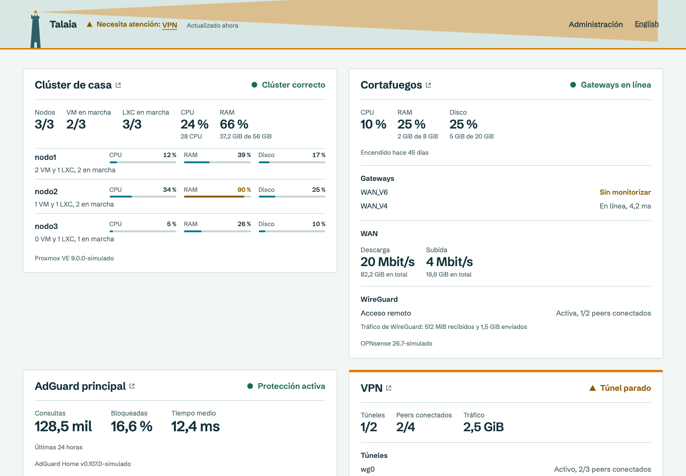
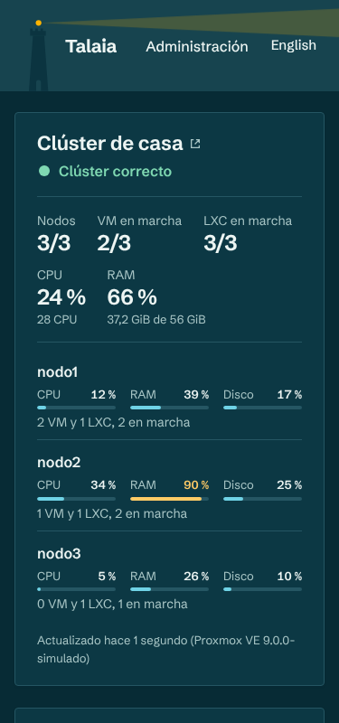
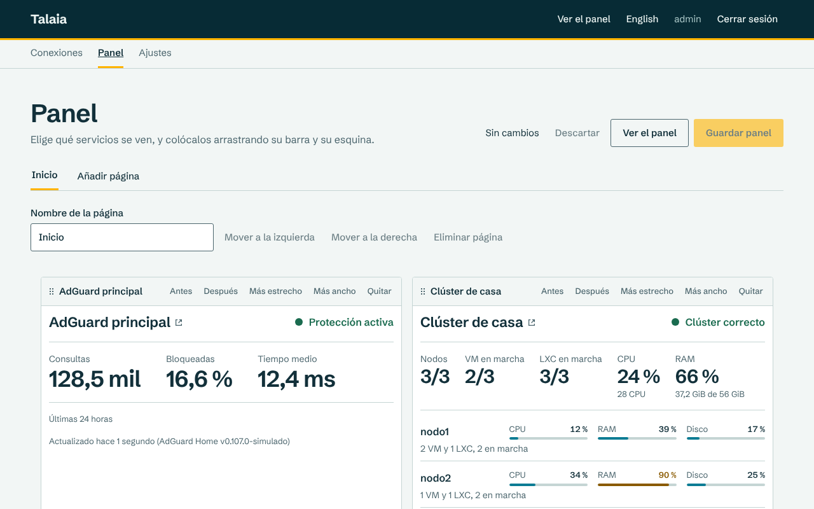
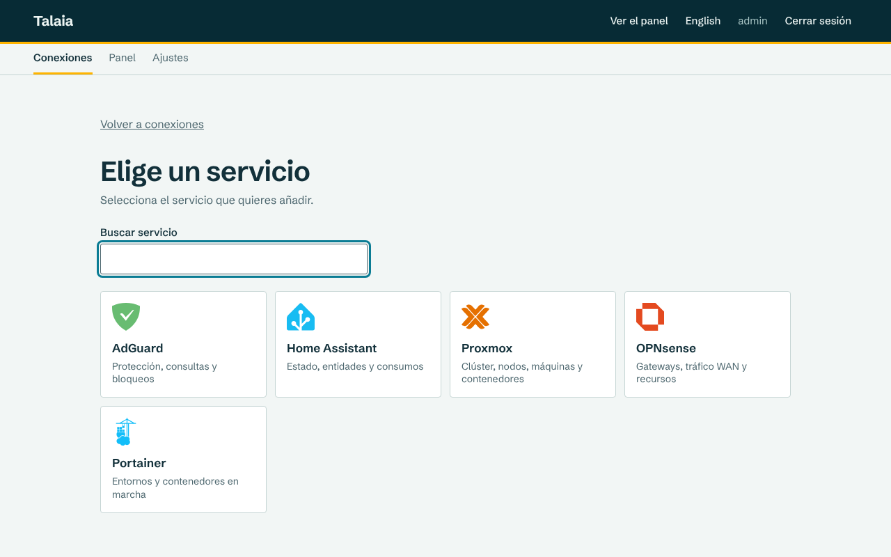

# Talaia

**Un panel de estado autoalojado para tu homelab.** De un vistazo sabes si todo va bien y, si no, qué servicio te necesita.

[](https://github.com/izakdev/talaia/actions/workflows/ci.yml)
[](https://github.com/izakdev/talaia/releases/latest)
[](LICENSE)

[Read in English](README.md)



> **Estado:** `v0.2.4` publicada. La instalación, la actualización y el arranque automático en Proxmox VE están verificados en un servidor real.

*Talaia* significa «atalaya» en catalán: una torre desde la que se vigila el entorno.

## Por qué Talaia

- **Responde primero a una pregunta.** La cabecera resume todos los servicios de todas las páginas: «Los 6 servicios están en orden», o «Necesita atención: VPN» con un enlace a su bloque. La luz de la atalaya y cada bloque afectado se ponen en ámbar o en rojo.
- **Solo lectura, y se puede compartir.** Talaia solo lee de tus servicios. Las credenciales se guardan cifradas y nunca salen del servidor; el panel público no muestra URL, direcciones IP, claves ni nombres de peers.
- **En vivo.** Los bloques se actualizan solos, sin recargar. Si un servicio falla, su bloque conserva el último dato y dice su antigüedad.
- **Un comando en Proxmox VE.** El instalador crea un contenedor LXC no privilegiado, y al actualizar hace una copia de seguridad y vuelve atrás si la versión nueva no arranca.
- **Ligero.** Un único binario de Go con la web integrada y SQLite. Sin Docker ni base de datos externa.
- **A tu manera.** Varias páginas, bloques que se colocan arrastrando, tema claro y oscuro, colores de acento, y español e inglés.

## Servicios compatibles

| Servicio | Qué ves |
|---|---|
| Proxmox VE | Nodos, VM y LXC en marcha, CPU y RAM por nodo y, si quieres, el detalle de cada VM y LXC |
| Home Assistant | Recursos, resumen de luces, interruptores y automatizaciones, consumos y las entidades que elijas |
| AdGuard Home | Estado de la protección, consultas, porcentaje de bloqueo, tiempo de respuesta y, si quieres, los dominios más consultados |
| OPNsense | Gateways, tráfico y velocidad de la WAN, recursos y, si quieres, el estado de WireGuard |
| Portainer | Entornos, contenedores en marcha y con problemas, y stacks |
| WGDashboard | Túneles, peers conectados y tráfico |

## Instalación rápida en Proxmox VE

Como root, en un nodo de Proxmox:

```sh
curl -fsSL https://github.com/izakdev/talaia/releases/latest/download/talaia-proxmox.sh -o talaia-proxmox.sh
bash talaia-proxmox.sh install
```

El script descarga la última versión, comprueba su suma, crea el contenedor y muestra un enlace de un solo uso para crear el administrador. Para actualizar más adelante:

```sh
bash talaia-proxmox.sh update --ctid <id-del-contenedor>
```

Cada [versión](https://github.com/izakdev/talaia/releases/latest) incluye también los binarios para Linux amd64 y arm64, por si prefieres ejecutar Talaia en otro sitio. Más opciones en el [manual de usuario](docs/usuario/manual-de-usuario.md#instalación).

## Capturas

| Móvil, tema oscuro | Editor del panel | Catálogo de servicios |
|---|---|---|
|  |  |  |

## Documentación

- [Manual de usuario](docs/usuario/manual-de-usuario.md): instalación, cada servicio y solución de problemas.
- [Documentación del proyecto](docs/README.md): requisitos, arquitectura, decisiones y plan de pruebas.

## Desarrollo

Requiere Go y Node.js 22.

```sh
make build   # compila la web y el binario en bin/talaia
make test    # ejecuta go vet y los tests
make e2e     # ejecuta las pruebas en el navegador, contra servicios simulados
./bin/talaia -listen :8080 -data ./data
```

Las incidencias y los pull requests son bienvenidos.

## Licencia

[MIT](LICENSE)
