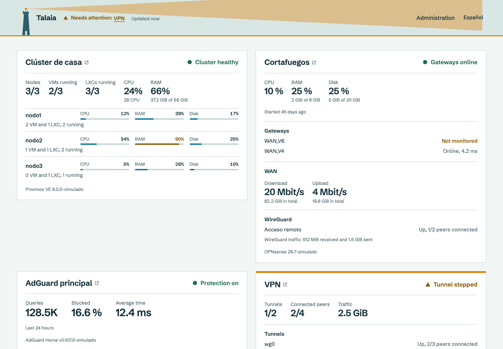
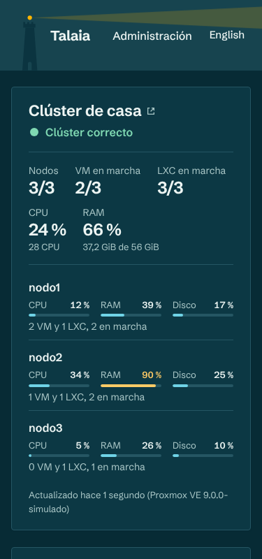
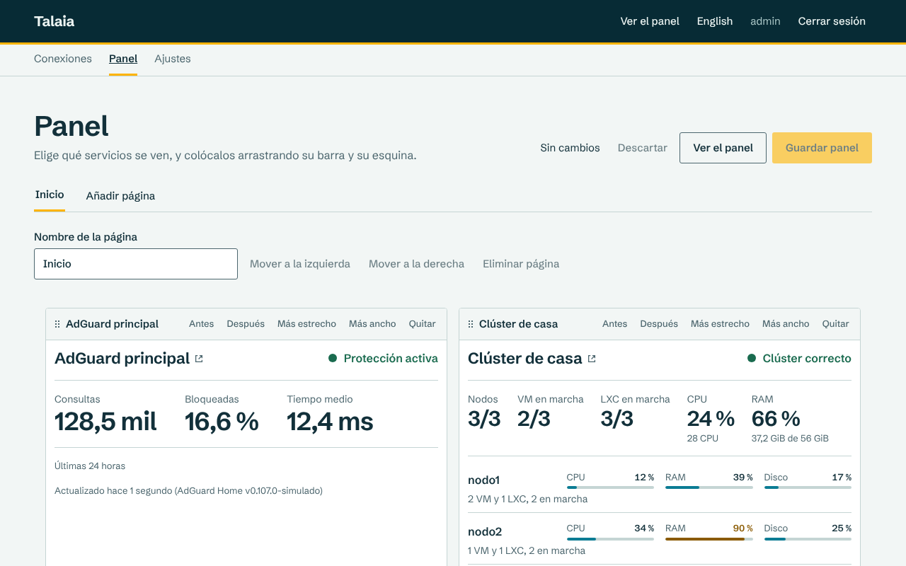
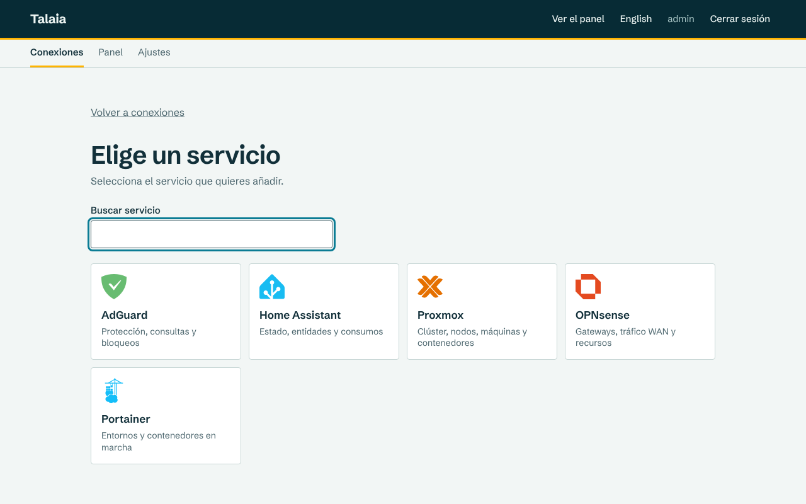

# Talaia

**A self-hosted status page for your homelab.** One glance tells you whether everything is fine, and if it isn't, which service needs you.

[](https://github.com/izakdev/talaia/actions/workflows/ci.yml)
[](https://github.com/izakdev/talaia/releases/latest)
[](LICENSE)

[Leer en español](README.es.md)



> **Status:** `v0.2.3` released. Installing, updating and starting on boot in Proxmox VE are verified on a real server.

*Talaia* is Catalan for "watchtower": a tower from which you keep an eye on your surroundings.

## Why Talaia

- **Answers one question first.** The header sums up every service on every page: "All 6 services are fine", or "Needs attention: VPN" with a link to the block. The watchtower's light and each affected block turn amber or red.
- **Read-only and safe to share.** Talaia only reads from your services. Credentials are stored encrypted and never leave the server; the public dashboard shows no URLs, IP addresses, keys or peer names.
- **Live.** Blocks update on their own, without reloading. If a service fails, its block keeps the last data and says how old it is.
- **One command on Proxmox VE.** The installer creates an unprivileged LXC container, and updates make a backup and roll back if the new version doesn't start.
- **Light.** A single Go binary with an embedded web app and SQLite. No Docker, no external database.
- **Yours to arrange.** Several pages, drag-and-drop layout, light and dark themes, accent colours, and Spanish and English.

## Supported services

| Service | What you see |
|---|---|
| Proxmox VE | Nodes, VMs and LXCs running, CPU and RAM per node, optional guest detail |
| Home Assistant | Resources, a summary of lights, switches and automations, power and energy, chosen entities |
| AdGuard Home | Protection status, queries, block rate, response time, optional top domains |
| OPNsense | Gateways, WAN traffic and speed, resources, optional WireGuard status |
| Portainer | Environments, running and unhealthy containers, stacks |
| WGDashboard | Tunnels, connected peers and traffic |

## Quick start on Proxmox VE

As root, on a Proxmox node:

```sh
curl -fsSL https://github.com/izakdev/talaia/releases/latest/download/talaia-proxmox.sh -o talaia-proxmox.sh
bash talaia-proxmox.sh install
```

The script downloads the latest release, checks its checksum, creates the container and prints a one-time link to create the administrator. To update later:

```sh
bash talaia-proxmox.sh update --ctid <container-id>
```

Binaries for Linux amd64 and arm64 are also attached to every [release](https://github.com/izakdev/talaia/releases/latest), if you prefer to run Talaia elsewhere.

## Screenshots

| Phone, dark theme | Panel editor | Service catalogue |
|---|---|---|
|  |  |  |

These screenshots come from the user manual and show the Spanish interface; English is one click away.

## Documentation

The documentation is in Spanish:

- [User manual](docs/usuario/manual-de-usuario.md): installation, every service, troubleshooting.
- [Project documentation](docs/README.md): requirements, architecture, decisions and test plan.

## Development

Requires Go and Node.js 22.

```sh
make build   # builds the web app and the binary in bin/talaia
make test    # go vet and the Go tests
make e2e     # end-to-end tests in a browser, against simulated services
./bin/talaia -listen :8080 -data ./data
```

Issues and pull requests are welcome.

## License

[MIT](LICENSE)
