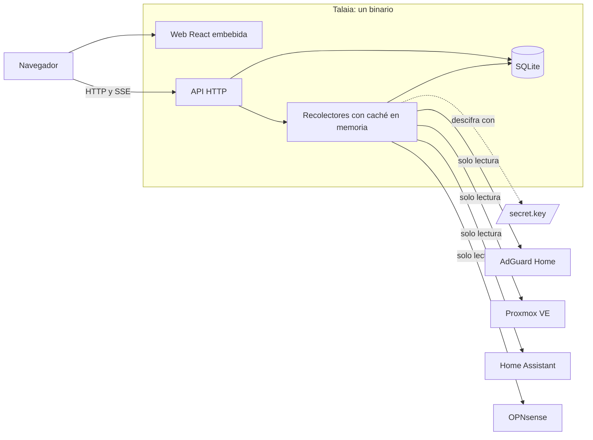
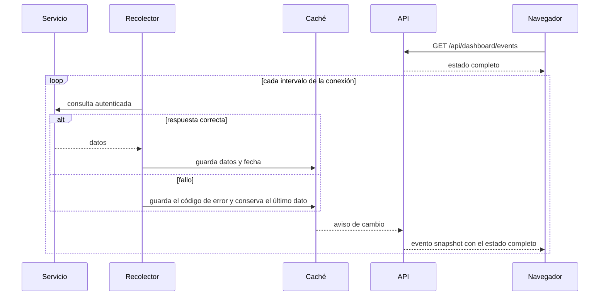
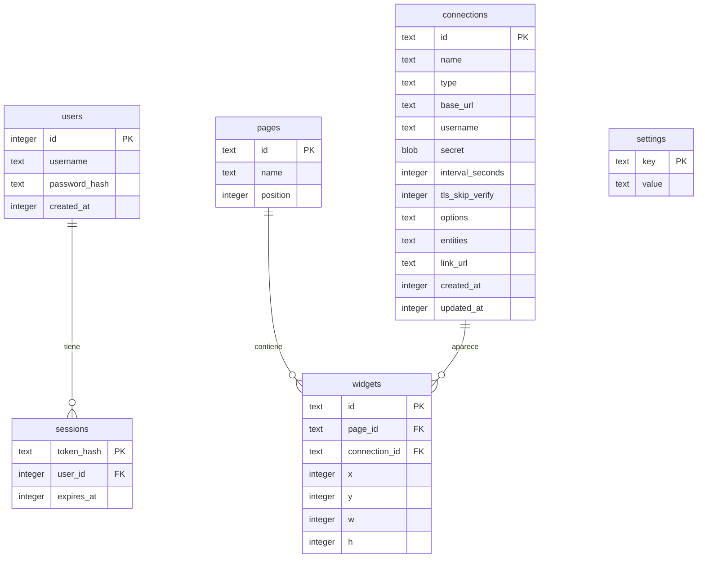

# Arquitectura

## Visión general

Talaia es un único binario de Go que incluye la web de React y una base de datos SQLite embebida. El navegador solo habla con Talaia, y Talaia consulta los servicios en segundo plano.



## Tecnologías

| Área | Tecnología | Motivo |
|---|---|---|
| Backend | Go, `chi` | Binario único y bajo consumo |
| Base de datos | SQLite con `modernc.org/sqlite` | Sin CGO ni servicios externos |
| Criptografía | AES-256-GCM, Argon2id con `golang.org/x/crypto` | Algoritmos actuales |
| Frontend | React, TypeScript, Vite, TanStack Query | Ecosistema actual, con tipado |
| Editor | `react-grid-layout`, cargado solo al abrir el editor | Arrastrar y redimensionar sin cargar el panel |
| WebSocket | `coder/websocket` | Sin dependencias; necesario para consultar Supervisor |
| Iconos | `simple-icons` | Incluidos en la aplicación, sin depender de Internet |
| Tipografía | Schibsted Grotesk, servida por Talaia | Sin peticiones a terceros |
| CI | GitHub Actions | Pruebas en cada cambio y publicación por etiqueta |

Los motivos detallados están en [Decisiones](05-decisiones.md).

## Estructura del código

| Ruta | Responsabilidad |
|---|---|
| `cmd/talaia` | Arranque, configuración y parada ordenada |
| `internal/api` | Rutas HTTP, validación, sesiones y SSE |
| `internal/auth` | Contraseñas y tokens de sesión |
| `internal/secrets` | Clave de cifrado y cifrado de credenciales |
| `internal/store` | SQLite, migraciones y consultas |
| `internal/collector` | Un recolector por conexión, caché de estado y avisos de cambio |
| `internal/integrations` | Interfaz común, cliente HTTP y códigos de error |
| `internal/integrations/adguard` | Integración con AdGuard Home |
| `internal/integrations/proxmox` | Integración con Proxmox VE |
| `internal/integrations/homeassistant` | Integración con Home Assistant |
| `internal/integrations/opnsense` | Integración con OPNsense |
| `web` | Frontend; `web/embed.go` lo incluye en el binario |
| `web/src/widgets` | Estado, contenido y pie del bloque de cada integración |
| `web/src/PanelEditor.tsx` | Editor de páginas y bloques |
| `web/src/Settings.tsx` | Tema, acento, acceso y contraseña |
| `e2e` | Pruebas de extremo a extremo y generación de capturas |
| `scripts/talaia-proxmox.sh` | Instalador y actualizador para Proxmox VE, en un solo archivo |
| `scripts/test` | Prueba del instalador con systemd real y comandos de Proxmox simulados |
| `scripts/check_docs.py` | Comprobaciones de la documentación |

## Flujos principales

### Recolección y actualización en vivo



- **Sin carga adicional:** abrir más navegadores no aumenta las consultas a los servicios.
- **Avisos agrupados:** si llegan varios cambios seguidos, se envía un solo evento con el estado actual.
- **Reconexión:** `EventSource` reconecta por sí solo y el evento inicial restablece el estado completo.
- **Límite:** se admiten hasta 256 suscriptores simultáneos; a partir de ahí, la API responde `503`.

### Cambios en una conexión

Al crear, editar o eliminar una conexión, la API reinicia su recolector. Si cambian la URL, el usuario o las opciones, se descarta el dato en caché. Así, un dato de otro destino nunca se muestra como actual, y una opción desactivada deja de exponer datos de inmediato.

## Interfaz de integraciones

```go
type Integration interface {
    Collect(ctx context.Context) (any, error)
}
```

`Collect` devuelve los datos que se enviarán al dashboard público, por lo que no debe incluir credenciales ni direcciones internas. Una integración con entidades que elegir implementa además `EntityLister`, que alimenta el selector de la administración. Los errores se clasifican en códigos públicos con `integrations.Code`:

| Código | Causa |
|---|---|
| `unauthorized` | El servicio responde `401` o `403`, o el token no ve ningún nodo de Proxmox |
| `timeout` | Se agota el tiempo de espera |
| `unreachable` | Error de red o conexión rechazada |
| `tls` | Certificado no válido, protocolo incompatible o URL `https` contra un servidor HTTP |
| `bad_response` | Estado HTTP inesperado, redirección o contenido que no corresponde al servicio |
| `secret_unreadable` | La credencial no se puede descifrar |
| `internal` | Cualquier otro error |

### Cómo añadir una integración

1. Crear el paquete en `internal/integrations/<nombre>` e implementar `Integration`.
2. Registrarla en `registry`, en `cmd/talaia/main.go`.
3. Declarar el tipo y sus opciones en `connectionTypes`, en `internal/api/api.go`.
4. Añadir la entrada y su icono en `web/src/catalog.ts`, y sus textos en `web/src/i18n.tsx`.
5. Crear su widget en `web/src/widgets` y registrarlo en `WIDGETS`, en `web/src/Dashboard.tsx`.
6. Actualizar las pruebas y la documentación.

**Deuda técnica conocida:** los tipos de conexión y sus opciones están repetidos entre backend y frontend.

### Home Assistant

| Aspecto | Detalle |
|---|---|
| Autenticación | Cabecera `Authorization: Bearer` con un token de larga duración |
| Consultas | `/api/config`; `/api/states` si hay entidades elegidas o resumen; y `/core/stats` y `/host/info` por WebSocket |
| Recursos | El proxy REST de Supervisor no permite esas rutas: se usa `supervisor/api` por `/api/websocket`, que exige administrador. Si falla, el bloque sigue funcionando sin recursos, y **Probar conexión** lo indica |
| Resumen | Cuenta por dominio y excluye grupos, entidades sin datos, y puertas, garajes y verjas |
| Nunca se publica | Personas, cerraduras, alarmas y nombre del equipo |
| Selección | Lista de `entity_id` por conexión, en la columna `entities` |
| Datos públicos | Identificador, nombre, estado, unidad y clase de las entidades elegidas; versión y estado del servicio; recursos y resumen |
| Excluido | Ubicación de `/api/config`, atributos y el resto de entidades |
| Consumos | Entidades con clase `power` o `energy`, sin sumar: un medidor general y sus enchufes contarían dos veces |
| Entidad eliminada | Se publica con estado `missing` para que se vea en el panel |

### Proxmox VE

| Aspecto | Detalle |
|---|---|
| Autenticación | Cabecera `Authorization: PVEAPIToken=usuario@reino!nombre=valor` |
| Permisos | Rol `PVEAuditor` en `/`; `/cluster/status` exige `Sys.Audit` |
| Consultas | `/api2/json/version`, `/cluster/status` y `/cluster/resources` |
| Clúster o nodo | Sin entrada `cluster` en el estado, se trata como nodo independiente |
| CPU agregada | Media ponderada por CPU de los nodos en línea |
| Excluido | Plantillas y almacenamiento |
| Valores booleanos | La API los puede devolver como `0` y `1`, y se aceptan ambas formas |

Proxmox filtra `/cluster/resources` según los permisos. Una lista sin nodos se interpreta como falta de permisos.

### OPNsense

| Aspecto | Detalle |
|---|---|
| Autenticación | HTTP Basic con la clave y el secreto de API |
| Imprescindibles | `GET /api/diagnostics/activity/get_activity`, de cuyas cabeceras salen CPU y tiempo encendido, y `GET /api/routes/gateway/status` |
| Opcionales | `GET /api/diagnostics/system/system_information`, `system_resources` y `system_disk`, y `GET /api/diagnostics/traffic/interface`. Un `401` o `403` omite el dato y añade el aviso `limited_privileges` |
| Velocidad WAN | Diferencia de los contadores de la interfaz `wan` entre dos lecturas. Vive en memoria, así que falta en la primera lectura y si los contadores bajan |
| Datos públicos | Nunca incluyen el nombre del equipo, direcciones de gateway, procesos, dispositivos de red ni sistemas de archivos |

## API HTTP

Las respuestas son JSON. Las escrituras exigen `Content-Type: application/json` y rechazan otro origen en la cabecera `Origin`.

| Método y ruta | Acceso | Función |
|---|---|---|
| `GET /healthz` | Público | Comprobación de vida |
| `GET /api/state` | Público | Si falta el primer arranque, versión, usuario actual, tema, acento y si el panel exige sesión |
| `GET /api/dashboard` | Público o sesión, según ajustes | Páginas y estado de las conexiones colocadas en ellas, con el enlace a cada servicio |
| `GET /api/dashboard/events` | Público o sesión, según ajustes | Eventos SSE con el mismo contenido. Se cierran si se pierde el permiso |
| `POST /api/setup` | Público, solo una vez | Crea el primer administrador e inicia sesión |
| `POST /api/auth/login` | Público | Inicia sesión |
| `POST /api/auth/logout` | Público | Cierra la sesión y la revoca en el servidor |
| `GET /api/admin/status` | Sesión | Estado de todas las conexiones, estén o no en el panel |
| `GET` y `PUT /api/admin/panel` | Sesión | Lee o sustituye de forma atómica las páginas y sus bloques |
| `GET` y `PUT /api/admin/settings` | Sesión | Lee o guarda tema, acento y acceso |
| `POST /api/admin/password` | Sesión | Cambia la contraseña y revoca las demás sesiones |
| `GET /api/admin/connections` | Sesión | Lista las conexiones |
| `POST /api/admin/connections` | Sesión | Crea una conexión |
| `POST /api/admin/connections/test` | Sesión | Prueba una conexión sin guardarla |
| `POST /api/admin/connections/entities` | Sesión | Lista las entidades que se pueden elegir, sin guardar nada |
| `GET /api/admin/connections/{id}` | Sesión | Devuelve una conexión |
| `PUT /api/admin/connections/{id}` | Sesión | Actualiza una conexión |
| `DELETE /api/admin/connections/{id}` | Sesión | Elimina una conexión |

## Modelo de datos



- **Migraciones:** se aplican al arrancar, y `PRAGMA user_version` guarda la versión. Talaia no arranca con una base de datos de una versión posterior.
- **Panel inicial:** la migración crea la página «Inicio» con las conexiones existentes. Una conexión nueva se añade a la primera página.
- **Rejilla:** 12 columnas. Un bloque ocupa de 2 a 12 columnas y de 2 a 60 filas, sin solapes. Las opciones siguen en la conexión, ver [DEC-21](05-decisiones.md).
- **Estado de los servicios:** se guarda solo en memoria y se reconstruye al arrancar.

## Seguridad

| Aspecto | Medida |
|---|---|
| Contraseñas | Argon2id con 64 MiB, 3 iteraciones y 2 hilos; mínimo de 12 caracteres |
| Coste del hash | Máximo de 2 cálculos simultáneos, para proteger la memoria de un LXC pequeño |
| Enumeración de usuarios | Un usuario inexistente tiene el mismo coste de verificación |
| Fuerza bruta | 10 fallos por IP bloquean durante 15 minutos, incluidos los del código de instalación; el contador está en memoria |
| Código de instalación | De 192 bits, comparado en tiempo constante y eliminado al usarse |
| Sesiones | Token aleatorio de 32 bytes en una cookie `HttpOnly` y `SameSite=Lax`; en la base de datos solo se guarda su hash; duran 30 días |
| Cookie `Secure` | Se activa con TLS o con `X-Forwarded-Proto: https` |
| Credenciales | AES-256-GCM, vinculadas al ID de la conexión para que no se puedan intercambiar entre filas |
| Clave de cifrado | `secret.key` con permisos `600`; Talaia no arranca si son más abiertos |
| Archivos | Al crearlos, directorio de datos `700` y base de datos `600` |
| Salida a servicios | Sin proxy, sin seguir redirecciones, 10 s de espera por petición y respuestas de 32 MiB como máximo |
| TLS | Verificación activa por defecto, con excepción explícita por conexión |
| API pública | Sin usuarios ni credenciales. Incluye el enlace al servicio: la URL de conexión o la dirección propia configurada |
| Enlaces | Solo `http` y `https`, sin credenciales; se abren con `noopener` y `noreferrer` |
| Navegador | Sin `unsafe-inline`: el editor evita el `<style>` que `react-draggable` insertaría. CSP `default-src 'self'`, `frame-ancestors 'none'`, `nosniff` y `Referrer-Policy: same-origin` |
| CSRF | Cookie `SameSite=Lax`, comprobación de `Origin` y JSON obligatorio |
| Tamaño de petición | 64 KiB como máximo |

### Riesgos aceptados

- **Dashboard abierto por defecto:** cualquiera que llegue al puerto puede ver el estado de los servicios. Para publicarlo fuera de la red de confianza hay que exigir inicio de sesión en los ajustes (RF-07) y usar HTTPS.
- **Recuperación por acceso al equipo:** quien pueda ejecutar `talaia reset-password` puede tomar la cuenta. Es el mismo nivel de acceso que ya da leer la carpeta de datos.
- **Enlaces visibles:** quien abra el panel ve la dirección de cada servicio, que puede ser interna. Una dirección propia evita mostrar la URL de conexión.
- **Token de administrador para los recursos:** Home Assistant solo da CPU y memoria a un administrador, de modo que quien quiera verlas debe dar a Talaia un token con todos esos permisos, aunque solo lea.
- **Primer arranque abierto sin el instalador:** al ejecutar el binario sin `-setup-token-file`, cualquiera en la red puede crear el administrador hasta que exista. El instalador siempre usa el código.
- **Bloqueo por IP detrás de un proxy inverso:** Talaia ve la IP del proxy, de modo que los fallos cuentan para todos los clientes. No se confía en `X-Forwarded-For` porque se podría falsificar.
- **Sin TLS propio:** Talaia sirve HTTP y delega el cifrado en un proxy inverso.
- **Acceso de administrador:** una sesión de administrador puede hacer que Talaia envíe peticiones a cualquier URL, necesario para probar conexiones.

## Despliegue

**Configuración actual**, por parámetro o variable de entorno:

| Parámetro | Variable | Por defecto | Función |
|---|---|---|---|
| `-listen` | `TALAIA_LISTEN` | `:8080` | Dirección de escucha |
| `-data` | `TALAIA_DATA_DIR` | `data` | Directorio de datos |
| `-key-file` | `TALAIA_KEY_FILE` | `<datos>/secret.key` | Clave de cifrado |
| `-setup-token-file` | `TALAIA_SETUP_TOKEN_FILE` | Ninguno | Archivo con el código que protege el primer arranque |
| `-version` | | | Muestra la versión |

**Recuperar la contraseña:** `talaia reset-password -data <datos>` genera una contraseña aleatoria, la muestra y revoca las sesiones. Admite `-key-file` y puede ejecutarse con Talaia en marcha.

### Instalación en Proxmox VE

`talaia-proxmox.sh` se ejecuta como root en el host, con las herramientas de Proxmox (`pct`, `pveam`, `pvesh` y `pvesm`).

```mermaid
sequenceDiagram
    participant H as Host Proxmox
    participant R as Versiones publicadas
    participant C as Contenedor LXC

    H->>R: Descarga el binario y SHA256SUMS
    H->>H: Comprueba la suma; si falla, no crea nada
    H->>C: pct create, sin privilegios y con arranque automático
    H->>C: pct push del binario y del código de instalación
    H->>C: Crea usuario, carpeta de datos y servicio
    H->>C: Arranca y comprueba /healthz desde dentro
    Note over H,C: Si algo falla, elimina el contenedor recién creado
```

| Aspecto | Detalle |
|---|---|
| Contenedor | No privilegiado, con `nesting=1`, Debian estable y arranque automático. Por defecto, 1 vCPU, 512 MB de RAM, 256 MB de intercambio y 4 GB de disco |
| Sin red dentro | El host descarga y empuja el binario, de modo que el contenedor no necesita acceso a Internet para instalar |
| Servicio | Usuario `talaia`, sin privilegios ni capacidades, con el sistema de archivos protegido salvo `/var/lib/talaia`, y `GOMEMLIMIT=400MiB` |
| Rutas | Binario en `/usr/local/bin/talaia`, configuración en `/etc/talaia/talaia.env` y datos en `/var/lib/talaia` |
| Actualización | Para el servicio, copia la base de datos y el binario en `backups/`, y arranca la versión nueva. Si no responde, restaura ambos. Conserva 3 copias |

**Publicación del instalador:** cada versión incluye también el script.

**Publicación:** al subir una etiqueta `v*`, por ejemplo con `git push origin v1.0.0`, se generan en GitHub Actions los binarios de Linux para amd64 y arm64, con `SHA256SUMS` y el instalador. Una etiqueta con guion se publica como versión preliminar.
