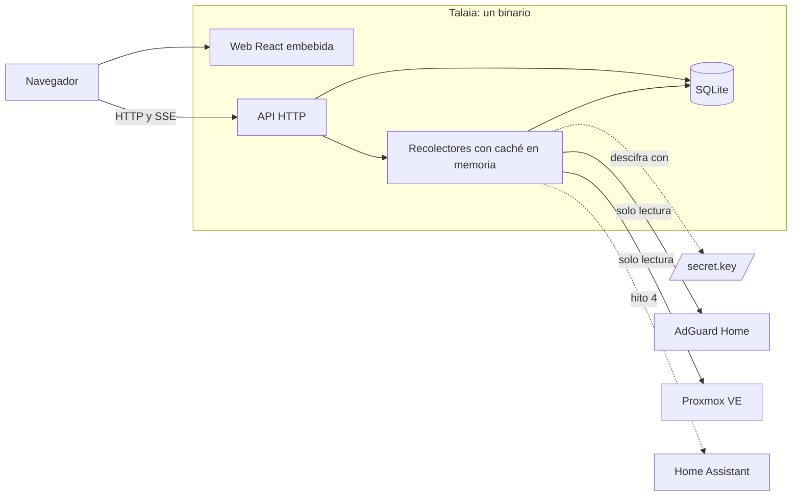
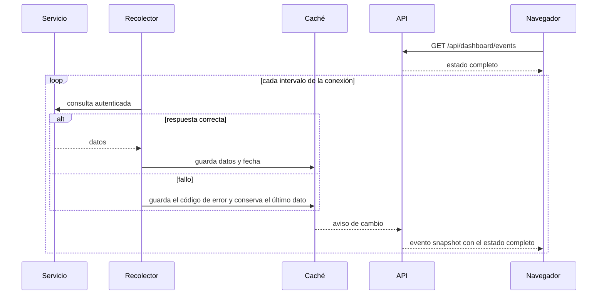
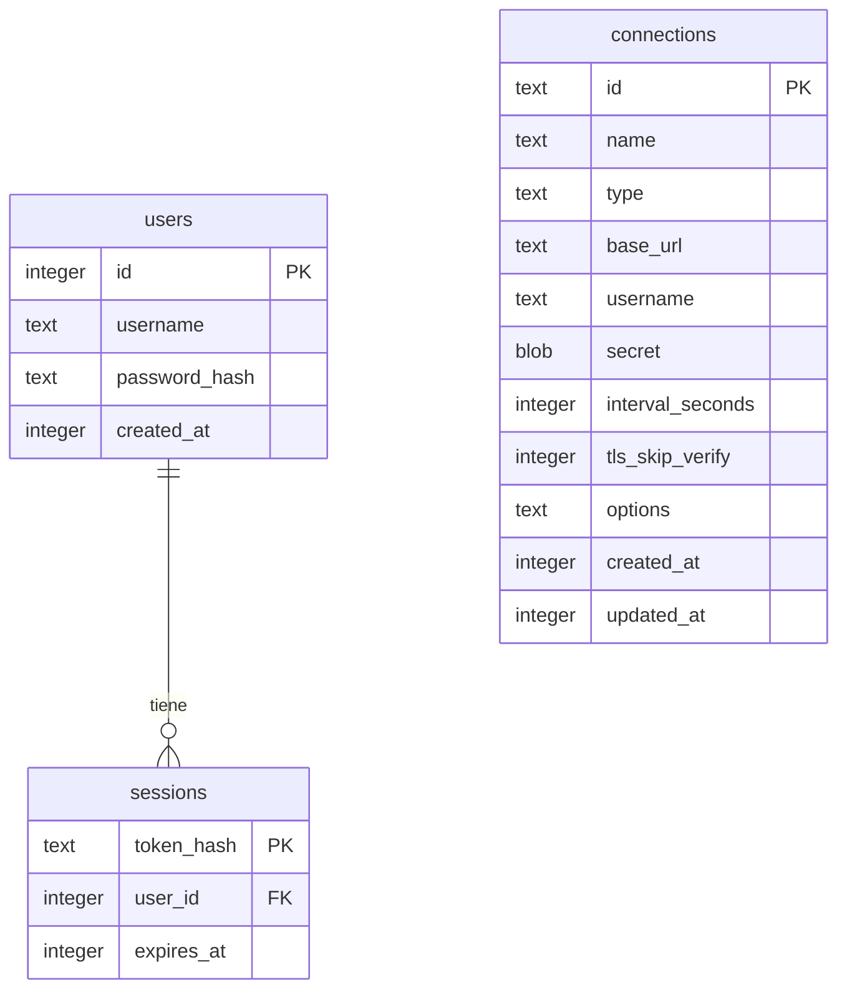

# Arquitectura

## Visión general

Talaia es un único binario de Go que incluye la web de React y una base de datos SQLite embebida. El navegador solo habla con Talaia, y Talaia consulta los servicios en segundo plano.



La línea discontinua de Home Assistant indica una integración todavía no implementada.

## Tecnologías

| Área | Tecnología | Motivo |
|---|---|---|
| Backend | Go, `chi` | Binario único y bajo consumo |
| Base de datos | SQLite con `modernc.org/sqlite` | Sin CGO ni servicios externos |
| Criptografía | AES-256-GCM, Argon2id con `golang.org/x/crypto` | Algoritmos actuales |
| Frontend | React, TypeScript, Vite, TanStack Query | Ecosistema actual, con tipado |
| Iconos | `simple-icons` | Incluidos en la aplicación, sin depender de Internet |
| Tipografía | Schibsted Grotesk, servida por Talaia | Sin peticiones a terceros |
| CI | GitHub Actions | Pruebas en cada cambio y publicación por etiqueta |

Los motivos detallados están en [Decisiones](05-decisiones.md).

## Estructura del código

| Ruta | Responsabilidad |
|---|---|
| `cmd/talaia` | Arranque, configuración y parada ordenada |
| `internal/api` | Rutas HTTP, validación, sesiones y SSE |
| `internal/auth` | Contraseñas y tokens de sesión |
| `internal/secrets` | Clave de cifrado y cifrado de credenciales |
| `internal/store` | SQLite, migraciones y consultas |
| `internal/collector` | Un recolector por conexión, caché de estado y avisos de cambio |
| `internal/integrations` | Interfaz común, cliente HTTP y códigos de error |
| `internal/integrations/adguard` | Integración con AdGuard Home |
| `internal/integrations/proxmox` | Integración con Proxmox VE |
| `web` | Frontend; `web/embed.go` lo incluye en el binario |
| `web/src/widgets` | Estado, contenido y pie del bloque de cada integración |
| `e2e` | Pruebas de extremo a extremo y generación de capturas |
| `scripts` | Comprobaciones de la documentación |

## Flujos principales

### Recolección y actualización en vivo



- **Sin carga adicional:** abrir más navegadores no aumenta las consultas a los servicios.
- **Avisos agrupados:** si llegan varios cambios seguidos, se envía un solo evento con el estado actual.
- **Reconexión:** `EventSource` reconecta por sí solo y el evento inicial restablece el estado completo.
- **Límite:** se admiten hasta 256 suscriptores simultáneos; a partir de ahí, la API responde `503`.

### Cambios en una conexión

Al crear, editar o eliminar una conexión, la API reinicia su recolector. Si cambian la URL, el usuario o las opciones, se descarta el dato en caché. Así, un dato de otro destino nunca se muestra como actual, y una opción desactivada deja de exponer datos de inmediato.

## Interfaz de integraciones

```go
type Integration interface {
    Collect(ctx context.Context) (any, error)
}
```

`Collect` devuelve los datos que se enviarán al dashboard público, por lo que no debe incluir credenciales ni direcciones internas. Los errores se clasifican en códigos públicos con `integrations.Code`:

| Código | Causa |
|---|---|
| `unauthorized` | El servicio responde `401` o `403`, o el token no ve ningún nodo de Proxmox |
| `timeout` | Se agota el tiempo de espera |
| `unreachable` | Error de red o conexión rechazada |
| `tls` | Certificado no válido, protocolo incompatible o URL `https` contra un servidor HTTP |
| `bad_response` | Estado HTTP inesperado, redirección o contenido que no corresponde al servicio |
| `secret_unreadable` | La credencial no se puede descifrar |
| `internal` | Cualquier otro error |

### Cómo añadir una integración

1. Crear el paquete en `internal/integrations/<nombre>` e implementar `Integration`.
2. Registrarla en `registry`, en `cmd/talaia/main.go`.
3. Declarar el tipo y sus opciones en `connectionTypes`, en `internal/api/api.go`.
4. Añadir la entrada y su icono en `web/src/catalog.ts`, y sus textos en `web/src/i18n.tsx`.
5. Crear su widget en `web/src/widgets` y registrarlo en `WIDGETS`, en `web/src/Dashboard.tsx`.
6. Actualizar las pruebas y la documentación.

**Deuda técnica conocida:** los tipos de conexión y sus opciones están repetidos entre backend y frontend.

### Proxmox VE

| Aspecto | Detalle |
|---|---|
| Autenticación | Cabecera `Authorization: PVEAPIToken=usuario@reino!nombre=valor` |
| Permisos | Rol `PVEAuditor` en `/`; `/cluster/status` exige `Sys.Audit` |
| Consultas | `/api2/json/version`, `/cluster/status` y `/cluster/resources` |
| Clúster o nodo | Sin entrada `cluster` en el estado, se trata como nodo independiente |
| CPU agregada | Media ponderada por CPU de los nodos en línea |
| Excluido | Plantillas y almacenamiento |
| Valores booleanos | La API los puede devolver como `0` y `1`, y se aceptan ambas formas |

Proxmox filtra `/cluster/resources` según los permisos. Una lista sin nodos se interpreta como falta de permisos.

## API HTTP

Las respuestas son JSON. Las escrituras exigen `Content-Type: application/json` y rechazan otro origen en la cabecera `Origin`.

| Método y ruta | Acceso | Función |
|---|---|---|
| `GET /healthz` | Público | Comprobación de vida |
| `GET /api/state` | Público | Si falta el primer arranque, versión y usuario actual |
| `GET /api/dashboard` | Público | Estado de las conexiones con integración disponible |
| `GET /api/dashboard/events` | Público | Eventos SSE con el mismo contenido |
| `POST /api/setup` | Público, solo una vez | Crea el primer administrador e inicia sesión |
| `POST /api/auth/login` | Público | Inicia sesión |
| `POST /api/auth/logout` | Público | Cierra la sesión y la revoca en el servidor |
| `GET /api/admin/connections` | Sesión | Lista las conexiones |
| `POST /api/admin/connections` | Sesión | Crea una conexión |
| `POST /api/admin/connections/test` | Sesión | Prueba una conexión sin guardarla |
| `GET /api/admin/connections/{id}` | Sesión | Devuelve una conexión |
| `PUT /api/admin/connections/{id}` | Sesión | Actualiza una conexión |
| `DELETE /api/admin/connections/{id}` | Sesión | Elimina una conexión |

## Modelo de datos



- **Migraciones:** se aplican al arrancar, y `PRAGMA user_version` guarda la versión. Talaia no arranca con una base de datos de una versión posterior.
- **Planificado:** las tablas `pages`, `widgets` y `settings` llegarán en el hito 5.
- **Estado de los servicios:** se guarda solo en memoria y se reconstruye al arrancar.

## Seguridad

| Aspecto | Medida |
|---|---|
| Contraseñas | Argon2id con 64 MiB, 3 iteraciones y 2 hilos; mínimo de 12 caracteres |
| Coste del hash | Máximo de 2 cálculos simultáneos, para proteger la memoria de un LXC pequeño |
| Enumeración de usuarios | Un usuario inexistente tiene el mismo coste de verificación |
| Fuerza bruta | 10 fallos por IP bloquean durante 15 minutos; el contador está en memoria |
| Sesiones | Token aleatorio de 32 bytes en una cookie `HttpOnly` y `SameSite=Lax`; en la base de datos solo se guarda su hash; duran 30 días |
| Cookie `Secure` | Se activa con TLS o con `X-Forwarded-Proto: https` |
| Credenciales | AES-256-GCM, vinculadas al ID de la conexión para que no se puedan intercambiar entre filas |
| Clave de cifrado | `secret.key` con permisos `600`; Talaia no arranca si son más abiertos |
| Archivos | Al crearlos, directorio de datos `700` y base de datos `600` |
| Salida a servicios | Sin proxy, sin seguir redirecciones, 10 s de espera por petición y respuestas de 8 MiB como máximo |
| TLS | Verificación activa por defecto, con excepción explícita por conexión |
| API pública | Sin URL, usuarios ni credenciales |
| Navegador | CSP `default-src 'self'`, `frame-ancestors 'none'`, `nosniff` y `Referrer-Policy: same-origin` |
| CSRF | Cookie `SameSite=Lax`, comprobación de `Origin` y JSON obligatorio |
| Tamaño de petición | 64 KiB como máximo |

### Riesgos aceptados

- **Dashboard abierto:** cualquiera que llegue al puerto puede ver el estado de los servicios. No debe publicarse en Internet hasta disponer del login opcional (RF-07), o debe protegerse con otra capa.
- **Primer arranque abierto:** hasta crear el administrador, cualquiera en la red puede hacerlo.
- **Bloqueo por IP detrás de un proxy inverso:** Talaia ve la IP del proxy, de modo que los fallos cuentan para todos los clientes. No se confía en `X-Forwarded-For` porque se podría falsificar.
- **Sin TLS propio:** Talaia sirve HTTP y delega el cifrado en un proxy inverso.
- **Acceso de administrador:** una sesión de administrador puede hacer que Talaia envíe peticiones a cualquier URL, necesario para probar conexiones.

## Despliegue

**Configuración actual**, por parámetro o variable de entorno:

| Parámetro | Variable | Por defecto | Función |
|---|---|---|---|
| `-listen` | `TALAIA_LISTEN` | `:8080` | Dirección de escucha |
| `-data` | `TALAIA_DATA_DIR` | `data` | Directorio de datos |
| `-key-file` | `TALAIA_KEY_FILE` | `<datos>/secret.key` | Clave de cifrado |
| `-version` | | | Muestra la versión |

**Objetivo del hito 6:** un comando en el host Proxmox crea un LXC no privilegiado con Debian estable, 1 vCPU, 512 MB de RAM y 4 GB de disco, y un servicio `systemd` que verifica el checksum del binario descargado.

**Publicación:** una etiqueta `v*` genera en GitHub Actions los binarios de Linux para amd64 y arm64, con `SHA256SUMS`.
