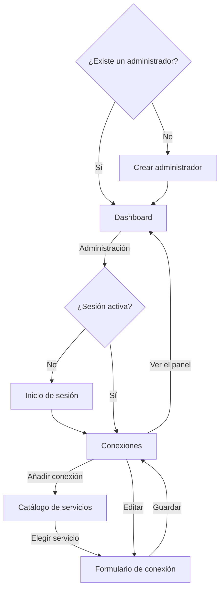

# Diseño funcional

## Mapa de pantallas

| Ruta | Pantalla |
|---|---|
| `/` | Dashboard |
| `/admin` | Conexiones o inicio de sesión |
| `/admin/connections/new` | Catálogo de servicios |

Mientras no exista un administrador, todas las rutas muestran el asistente de primer arranque.

## Pantallas

### Crear administrador

- **Campos:** usuario, de 1 a 64 caracteres, y contraseña, de 12 a 1024 bytes.
- **Resultado:** crea la cuenta, inicia sesión y muestra el dashboard.
- **Regla:** solo se puede usar una vez.

### Inicio de sesión

- **Errores:** el mensaje no indica si falla el usuario o la contraseña.
- **Bloqueo:** tras 10 fallos desde una IP, muestra un aviso durante 15 minutos.
- **Sesión:** dura 30 días.

### Dashboard

**Sin servicios:** muestra un mensaje y un enlace a la administración.

**Con servicios:** hay un bloque por cada conexión con integración disponible, ordenados por nombre.

| Elemento | Comportamiento |
|---|---|
| Actualización | En vivo. Si se pierde, muestra un aviso y reintenta |
| Antigüedad | «Actualizado hace…», recalculado cada 10 segundos |
| Estado | Se indica con texto y forma, no solo con color |

**Estados de un bloque de AdGuard:**

| Estado | Condición | Indicador |
|---|---|---|
| Consultando | Aún no hay resultado | Círculo vacío |
| Protección activa | DNS en marcha y protección activa | Círculo verde |
| Protección desactivada | DNS en marcha y protección desactivada | Triángulo ámbar |
| Servidor DNS parado | AdGuard indica que el DNS no está en marcha | Cuadrado rojo |
| Con fallos | La última consulta ha fallado | Cuadrado rojo, mensaje de error y último dato atenuado |

**Datos de un bloque de AdGuard:**

| Dato | Cálculo |
|---|---|
| Consultas | `num_dns_queries`, abreviado; el valor exacto se ve al pasar el cursor |
| Bloqueadas | (filtros + navegación segura + control parental) / consultas |
| Tiempo medio | `avg_processing_time`, en ms; por debajo de 1 ms, `< 1 ms` |
| Periodo | Unidad de tiempo y número de valores que devuelve AdGuard |
| Top de dominios | Los 5 primeros consultados y bloqueados, si la opción está activa |

Las búsquedas seguras reemplazadas no cuentan como bloqueos.

**Estados de un bloque de Proxmox:**

| Estado | Condición | Indicador |
|---|---|---|
| Consultando | Aún no hay resultado | Círculo vacío |
| Clúster correcto | Todos los nodos en línea y con quórum | Círculo verde |
| Nodo en línea | Nodo independiente en línea | Círculo verde |
| N de M nodos en línea | Algún nodo sin conexión, con quórum | Triángulo ámbar |
| Clúster sin quórum | El clúster indica que no hay quórum | Cuadrado rojo |
| Con fallos | La última consulta ha fallado | Cuadrado rojo, mensaje de error y último dato atenuado |

**Datos de un bloque de Proxmox:**

| Dato | Cálculo |
|---|---|
| Nodos | En línea / total |
| VM y LXC en marcha | En marcha / total, sin plantillas |
| CPU | Media ponderada por CPU de los nodos en línea, con el total de CPU |
| RAM | Usada / total de los nodos en línea |
| Por nodo | CPU, RAM y disco. Con un 90 % o más, el valor se resalta en ámbar. Sin conexión, muestra «Sin conexión» |
| Detalle | Con la opción activa, cada nodo se despliega para ver sus VM y LXC con estado, CPU y RAM |

El detalle desplegado sigue abierto cuando llegan datos nuevos.

### Conexiones

- **Lista:** nombre, servicio, URL, intervalo, estado y aviso si no se verifica TLS.
- **Estado:** se refresca cada 10 segundos.
- **Eliminar:** pide confirmación en la propia fila.
- **Sin conexiones:** invita a añadir la primera.

### Catálogo de servicios

- **Tarjetas:** icono, nombre, qué muestra y «Sin datos todavía» si aún no hay integración.
- **Búsqueda:** por nombre y descripción, sin distinguir mayúsculas ni tildes.
- **Sin resultados:** indica el texto buscado.
- **Teclado:** el buscador recibe el foco en dispositivos con ratón; en táctiles no, para no abrir el teclado.

### Formulario de conexión

| Campo | Servicios | Reglas |
|---|---|---|
| Nombre | Todos | Obligatorio, hasta 80 caracteres |
| URL | Todos | `http` o `https`, sin credenciales, parámetros ni fragmento |
| Usuario | AdGuard | Obligatorio |
| Credencial | Todos | Obligatoria al crear y al cambiar la URL; en otro caso, vacía conserva la actual. Hasta 4096 bytes |
| Refresco | Todos | De 5 a 3600 segundos, 30 por defecto |
| Mostrar dominios | AdGuard | Desactivado por defecto |
| Mostrar detalle de VM y LXC | Proxmox | Activado por defecto |
| No verificar TLS | Todos | Desactivado por defecto |

| Credencial | Formato |
|---|---|
| Proxmox | API token, `usuario@reino!nombre=valor` |
| Home Assistant | Token de larga duración |
| AdGuard | Contraseña |

**Probar conexión:** consulta el servicio una vez con los datos del formulario, sin guardar nada. Si se cambia algún dato de conexión, el resultado anterior desaparece. El botón solo aparece en servicios con integración disponible, y al editar puede usar la credencial guardada si la URL no ha cambiado.

## Mensajes de error de los servicios

| Código | Mensaje |
|---|---|
| `unauthorized` | Credenciales rechazadas por el servicio. Revisa la conexión. |
| `timeout` | El servicio no ha respondido a tiempo. |
| `unreachable` | No se puede conectar con el servicio. Revisa la URL y la red. |
| `tls` | Error de TLS. Revisa si la URL usa http o https y, si el certificado es autofirmado, desactiva la verificación en la conexión. |
| `bad_response` | La respuesta no es la esperada. Revisa que la URL sea la de este servicio. |
| `secret_unreadable` | No se puede descifrar la credencial. Vuelve a escribirla en la conexión. |
| `internal` | Error inesperado al consultar el servicio. Revisa los registros de Talaia. |

## Idioma y apariencia

- **Idioma:** se toma del navegador y, si no es español, se usa inglés. La elección manual se recuerda en ese navegador.
- **Apariencia:** sigue el modo claro u oscuro del sistema. Los temas configurables llegan en el hito 5.
- **Movimiento:** al abrir la página, el haz de la torre hace un único barrido, que se omite si el sistema pide reducir el movimiento.
