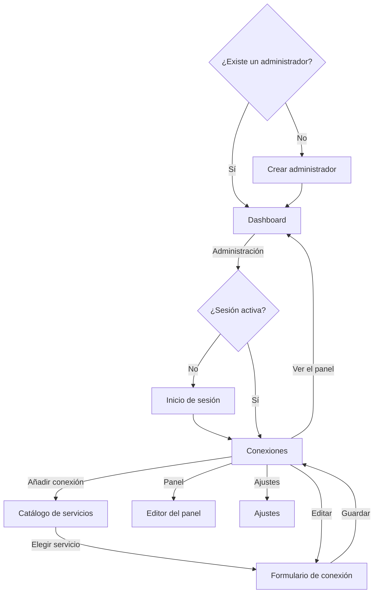

# Diseño funcional

## Mapa de pantallas



| Ruta | Pantalla |
|---|---|
| `/` | Dashboard |
| `/admin` | Conexiones o inicio de sesión |
| `/p/<id>` | Una página concreta del dashboard |
| `/admin/connections/new` | Catálogo de servicios |
| `/admin/panel` | Editor del panel |
| `/admin/settings` | Ajustes |

Mientras no exista un administrador, todas las rutas muestran el asistente de primer arranque.

## Pantallas

### Crear administrador

- **Campos:** usuario, de 1 a 64 caracteres, y contraseña, de 12 a 1024 bytes.
- **Código de instalación:** se pide solo si la instalación lo define. El enlace del instalador lo rellena y lo quita de la barra de direcciones.
- **Resultado:** crea la cuenta, inicia sesión y muestra el dashboard.
- **Regla:** solo se puede usar una vez.

### Inicio de sesión

- **Errores:** el mensaje no indica si falla el usuario o la contraseña.
- **Bloqueo:** tras 10 fallos desde una IP, muestra un aviso durante 15 minutos.
- **Sesión:** dura 30 días.

### Dashboard

**Sin servicios:** muestra un mensaje y un enlace a la administración.

**Con servicios:** cada página muestra sus bloques en la posición elegida en el editor. Con más de una página aparecen pestañas.

- **Recuadro:** cada bloque tiene fondo y borde, sin sombra. Si su estado es un aviso o un fallo, el borde superior es grueso y ámbar o rojo, para verlo a distancia.
- **Secciones del bloque:** cada sección (cifras, listas, tablas o un apartado con título) lleva una línea encima y ninguna debajo. Dentro de un apartado con título, las cifras no llevan línea propia.
- **Resumen en la cabecera:** junto al nombre, el estado de todos los servicios del panel, de cualquier página. Si todos están bien, «Los N servicios están en orden»; si no, «N servicios necesitan atención:» y sus nombres, con los fallos primero. Cada nombre lleva a su bloque, en su página, y le da el foco. Los servicios en neutro, como «Sin túneles», no cuentan como avisos.
- **Atalaya:** la luz y el haz de la cabecera toman el color del peor estado: el acento elegido si todo va bien, ámbar con avisos y rojo con fallos, con el haz más intenso y la línea inferior del mismo color. Al cambiar el peor estado, el haz vuelve a barrer una vez, salvo con movimiento reducido.
- **Colocación:** cada bloque conserva las columnas, el ancho y el orden del editor. En vertical queda justo debajo del último bloque de sus columnas, según la altura real de su contenido, con 1,5rem entre bloques. Si un bloque cambia de altura con los datos, los de debajo se recolocan sin animación.
- **Ancho del dashboard:** toda la ventana, con su margen lateral.
- **Pantallas de 900 a 1400 px:** los bloques de menos de media fila pasan a media fila y se colocan por orden en dos mitades.
- **Pantallas de menos de 900 px:** una sola columna, en el orden del editor.
- **Página vacía:** indica que no tiene servicios.
- **Sesión obligatoria:** si está activa, sin sesión se muestra el inicio de sesión. Quien tuviera el panel abierto deja de verlo.

| Elemento | Comportamiento |
|---|---|
| Nombre del servicio | Enlace a su URL, con un icono, que se abre en una pestaña nueva |
| Actualización | En vivo. Si se pierde, muestra un aviso y reintenta |
| Antigüedad | En la cabecera, «Actualizado hace…» con el dato más reciente, recalculado cada 10 segundos. Un bloque solo indica la suya si falla («Último dato hace…»); si no, su pie da solo el servicio y su versión |
| Estado | Se indica con texto y forma, no solo con color |
| Cifras | Un escalón por debajo del nombre y del estado, para que el estado se lea primero |
| Versión de Talaia | Al pie de la página, como en la administración |

**Estados de un bloque de AdGuard:**

| Estado | Condición | Indicador |
|---|---|---|
| Consultando | Aún no hay resultado | Círculo vacío |
| Protección activa | DNS en marcha y protección activa | Círculo verde |
| Protección desactivada | DNS en marcha y protección desactivada | Triángulo ámbar |
| Servidor DNS parado | AdGuard indica que el DNS no está en marcha | Cuadrado rojo |
| Con fallos | La última consulta ha fallado | Cuadrado rojo, mensaje de error y último dato atenuado |

**Datos de un bloque de AdGuard:**

| Dato | Cálculo |
|---|---|
| Consultas | `num_dns_queries`, abreviado; el valor exacto se ve al pasar el cursor |
| Bloqueadas | (filtros + navegación segura + control parental) / consultas |
| Tiempo medio | `avg_processing_time`, en ms; por debajo de 1 ms, `< 1 ms` |
| Periodo | Unidad de tiempo y número de valores que devuelve AdGuard |
| Top de dominios | Los 5 primeros consultados y bloqueados, si la opción está activa |

Las búsquedas seguras reemplazadas no cuentan como bloqueos.

**Estados de un bloque de Proxmox:**

| Estado | Condición | Indicador |
|---|---|---|
| Consultando | Aún no hay resultado | Círculo vacío |
| Clúster correcto | Todos los nodos en línea y con quórum | Círculo verde |
| Nodo en línea | Nodo independiente en línea | Círculo verde |
| N de M nodos en línea | Algún nodo sin conexión, con quórum | Triángulo ámbar |
| Clúster sin quórum | El clúster indica que no hay quórum | Cuadrado rojo |
| Con fallos | La última consulta ha fallado | Cuadrado rojo, mensaje de error y último dato atenuado |

**Datos de un bloque de Proxmox:**

| Dato | Cálculo |
|---|---|
| Nodos | En línea / total |
| VM y LXC en marcha | En marcha / total, sin plantillas |
| CPU | Media ponderada por CPU de los nodos en línea, con el total de CPU |
| RAM | Usada / total de los nodos en línea |
| Por nodo | CPU, RAM y disco. Con un 90 % o más, el valor se resalta en ámbar. Sin conexión, muestra «Sin conexión» |
| Detalle | Con la opción activa, cada nodo se despliega para ver sus VM y LXC con estado, CPU y RAM |

El detalle desplegado sigue abierto cuando llegan datos nuevos.

**Estados de un bloque de Home Assistant:**

| Estado | Condición | Indicador |
|---|---|---|
| Consultando | Aún no hay resultado | Círculo vacío |
| En marcha | Servicio en marcha y todas las entidades con datos | Círculo verde |
| Entidades sin datos: N | Alguna entidad no disponible, desconocida o eliminada | Triángulo ámbar |
| Modo seguro | Home Assistant indica `safe_mode` | Triángulo ámbar |
| Arrancando | El estado no es `RUNNING`, también al detenerse | Triángulo ámbar |
| Modo de recuperación | Home Assistant indica `recovery_mode` | Cuadrado rojo |
| Con fallos | La última consulta ha fallado | Cuadrado rojo, mensaje de error y último dato atenuado |

**Datos de un bloque de Home Assistant:**

| Sección | Contenido |
|---|---|
| Consumos | Entidades elegidas con clase de potencia o energía, con su valor y unidad. No se suman |
| Entidades | El resto de las elegidas, por nombre |
| Recursos | CPU y RAM de Home Assistant, y disco y arranque del equipo. Solo con Supervisor y token de administrador |
| Resumen | Elementos activos sobre el total por dominio; entidades, no disponibles, actualizaciones pendientes e integraciones. Opcional |
| Sin selección | Lo anterior, junto con el estado y la versión |

La CPU y la RAM son las de Home Assistant, no las del equipo completo.

**Valores:** los números siguen el formato del idioma. `on` y `off` se muestran como Encendido y Apagado. El resto de estados se muestra tal como llega de Home Assistant.

### Conexiones

- **Lista:** nombre, servicio, URL, intervalo, estado, aviso si no se verifica TLS y «Sin avisos» si la conexión no avisa de sus cambios.
- **Estado:** se refresca cada 10 segundos.
- **Eliminar:** pide confirmación en la propia fila.
- **Sin conexiones:** invita a añadir la primera.

### Catálogo de servicios

- **Tarjetas:** icono, nombre y qué muestra.
- **Búsqueda:** por nombre y descripción, sin distinguir mayúsculas ni tildes.
- **Sin resultados:** indica el texto buscado.
- **Teclado:** el buscador recibe el foco en dispositivos con ratón; en táctiles no, para no abrir el teclado.

### Formulario de conexión

| Campo | Servicios | Reglas |
|---|---|---|
| Nombre | Todos | Obligatorio, hasta 80 caracteres |
| URL | Todos salvo QNAP, SAI (NUT) y Disponibilidad | `http` o `https`, sin credenciales, parámetros ni fragmento |
| Dirección SNMP | QNAP | `snmp://host` o `snmp://host:puerto`, sin ruta ni credenciales; puerto 161 por defecto |
| Dirección del servidor NUT | SAI (NUT) | `nut://host`, `nut://host:puerto` o `nut://host/sai`, sin credenciales; puerto 3493 por defecto. El nombre del SAI solo admite letras, cifras, `.`, `_` y `-` |
| Dirección del equipo | Disponibilidad | `tcp://host:puerto`, con el puerto obligatorio y sin ruta, o `http(s)://host[:puerto][/ruta]`; sin credenciales, parámetros ni fragmento. Si no, «La dirección debe tener la forma tcp://host:puerto, http://host o https://host.» |
| Usuario | AdGuard; QNAP (usuario SNMPv3) | Obligatorio |
| Clave de API | OPNsense | Obligatoria, sin espacios. Admite pegar la línea `key=…` del archivo |
| Credencial | Todos salvo SAI (NUT) y Disponibilidad | Obligatoria al crear y al cambiar la URL; en otro caso, vacía conserva la actual. Hasta 4096 bytes |
| Clave de cifrado | QNAP | Se escribe a la vez que la de autenticación, con las mismas reglas; las dos con al menos 8 caracteres |
| Protocolo de cifrado | QNAP | CBC-DES por defecto, o AES |
| Refresco | Todos | De 5 a 3600 segundos, 30 por defecto |
| Mostrar dominios | AdGuard | Desactivado por defecto |
| Mostrar detalle de VM y LXC | Proxmox | Activado por defecto |
| Entidades en el panel | Home Assistant | Ninguna por defecto, hasta 200 |
| Mostrar resumen | Home Assistant | Activado por defecto |
| Enlace para abrir el servicio | Todos | Opcional, `http` o `https`, sin credenciales. Vacío, usa la URL de conexión |
| No verificar TLS | Todos salvo QNAP y SAI (NUT) | Desactivado por defecto. En Disponibilidad solo se guarda con `https://` |
| Avisar de sus cambios | Todos | Activado por defecto. Desactivado, la conexión sigue en el panel, pero no envía avisos; ver [Notificaciones](#notificaciones) |

| Credencial | Formato |
|---|---|
| Proxmox | API token, `usuario@reino!nombre=valor` |
| Home Assistant | Token de larga duración |
| AdGuard | Contraseña |
| OPNsense | Secreto de API. Admite pegar la línea `secret=…` del archivo |
| Portainer | Token de acceso |
| WGDashboard | Clave de API |
| QNAP | Clave de autenticación de SNMPv3 (HMAC-SHA), más la clave de cifrado en su propio campo |
| SAI (NUT) | Ninguna: el formulario no muestra el campo y avisa de que NUT no pide usuario ni contraseña para leer; ver DEC-47 |
| Disponibilidad | Ninguna: el formulario no muestra el campo y avisa de que solo comprueba que el equipo responde |

**Probar conexión:** consulta el servicio una vez con los datos del formulario, sin guardar nada. En Home Assistant, avisa si no hay CPU, memoria ni disco disponibles. En OPNsense, avisa si faltan datos por los privilegios del usuario. Si se cambia algún dato de conexión, el resultado anterior desaparece. Al editar, puede usar la credencial guardada si la URL no ha cambiado.

### Selector de entidades

- **Carga:** el botón **Cargar entidades** consulta Home Assistant con los datos del formulario, sin guardar nada. Al editar, puede usar la credencial guardada si la URL no ha cambiado.
- **Filtros:** Todas, Consumos o Seleccionadas, combinables con una búsqueda por nombre e identificador, sin distinguir mayúsculas ni tildes.
- **Rendimiento:** se muestran hasta 200 filas; si hay más, se pide afinar la búsqueda.
- **Conservación:** una entidad elegida sigue seleccionada aunque desaparezca de Home Assistant, y el panel la muestra como «No encontrada».

### Editor del panel

- **Páginas:** añadir, renombrar (hasta 40 caracteres), mover y eliminar con confirmación. Entre 1 y 20. Eliminar una página no elimina sus conexiones.
- **Añadir a esta página:** botones con las conexiones que aún no están en ella.
- **Colocar:** arrastrando la barra de cada bloque para moverlo y su borde derecho para cambiar el ancho, de 3 a 12 columnas. La altura no se elige: se ajusta sola al contenido de la vista previa, y los bloques suben solos como en el dashboard.
- **Teclado:** botones **Antes**, **Después**, **Más estrecho** y **Más ancho**, que recolocan por filas, y **Quitar**. Los anchos de los botones son un cuarto, un tercio, media fila, dos tercios y la fila entera. Un bloque nuevo ocupa un tercio.
- **Vista previa:** muestra el contenido real, sin interacción. Su altura es aproximada, porque se mide con el ancho del editor.
- **Guardar:** los cambios no se aplican hasta pulsar **Guardar panel**. Las alturas medidas no cuentan como cambios. **Descartar** vuelve a lo guardado, y el navegador avisa si se cierra la página con cambios.

Una misma conexión puede estar en varias páginas, una vez en cada una. Una conexión fuera de todas las páginas se sigue consultando y su estado se ve en **Conexiones**, pero no sale por la API pública.

### Ajustes

| Ajuste | Valores | Por defecto |
|---|---|---|
| Tema | Según el sistema, claro u oscuro | Según el sistema |
| Color de acento | Ámbar, turquesa, lima, coral o rosa | Ámbar |
| Exigir inicio de sesión para ver el panel | Sí o no | No |

Se aplican a todos los usuarios del panel. El idioma sigue siendo de cada navegador.

#### Notificaciones

Sección de Ajustes, después de «Acceso». Talaia avisa cuando un servicio del panel cambia de color y cuando vuelve a estar en orden, sin ningún navegador abierto.

| Ajuste | Valores | Por defecto |
|---|---|---|
| Idioma de los avisos | Español o English | El de la administración al dar de alta el primer canal |
| Avisar si el cambio dura | Sin espera, 1, 2, 5, 10 o 15 minutos | 2 minutos |

El botón es «Guardar avisos», aparte de «Guardar ajustes», y cada uno guarda solo lo suyo.

**Canales:** una lista con el nombre, el tipo, si está activo y el resultado de su última prueba, y los botones «Enviar prueba», «Editar» y «Eliminar» (con confirmación en la fila). Sin canales, indica que Talaia no envía avisos. «Añadir canal» abre un diálogo:

| Campo | Tipos | Reglas |
|---|---|---|
| Tipo | Al crear | Telegram, ntfy o Webhook; no se cambia al editar |
| Nombre | Todos | Obligatorio, hasta 60 caracteres |
| Token del bot | Telegram | Obligatorio al crear, con la forma `número:texto` que da @BotFather. Cifrado |
| Chat ID | Telegram | Obligatorio: un número (negativo en grupos) o `@canal`. La ayuda explica que hay que escribir antes al bot |
| Servidor | ntfy | Opcional, `http` o `https`; vacío, ntfy.sh |
| Tópico | ntfy | Obligatorio al crear: letras, cifras, `_` y `-`, hasta 64. Cifrado, porque en ntfy.sh quien lo conoce lee los avisos |
| Token de acceso | ntfy | Opcional. Cifrado |
| URL del webhook | Webhook | Obligatoria al crear, `http` o `https`. Cifrada, porque suele llevar un token |
| Enviar avisos por este canal | Todos | Activado por defecto |
| No verificar TLS | ntfy y Webhook | Desactivado por defecto |

Al editar, los campos cifrados aparecen vacíos con «Déjalo en blanco para conservar el actual». Si se cambia el servidor de ntfy, hay que volver a escribir el tópico y, si lo había, el token, igual que al cambiar la URL de una conexión. «Enviar prueba» manda el mensaje de prueba con los datos del formulario sin guardar, y usa los secretos guardados si se dejan en blanco. Si se cambia un dato, el resultado anterior desaparece.

**Mensaje:** primero los problemas, del más grave al menos grave, y luego las vueltas a la normalidad. Cada línea es el nombre de la conexión y su estado tal como sale en el bloque. No lleva URL, IP, versiones ni credenciales.

```
🔴 Talaia · Necesita atención
Portainer: Entorno caído
VPN: Túnel parado

🟢 Talaia · Vuelve a estar en orden
AdGuard: Protección activa
```

El emoji del título es el del peor color: 🔴 rojo, 🟠 ámbar y 🟢 verde. En inglés: «Talaia · Needs attention» y «Talaia · Back to normal». La prueba dice «🔔 Talaia · Mensaje de prueba. Si lo ves, este canal funciona.». En ntfy, el emoji lo pone la propia app según la etiqueta, así que el título se envía sin él y el texto empieza en la línea siguiente al título: «Talaia · Mensaje de prueba» con «Si lo ves, este canal funciona.», o «Talaia · Necesita atención» con la lista de servicios.

**Reglas:**

- Solo avisan los servicios que están en alguna página del panel, como en la cabecera.
- Avisa un cambio de color (verde, ámbar o rojo) que dura el retardo elegido. Un cambio de etiqueta dentro del mismo color no avisa, ni un estado neutro como «Consultando…» o «Sin túneles», que tampoco interrumpe el plazo.
- Los cambios que coinciden van en un solo mensaje, aunque Talaia los vea con unos segundos de diferencia.
- Un servicio que entra ya en ámbar o en rojo avisa una vez pasado el retardo; uno que entra en verde, no.
- Sin recordatorios: un aviso al cambiar y otro al volver a verde.
- Un reinicio no repite los avisos. Una conexión silenciada, o Talaia sin canales, sigue el estado en silencio: al activar el aviso no llega nada atrasado.

**Últimos envíos:** una tabla con la fecha, el canal, el aviso (cada servicio y su nuevo estado: «en orden», «aviso» o «fallo»; o «Mensaje de prueba») y el resultado: «Enviado» o el motivo del fallo, y el número de intentos si hubo más de uno. Guarda los 50 últimos y se refresca cada 15 segundos.

| Motivo | Texto |
|---|---|
| `unauthorized` | El canal rechaza el token o la clave |
| `rejected` | El canal ha rechazado el mensaje; revisa el chat ID o el tópico |
| `unreachable` | No se puede conectar con el servidor |
| `timeout` | El servidor no responde a tiempo |
| `tls` | El certificado del servidor no es válido |
| `bad_response` | El servidor ha respondido con un error |
| `secret_unreadable` | No se puede descifrar el secreto; vuelve a escribirlo |
| `unconfirmed` | Sin confirmar: puede haber llegado (en ámbar, no en rojo) |

Cada envío espera hasta 30 s la respuesta del canal. Un aviso fallido se reintenta a los 30 s y a los 2 minutos si no llegó a salir (fallo de red o tiempo agotado antes de enviarlo) o si el servidor respondió con un error; si el canal rechaza el mensaje, no. Si el mensaje salió entero pero no llega la respuesta, queda «Sin confirmar» y no se reintenta, para no duplicar el aviso (DEC-53). En **Enviar prueba**, ese caso muestra en ámbar «Sin respuesta a tiempo: el mensaje puede haber llegado. Compruébalo antes de repetir la prueba.»

**Contraseña:** pide la actual y dos veces la nueva, de al menos 12 caracteres. Cierra las demás sesiones. Los fallos cuentan para el bloqueo por IP.

**Estados de un bloque de OPNsense:**

| Estado | Cuándo | Indicador |
|---|---|---|
| Gateways en línea | Al menos un gateway monitorizado y correcto, y ninguno con fallos | Círculo verde |
| Gateways sin monitorizar | Ninguno tiene medidas: OPNsense los indica como correctos, pero eso no demuestra que haya conexión | Neutro |
| Sin gateways | OPNsense no devuelve ninguno | Neutro |
| Gateway degradado | Alguno con pérdida o latencia alta | Triángulo ámbar |
| Túnel WireGuard caído | Con la opción de WireGuard, alguna instancia caída y ningún gateway con fallos | Triángulo ámbar |
| Gateway caído | Alguno caído | Cuadrado rojo |
| Con fallos | La última consulta ha fallado | Cuadrado rojo, mensaje de error y último dato atenuado |

**Datos de un bloque de OPNsense:**

| Sección | Contenido |
|---|---|
| Recursos | CPU, RAM, disco de `/` y tiempo encendido. RAM y disco dependen de los privilegios |
| Gateways | Nombre y estado; latencia y pérdida si existen |
| WAN | Velocidad de descarga y subida, y total desde el arranque de la interfaz. La velocidad aparece a partir de la segunda lectura, mientras indica «Midiendo…» |
| WireGuard | Solo con la opción activa: una fila por instancia con su estado y sus peers conectados sobre el total, y el tráfico recibido y enviado. Sin nombres de peers; ver DEC-35 |

En las filas de gateways y de WireGuard, si no caben en una línea, se reparte primero el estado; un nombre sin espacios solo se parte si no cabe en toda la fila.

**Estados de un bloque de Portainer:**

| Estado | Cuándo | Indicador |
|---|---|---|
| Entornos en línea | Todos en línea y sin contenedores con problemas | Círculo verde |
| Contenedores con problemas | Algún contenedor con su comprobación de salud fallida | Triángulo ámbar |
| Entorno caído | Algún entorno caído | Cuadrado rojo |
| Sin entornos Docker | Portainer no devuelve ninguno, o el usuario no tiene acceso | Neutro |
| Con fallos | La última consulta ha fallado | Cuadrado rojo, mensaje de error y último dato atenuado |

**Datos de un bloque de Portainer:** entornos en línea, contenedores en marcha y stacks, sumando los entornos en línea; una fila por entorno con su estado, contenedores en marcha y con problemas; y la antigüedad del recuento más antiguo. Los contenedores parados no cambian el estado, porque pueden estarlo a propósito.

**Estados de un bloque de WGDashboard:**

| Estado | Cuándo | Indicador |
|---|---|---|
| Túneles activos | Todos los túneles activos | Círculo verde |
| Túnel parado | Algún túnel parado | Triángulo ámbar |
| Sin túneles | WGDashboard no tiene ninguno | Neutro |
| Con fallos | La última consulta ha fallado | Cuadrado rojo, mensaje de error y último dato atenuado |

**Datos de un bloque de WGDashboard:** túneles activos, peers conectados en los túneles activos sobre el total, y tráfico acumulado; una fila por túnel con su estado y sus peers conectados; y el tráfico recibido y enviado. Un túnel parado es un aviso y no un fallo, porque puede estarlo a propósito. Un peer sin contacto reciente no cambia el estado. Los nombres de los peers no se muestran; ver DEC-33.

**Estados de un bloque de QNAP:**

| Estado | Cuándo | Indicador |
|---|---|---|
| Discos en buen estado | Ningún problema | Círculo verde |
| Disco con fallos | Algún disco con SMART anómalo o en error | Cuadrado rojo |
| Almacenamiento degradado | Algún grupo RAID o volumen degradado | Cuadrado rojo |
| Almacenamiento con errores | Algún pool no listo o en error, o un volumen con error | Cuadrado rojo |
| Temperatura crítica | CPU, sistema o algún disco en su umbral de error | Cuadrado rojo |
| Aviso SMART | Algún disco con aviso SMART | Triángulo ámbar |
| Sincronizando | Algún RAID o volumen reconstruyéndose o sincronizando | Triángulo ámbar |
| Almacenamiento con avisos | Algún pool en aviso o un estado desconocido | Triángulo ámbar |
| Volumen casi lleno | Algún volumen al 90 % o más | Triángulo ámbar |
| Temperatura alta | CPU, sistema o algún disco en su umbral de aviso | Triángulo ámbar |
| Ventilador averiado | QNAP marca un ventilador con fallo | Triángulo ámbar |
| Sin discos | El NAS no da ningún disco | Neutro |
| Con fallos | La última consulta ha fallado | Cuadrado rojo, mensaje de error y último dato atenuado |

Si hay varios problemas, la etiqueta es la del primero de la tabla. Umbrales: CPU 75 y 80 °C, sistema 60 y 70 °C, discos 60 y 70 °C; ver DEC-44.

**Datos de un bloque de QNAP:** uso de CPU, memoria y almacenamiento (la suma de los volúmenes); una fila por disco, «Disco» y su bahía o «USB» y su orden, con su salud SMART y su temperatura; una fila por volumen con su estado y su uso; la temperatura de la CPU y del sistema; y la versión del firmware en el pie. Las filas con aviso se ven en ámbar y las de fallo, en rojo. Un disco USB sin datos SMART se ve en gris como «Sin datos SMART» y no cambia el estado; ver DEC-45. No se muestran nombres de volúmenes, modelos ni números de serie. Sin enlace propio, el nombre del bloque no enlaza, porque la dirección es `snmp://`.

**Estados de un bloque de SAI (NUT):**

| Estado | Cuándo | Indicador |
|---|---|---|
| Batería baja | `ups.status` lleva `LB` | Cuadrado rojo |
| Con batería | Lleva `OB`: el SAI no tiene red | Triángulo ámbar |
| Cambiar batería | Lleva `RB` | Triángulo ámbar |
| Sobrecarga | Lleva `OVER` | Triángulo ámbar |
| Con red | Lleva `OL` | Círculo verde |
| Estado desconocido | No lleva ninguna de las anteriores | Neutro |
| Con fallos | El servidor no responde, no encuentra el SAI o no recibe sus datos | Cuadrado rojo, mensaje de error y último dato atenuado |

Si hay varios, la etiqueta es la del primero de la tabla: un SAI con red y la batería gastada da «Cambiar batería».

**Datos de un bloque de SAI (NUT):** carga de la batería en %, con «Cargando» si NUT lo indica; autonomía estimada, en minutos o en horas y minutos; y el modelo y la versión de NUT en el pie. Si el SAI no da la carga o la autonomía, no se muestran. No se muestran el nombre del SAI en NUT, su número de serie ni la dirección del servidor. Sin enlace propio, el nombre del bloque no enlaza, porque la dirección es `nut://`.

**Estados de un bloque de Disponibilidad:** cada equipo es una conexión con su propio bloque y sus propios avisos (DEC-54).

| Estado | Cuándo | Indicador |
|---|---|---|
| Responde | Conecta por TCP, o el HTTP devuelve un código 2xx o 3xx (una redirección no se sigue) | Círculo verde |
| Responde con HTTP … | El HTTP devuelve otro código, por ejemplo 503: el equipo está vivo, pero con error | Triángulo ámbar |
| Con fallos | No conecta, agota los 10 s o falla el TLS | Cuadrado rojo, mensaje de error y último dato atenuado |

**Datos de un bloque de Disponibilidad:** la latencia en milisegundos y, en el pie, «TCP» o «HTTP» con su código. No se muestran el host, el puerto ni la URL. Sin enlace propio, el nombre del bloque no enlaza, aunque la dirección sea `http(s)://`.

## Mensajes de error de los servicios

| Código | Mensaje |
|---|---|
| `unauthorized` | Credenciales rechazadas por el servicio. Revisa la conexión. |
| `timeout` | El servicio no ha respondido a tiempo. |
| `unreachable` | No se puede conectar con el servicio. Revisa la URL y la red. |
| `tls` | Error de TLS. Revisa si la URL usa http o https y, si el certificado es autofirmado, desactiva la verificación en la conexión. |
| `bad_response` | La respuesta no es la esperada. Revisa que la URL sea la de este servicio. |
| `secret_unreadable` | No se puede descifrar la credencial. Vuelve a escribirla en la conexión. |
| `internal` | Error inesperado al consultar el servicio. Revisa los registros de Talaia. |
| `ups_not_found` | No se encuentra el SAI. Si el servidor NUT tiene varios, indica cuál en la dirección: nut://equipo/sai. |
| `ups_stale` | El servidor NUT no recibe datos del SAI. Revisa el cable USB y el driver en el equipo que lo tiene conectado. |

## Idioma y apariencia

- **Idioma:** se toma del navegador y, si no es español, se usa inglés. La elección manual se recuerda en ese navegador y se aplica al momento a sus otras pestañas abiertas.
- **Apariencia:** tema y acento se eligen en los ajustes.
- **Movimiento:** al abrir la página, el haz de la torre hace un único barrido, que se omite si el sistema pide reducir el movimiento.
