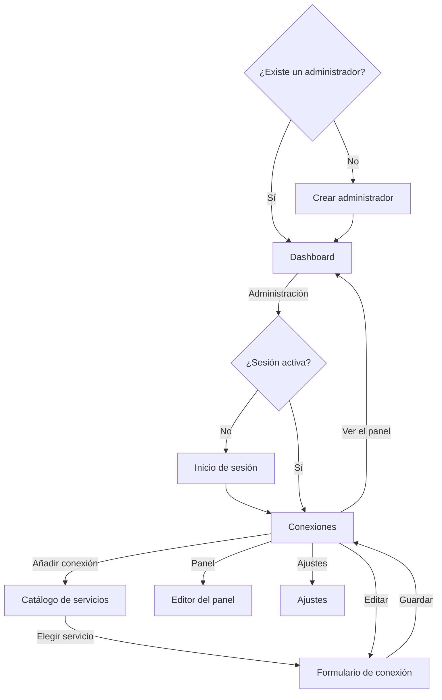

# Diseño funcional

## Mapa de pantallas

| Ruta | Pantalla |
|---|---|
| `/` | Dashboard |
| `/admin` | Conexiones o inicio de sesión |
| `/p/<id>` | Una página concreta del dashboard |
| `/admin/connections/new` | Catálogo de servicios |
| `/admin/panel` | Editor del panel |
| `/admin/settings` | Ajustes |

Mientras no exista un administrador, todas las rutas muestran el asistente de primer arranque.

## Pantallas

### Crear administrador

- **Campos:** usuario, de 1 a 64 caracteres, y contraseña, de 12 a 1024 bytes.
- **Código de instalación:** se pide solo si la instalación lo define. El enlace del instalador lo rellena y lo quita de la barra de direcciones.
- **Resultado:** crea la cuenta, inicia sesión y muestra el dashboard.
- **Regla:** solo se puede usar una vez.

### Inicio de sesión

- **Errores:** el mensaje no indica si falla el usuario o la contraseña.
- **Bloqueo:** tras 10 fallos desde una IP, muestra un aviso durante 15 minutos.
- **Sesión:** dura 30 días.

### Dashboard

**Sin servicios:** muestra un mensaje y un enlace a la administración.

**Con servicios:** cada página muestra sus bloques en la posición elegida en el editor. Con más de una página aparecen pestañas.

- **Recuadro:** cada bloque tiene fondo, borde y una sombra ligera, para distinguirlo de los demás. Los bloques de una misma fila igualan su altura.
- **Altura:** un bloque crece si su contenido lo necesita, sin solaparse.
- **Pantallas de menos de 900 px:** los bloques se apilan en una columna, de arriba abajo y de izquierda a derecha.
- **Página vacía:** indica que no tiene servicios.
- **Sesión obligatoria:** si está activa, sin sesión se muestra el inicio de sesión. Quien tuviera el panel abierto deja de verlo.

| Elemento | Comportamiento |
|---|---|
| Nombre del servicio | Enlace a su URL, con un icono, que se abre en una pestaña nueva |
| Actualización | En vivo. Si se pierde, muestra un aviso y reintenta |
| Antigüedad | «Actualizado hace…», recalculado cada 10 segundos |
| Estado | Se indica con texto y forma, no solo con color |

**Estados de un bloque de AdGuard:**

| Estado | Condición | Indicador |
|---|---|---|
| Consultando | Aún no hay resultado | Círculo vacío |
| Protección activa | DNS en marcha y protección activa | Círculo verde |
| Protección desactivada | DNS en marcha y protección desactivada | Triángulo ámbar |
| Servidor DNS parado | AdGuard indica que el DNS no está en marcha | Cuadrado rojo |
| Con fallos | La última consulta ha fallado | Cuadrado rojo, mensaje de error y último dato atenuado |

**Datos de un bloque de AdGuard:**

| Dato | Cálculo |
|---|---|
| Consultas | `num_dns_queries`, abreviado; el valor exacto se ve al pasar el cursor |
| Bloqueadas | (filtros + navegación segura + control parental) / consultas |
| Tiempo medio | `avg_processing_time`, en ms; por debajo de 1 ms, `< 1 ms` |
| Periodo | Unidad de tiempo y número de valores que devuelve AdGuard |
| Top de dominios | Los 5 primeros consultados y bloqueados, si la opción está activa |

Las búsquedas seguras reemplazadas no cuentan como bloqueos.

**Estados de un bloque de Proxmox:**

| Estado | Condición | Indicador |
|---|---|---|
| Consultando | Aún no hay resultado | Círculo vacío |
| Clúster correcto | Todos los nodos en línea y con quórum | Círculo verde |
| Nodo en línea | Nodo independiente en línea | Círculo verde |
| N de M nodos en línea | Algún nodo sin conexión, con quórum | Triángulo ámbar |
| Clúster sin quórum | El clúster indica que no hay quórum | Cuadrado rojo |
| Con fallos | La última consulta ha fallado | Cuadrado rojo, mensaje de error y último dato atenuado |

**Datos de un bloque de Proxmox:**

| Dato | Cálculo |
|---|---|
| Nodos | En línea / total |
| VM y LXC en marcha | En marcha / total, sin plantillas |
| CPU | Media ponderada por CPU de los nodos en línea, con el total de CPU |
| RAM | Usada / total de los nodos en línea |
| Por nodo | CPU, RAM y disco. Con un 90 % o más, el valor se resalta en ámbar. Sin conexión, muestra «Sin conexión» |
| Detalle | Con la opción activa, cada nodo se despliega para ver sus VM y LXC con estado, CPU y RAM |

El detalle desplegado sigue abierto cuando llegan datos nuevos.

**Estados de un bloque de Home Assistant:**

| Estado | Condición | Indicador |
|---|---|---|
| Consultando | Aún no hay resultado | Círculo vacío |
| En marcha | Servicio en marcha y todas las entidades con datos | Círculo verde |
| Entidades sin datos: N | Alguna entidad no disponible, desconocida o eliminada | Triángulo ámbar |
| Modo seguro | Home Assistant indica `safe_mode` | Triángulo ámbar |
| Arrancando | El estado no es `RUNNING`, también al detenerse | Triángulo ámbar |
| Modo de recuperación | Home Assistant indica `recovery_mode` | Cuadrado rojo |
| Con fallos | La última consulta ha fallado | Cuadrado rojo, mensaje de error y último dato atenuado |

**Datos de un bloque de Home Assistant:**

| Sección | Contenido |
|---|---|
| Consumos | Entidades elegidas con clase de potencia o energía, con su valor y unidad. No se suman |
| Entidades | El resto de las elegidas, por nombre |
| Recursos | CPU y RAM de Home Assistant, y disco y arranque del equipo. Solo con Supervisor y token de administrador |
| Resumen | Elementos activos sobre el total por dominio; entidades, no disponibles, actualizaciones pendientes e integraciones. Opcional |
| Sin selección | Lo anterior, junto con el estado y la versión |

La CPU y la RAM son las de Home Assistant, no las del equipo completo.

**Valores:** los números siguen el formato del idioma. `on` y `off` se muestran como Encendido y Apagado. El resto de estados se muestra tal como llega de Home Assistant.

### Conexiones

- **Lista:** nombre, servicio, URL, intervalo, estado y aviso si no se verifica TLS.
- **Estado:** se refresca cada 10 segundos.
- **Eliminar:** pide confirmación en la propia fila.
- **Sin conexiones:** invita a añadir la primera.

### Catálogo de servicios

- **Tarjetas:** icono, nombre y qué muestra.
- **Búsqueda:** por nombre y descripción, sin distinguir mayúsculas ni tildes.
- **Sin resultados:** indica el texto buscado.
- **Teclado:** el buscador recibe el foco en dispositivos con ratón; en táctiles no, para no abrir el teclado.

### Formulario de conexión

| Campo | Servicios | Reglas |
|---|---|---|
| Nombre | Todos | Obligatorio, hasta 80 caracteres |
| URL | Todos | `http` o `https`, sin credenciales, parámetros ni fragmento |
| Usuario | AdGuard | Obligatorio |
| Credencial | Todos | Obligatoria al crear y al cambiar la URL; en otro caso, vacía conserva la actual. Hasta 4096 bytes |
| Refresco | Todos | De 5 a 3600 segundos, 30 por defecto |
| Mostrar dominios | AdGuard | Desactivado por defecto |
| Mostrar detalle de VM y LXC | Proxmox | Activado por defecto |
| Entidades en el panel | Home Assistant | Ninguna por defecto, hasta 200 |
| Mostrar resumen | Home Assistant | Activado por defecto |
| Enlace para abrir el servicio | Todos | Opcional, `http` o `https`, sin credenciales. Vacío, usa la URL de conexión |
| No verificar TLS | Todos | Desactivado por defecto |

| Credencial | Formato |
|---|---|
| Proxmox | API token, `usuario@reino!nombre=valor` |
| Home Assistant | Token de larga duración |
| AdGuard | Contraseña |

**Probar conexión:** consulta el servicio una vez con los datos del formulario, sin guardar nada. En Home Assistant, avisa si no hay CPU, memoria ni disco disponibles. Si se cambia algún dato de conexión, el resultado anterior desaparece. Al editar, puede usar la credencial guardada si la URL no ha cambiado.

### Selector de entidades

- **Carga:** el botón **Cargar entidades** consulta Home Assistant con los datos del formulario, sin guardar nada. Al editar, puede usar la credencial guardada si la URL no ha cambiado.
- **Filtros:** Todas, Consumos o Seleccionadas, combinables con una búsqueda por nombre e identificador, sin distinguir mayúsculas ni tildes.
- **Rendimiento:** se muestran hasta 200 filas; si hay más, se pide afinar la búsqueda.
- **Conservación:** una entidad elegida sigue seleccionada aunque desaparezca de Home Assistant, y el panel la muestra como «No encontrada».

### Editor del panel

- **Páginas:** añadir, renombrar (hasta 40 caracteres), mover y eliminar con confirmación. Entre 1 y 20. Eliminar una página no elimina sus conexiones.
- **Añadir a esta página:** botones con las conexiones que aún no están en ella.
- **Colocar:** arrastrando la barra de cada bloque y su esquina inferior derecha.
- **Teclado:** botones **Antes**, **Después**, **Más estrecho** y **Más ancho**, que recolocan por filas, y **Quitar**.
- **Vista previa:** muestra el contenido real, recortado a su tamaño, y sin interacción.
- **Guardar:** los cambios no se aplican hasta pulsar **Guardar panel**. **Descartar** vuelve a lo guardado, y el navegador avisa si se cierra la página con cambios.

Una misma conexión puede estar en varias páginas, una vez en cada una. Una conexión fuera de todas las páginas se sigue consultando y su estado se ve en **Conexiones**, pero no sale por la API pública.

### Ajustes

| Ajuste | Valores | Por defecto |
|---|---|---|
| Tema | Según el sistema, claro u oscuro | Según el sistema |
| Color de acento | Ámbar, turquesa, lima, coral o rosa | Ámbar |
| Exigir inicio de sesión para ver el panel | Sí o no | No |

Se aplican a todos los usuarios del panel. El idioma sigue siendo de cada navegador.

**Contraseña:** pide la actual y dos veces la nueva, de al menos 12 caracteres. Cierra las demás sesiones. Los fallos cuentan para el bloqueo por IP.

## Mensajes de error de los servicios

| Código | Mensaje |
|---|---|
| `unauthorized` | Credenciales rechazadas por el servicio. Revisa la conexión. |
| `timeout` | El servicio no ha respondido a tiempo. |
| `unreachable` | No se puede conectar con el servicio. Revisa la URL y la red. |
| `tls` | Error de TLS. Revisa si la URL usa http o https y, si el certificado es autofirmado, desactiva la verificación en la conexión. |
| `bad_response` | La respuesta no es la esperada. Revisa que la URL sea la de este servicio. |
| `secret_unreadable` | No se puede descifrar la credencial. Vuelve a escribirla en la conexión. |
| `internal` | Error inesperado al consultar el servicio. Revisa los registros de Talaia. |

## Idioma y apariencia

- **Idioma:** se toma del navegador y, si no es español, se usa inglés. La elección manual se recuerda en ese navegador.
- **Apariencia:** tema y acento se eligen en los ajustes.
- **Movimiento:** al abrir la página, el haz de la torre hace un único barrido, que se omite si el sistema pide reducir el movimiento.
