# Talaia user manual

Talaia is a dashboard that shows the status of your homelab services at a glance. It is meant to be your browser's start page.

> **Manual version:** `v0.2.3`. It shows data from AdGuard Home, Proxmox VE, Home Assistant, OPNsense, Portainer and WGDashboard. See the [current limitations](#current-limitations).
>
> This manual is a translation of the [Spanish user manual](../usuario/manual-de-usuario.md), which is the reference. The project documentation is only in Spanish.

## Contents

1. [Installation](#installation)
2. [First start](#first-start)
3. [The dashboard](#the-dashboard)
4. [Administration](#administration)
5. [Adding a connection](#adding-a-connection)
6. [Editing and deleting connections](#editing-and-deleting-connections)
7. [Arranging the dashboard](#arranging-the-dashboard)
8. [Settings](#settings)
9. [Language and appearance](#language-and-appearance)
10. [Security and remote access](#security-and-remote-access)
11. [Backups](#backups)
12. [Troubleshooting](#troubleshooting)
13. [Current limitations](#current-limitations)

## Installation

### On Proxmox VE (recommended)

Run this as root in the shell of a Proxmox node:

```sh
curl -fsSL https://github.com/izakdev/talaia/releases/latest/download/talaia-proxmox.sh -o talaia-proxmox.sh
bash talaia-proxmox.sh install
```

It shows what it is going to create and asks for confirmation. It creates an unprivileged Debian container with 1 vCPU, 512 MB of RAM and 4 GB of disk, which starts with the node. The container does not need Internet access.

When it finishes, it shows **a link to create the administrator**. It works only once, and until it is used nobody else can create one.

**Most common options:**

| Option | Default | Purpose |
|---|---|---|
| `--ctid ID` | The next free one | Container ID |
| `--hostname NAME` | `talaia` | Container name |
| `--ip CIDR` and `--gateway IP` | DHCP | Static address, for example `--ip 192.0.2.50/24 --gateway 192.0.2.1` |
| `--bridge NAME` and `--vlan ID` | `vmbr0`, no VLAN | Network |
| `--storage NAME` | The first available one | Disk storage |
| `--port N` | `8080` | Talaia's port |
| `--cores`, `--memory` and `--disk` | 1, 512 and 4 | vCPUs, MB of RAM and GB of disk |
| `--yes` | | Don't ask for confirmation |

See them all with `bash talaia-proxmox.sh --help`.

> **If the node can't reach GitHub,** build the binary with `make dist`, copy `dist/talaia-linux-amd64` and `scripts/talaia-proxmox.sh` to the node, and run `bash talaia-proxmox.sh install --binary ./talaia-linux-amd64`.

### Updating

On the Proxmox node, with your container's ID:

```sh
curl -fsSL https://github.com/izakdev/talaia/releases/latest/download/talaia-proxmox.sh -o talaia-proxmox.sh
bash talaia-proxmox.sh update --ctid ID
```

It backs up the database and the binary, then updates. **If the new version doesn't start or a step fails, it goes back to the previous one on its own**, tells you which step failed and confirms which version is still running. Up to 3 backups are kept in `/var/lib/talaia/backups` inside the container.

To update the container's system:

```sh
pct exec ID -- bash -c "apt update && apt -y upgrade"
```

### From source

You need `git`, `make`, Go and Node.js 22 or later.

```sh
git clone https://github.com/izakdev/talaia.git
cd talaia
make build
./bin/talaia -listen :8080 -data ./data
```

Open `http://HOST_IP:8080`. Create the administrator right away: without the installer, anyone on your network could do it until then.

**Startup options:**

| Flag | Environment variable | Default | Purpose |
|---|---|---|---|
| `-listen` | `TALAIA_LISTEN` | `:8080` | Address and port |
| `-data` | `TALAIA_DATA_DIR` | `data` | Data folder |
| `-key-file` | `TALAIA_KEY_FILE` | `secret.key` in the data folder | Encryption key |
| `-setup-token-file` | `TALAIA_SETUP_TOKEN_FILE` | None | Code that protects the first start |

In the container, these variables are in `/etc/talaia/talaia.env`. If you change anything, restart with `pct exec ID -- systemctl restart talaia`.

## First start

The first time, Talaia asks you to create the administrator. If you used the installer, open its link, which already includes the **installation code**. If you lost it, it is in `/var/lib/talaia/setup.token` inside the container.

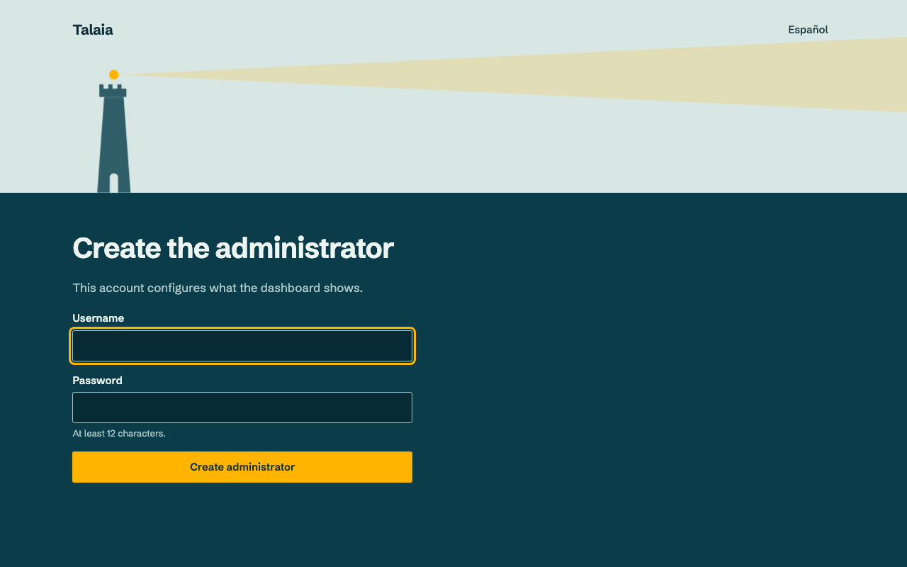

1. Enter a username.
2. Enter a password of at least 12 characters.
3. Click **Create administrator**.

You can change it in **Settings**. If you forget it, see [Troubleshooting](#troubleshooting).

## The dashboard

The dashboard is the main page. By default it doesn't require signing in, unless you [require it in the settings](#settings). It updates on its own, without reloading the page.

If there are no services yet, it takes you to the administration to add them:

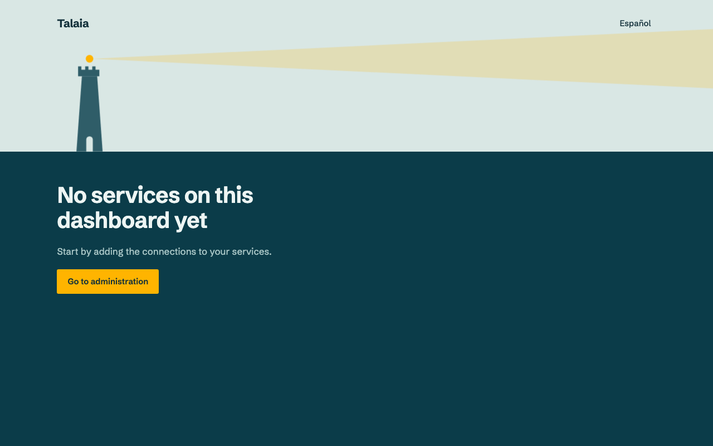

Once there are services, each one has its own block. Its name is a link that opens the service in a new tab:

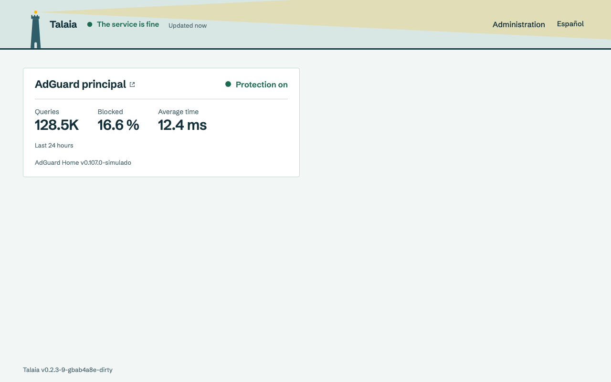

**At a glance:** next to Talaia's name you see whether everything is fine, for example "All 6 services are fine", and when the data was last updated. Talaia's version appears at the bottom of the page. If a service has a warning or is failing, the header says so and names each service, even if it is on another page; click a name to go to its block. The watchtower's light changes too: amber for warnings and red for failures. Those blocks also get a stripe of the same colour along their top edge.

**AdGuard status:**

| Indicator | Meaning |
|---|---|
| Green circle: **Protection on** | Everything works and domains are being blocked |
| Amber triangle: **Protection off** | AdGuard responds, but it isn't filtering |
| Red square: **DNS server stopped** | AdGuard responds, but its DNS server isn't running |
| Red square: **Failing** | Talaia can't query the service |
| Empty circle: **Checking…** | No result yet |

**AdGuard data:**

| Figure | Meaning |
|---|---|
| Queries | DNS queries in the period shown. Hover to see the exact number |
| Blocked | Percentage blocked by filters, safe browsing and parental control |
| Average time | Average response time |

The percentage may be somewhat higher than AdGuard's "blocked by filters" figure, because it also includes the other two reasons.

**Proxmox status:**

| Indicator | Meaning |
|---|---|
| Green circle: **Cluster healthy** or **Node online** | All nodes respond |
| Amber triangle: **N of M nodes online** | Some node is offline |
| Red square: **Cluster without quorum** | There isn't a majority of nodes to make decisions |
| Red square: **Failing** | Talaia can't query the service |

**Proxmox data:**

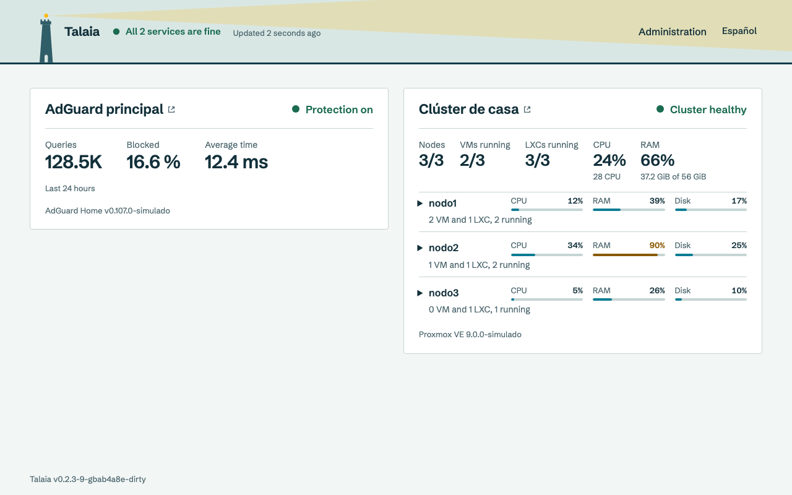

| Figure | Meaning |
|---|---|
| Nodes | Online nodes out of the total |
| VMs and LXCs running | Running out of the total, not counting templates |
| CPU and RAM | Combined usage of the online nodes |
| Per node | CPU, RAM and disk usage. At 90 % or more, the value is highlighted |

If the detail is turned on, click a node to see its VMs and LXCs:

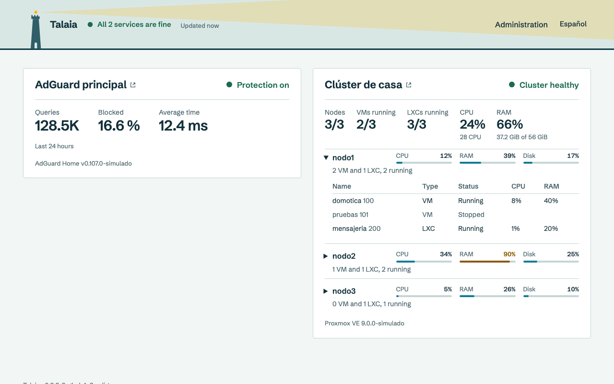

**Home Assistant status:**

| Indicator | Meaning |
|---|---|
| Green circle: **Running** | It works and the chosen entities have data |
| Amber triangle: **Entities without data: N** | Some entity is unavailable, unknown or no longer exists |
| Amber triangle: **Starting** | Home Assistant hasn't finished starting, or is stopping |
| Amber triangle: **Safe mode** | It started with custom integrations disabled |
| Red square: **Recovery mode** | The configuration has errors and it runs with the bare minimum |
| Red square: **Failing** | Talaia can't query the service |

**Home Assistant data:**

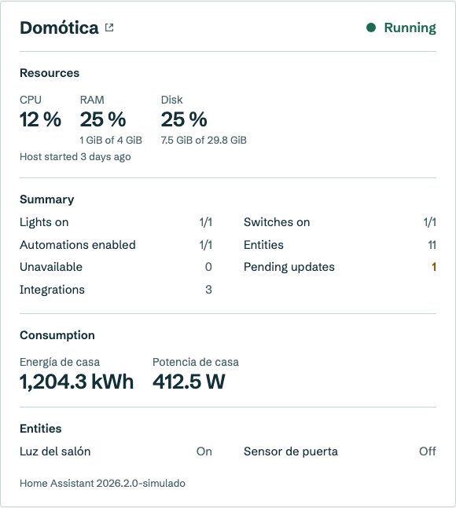

| Section | Contents |
|---|---|
| Resources | Home Assistant's CPU and RAM, and the host's disk and last start. Requires [Supervisor and an administrator token](#home-assistant) |
| Summary | Lights, switches and other active items out of the total, and the number of entities, unavailable ones, pending updates and integrations |
| Consumption and Entities | The entities you choose |

CPU and RAM are Home Assistant's, not the whole host's.

Only the entities you choose appear. Power and energy sensors go in **Consumption** and the rest in **Entities**. Consumption figures aren't added up, so a main meter and its smart plugs aren't counted twice: if you want a total, create an aggregate sensor in Home Assistant and choose it here.

**If a service fails,** the header and the watchtower turn red, and its block shows the reason and keeps the last known data dimmed, with how old it is. It recovers on its own when the service comes back.

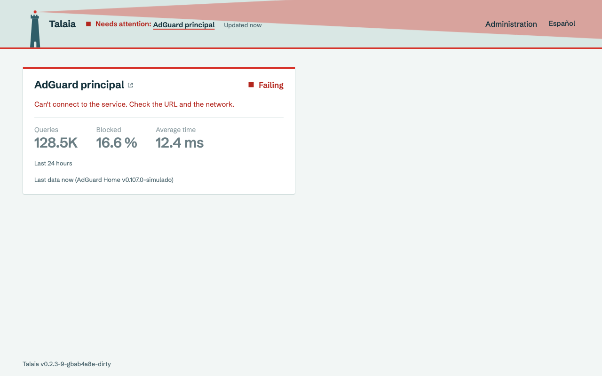

If **Live updates lost** appears, the connection with Talaia has been lost. The dashboard retries on its own, and the data may be out of date until then.

## Administration

Open it with the **Administration** link on the dashboard or at `/admin`. If you aren't signed in, it asks for your username and password. The session lasts 30 days or until you click **Sign out**.

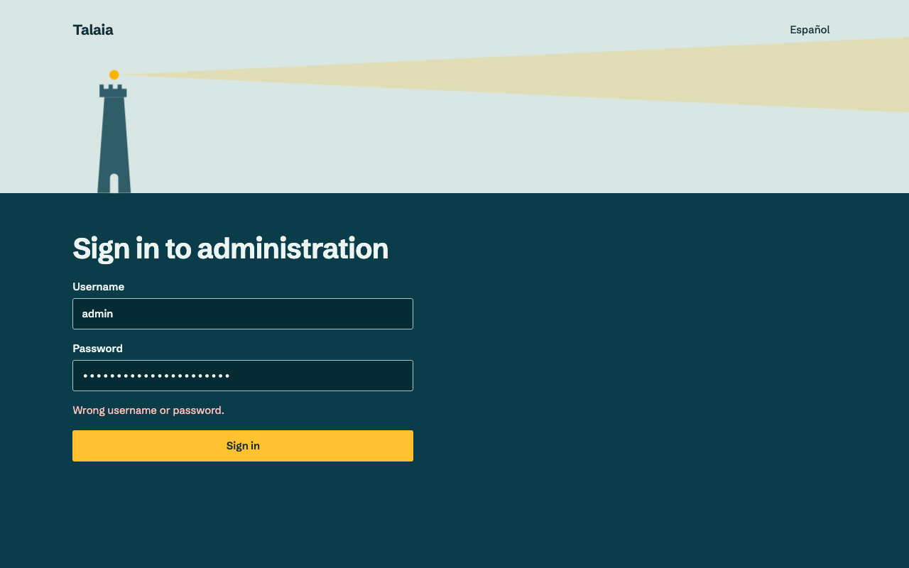

After 10 failed attempts from the same IP, you'll have to wait 15 minutes or restart Talaia.

In **Connections** you see your services, their configuration and whether they work:

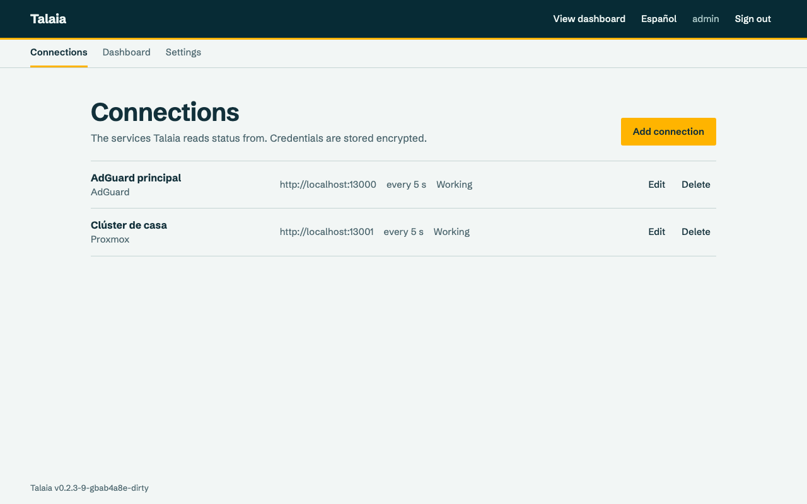

## Adding a connection

1. In **Connections**, click **Add connection**.
2. Search for or choose the service.

   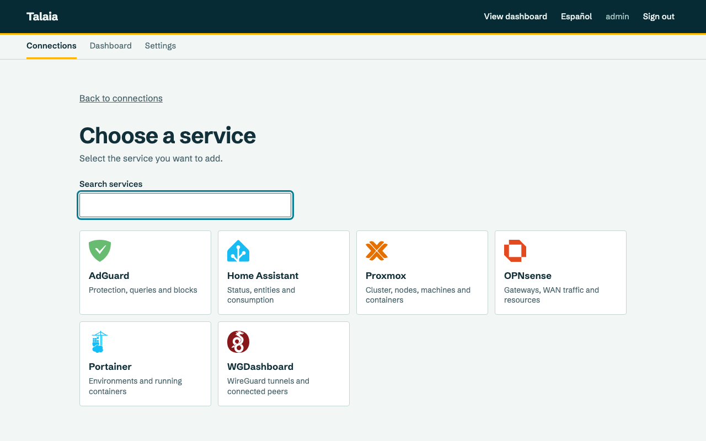

3. Fill in the form.
4. Click **Test connection**. It doesn't save anything.
5. Click **Save**.

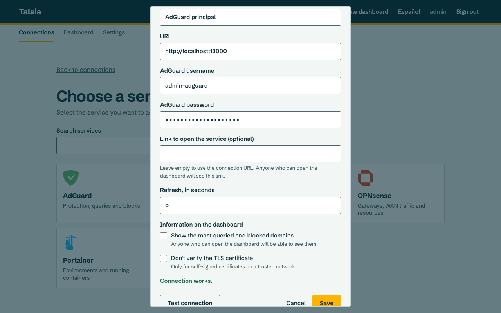

**Common fields:**

| Field | What to enter |
|---|---|
| Name | How you want to see it on the dashboard |
| URL | The service's address with `http://` or `https://` and its port |
| Refresh | How often it is queried, in seconds, from 5 to 3600 |
| Link to open the service | Optional. The address you use in the browser, if it differs from the URL. If empty, the URL is used |
| Don't verify the TLS certificate | Only for self-signed certificates on a trusted network |

It is Talaia, not your browser, that connects to the service. The URL must be reachable from the machine where Talaia runs.

### AdGuard Home

| Field | What to enter |
|---|---|
| URL | That of AdGuard's web interface, for example `http://adguard.local:3000` |
| AdGuard username | Your web interface username |
| AdGuard password | Its password |
| Show the most queried and blocked domains | Optional. Adds two lists to the dashboard |

The domain lists are off by default because they add detail to a quick view and can reveal browsing habits: **anyone who can open the dashboard will see them**.

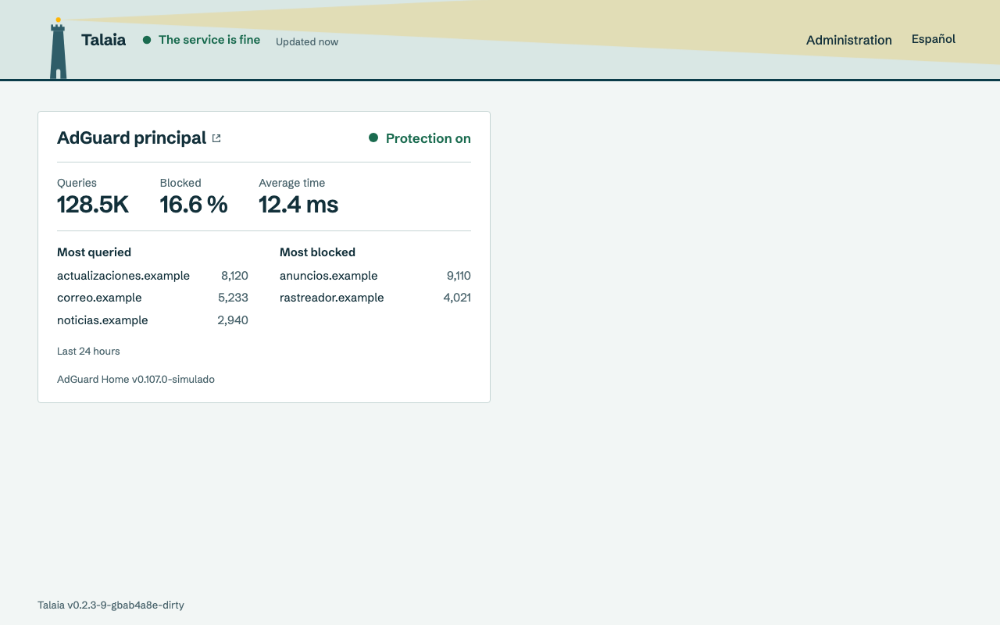

### Proxmox VE

Talaia only needs read permissions. Create a dedicated user and token by running this on a node:

```sh
pveum user add talaia@pve
pveum acl modify / --users talaia@pve --roles PVEAuditor
pveum user token add talaia@pve dashboard --privsep 1
pveum acl modify / --tokens 'talaia@pve!dashboard' --roles PVEAuditor
```

The third command shows the token's value only once. Copy it.

| Field | What to enter |
|---|---|
| URL | That of any node, for example `https://proxmox.local:8006` |
| Proxmox API token | `talaia@pve!dashboard=VALUE`, with the value you copied |
| Show details of each VM and LXC | On by default. Turn it off to see only the usage per node |
| Don't verify the TLS certificate | Tick it if you use Proxmox's self-signed certificate |

**Cluster:** one connection to any of its nodes is enough. If that node goes down, Talaia won't be able to query the cluster.

**Standalone nodes:** add one connection per node.

**Visible data:** anyone who can open the dashboard will see the node names and, with the detail on, the names of the VMs and LXCs.

**If you update from an earlier version:** Proxmox connections saved before have the detail off until you turn it on when editing them.

### Home Assistant

Create the token in Home Assistant: open your profile, go to **Security** and, under **Long-lived access tokens**, click **Create token**. It is shown only once, so copy it.

| Field | What to enter |
|---|---|
| URL | That of your Home Assistant, for example `http://homeassistant.local:8123` |
| Long-lived access token | The one you copied |
| Entities on the dashboard | The ones you want to see |
| Show a summary of lights, switches and other items | On by default. It only counts items, without people, locks, alarms or doors |

**To choose the entities:**

1. Fill in the URL and the token, and click **Load entities**.
2. Search by name or identifier, or filter by **Consumption** or **Selected**.
3. Tick the ones you want to see, up to 200.

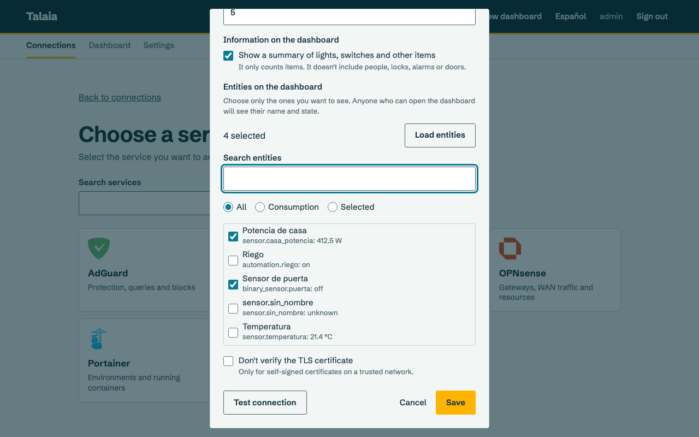

**Visible data:** anyone who can open the dashboard will see the name and state of the chosen entities. Be careful with those that reveal personal information, such as a person's location or an alarm. The ones you don't choose never leave Talaia.

**CPU, memory and disk:** Home Assistant only provides them under these two conditions:

- An installation with Supervisor, such as Home Assistant OS.
- A token from an administrator user. Talaia only reads, but that token has every administration permission, so protect it.

If they aren't met, **Test connection** tells you and the rest of the block works the same. If you don't want to use an administrator token, or your installation has no Supervisor, enable the System Monitor integration in Home Assistant and choose its sensors as entities.

**If you update from an earlier version:** connections saved before have the summary off until you turn it on when editing them.

### OPNsense

| Field | What to enter |
|---|---|
| URL | That of the web interface, with `https://`, for example `https://opnsense.local` |
| API key | The `key` value in the file OPNsense downloads |
| API secret | The `secret` value in that file |
| Don't verify the TLS certificate | Turn it on if OPNsense uses its self-signed certificate |

Create a user just for Talaia, in *System > Access > Users*:

1. Tick the random password, so it can't sign in to the web interface.
2. Under **Effective Privileges**, add these privileges:

| Privilege | What for |
|---|---|
| `Diagnostics: System Activity` | CPU and uptime. Required |
| The gateway status one | Gateways. Required |
| `Reporting: Traffic` | WAN traffic |
| `Lobby: Dashboard` | RAM, disk and version |
| `VPN: WireGuard: Status` | WireGuard status, only if you turn its option on |

3. Create an API key and copy each value into its field.

Names may vary between versions. **Test connection** warns you if data is missing because of the privileges.

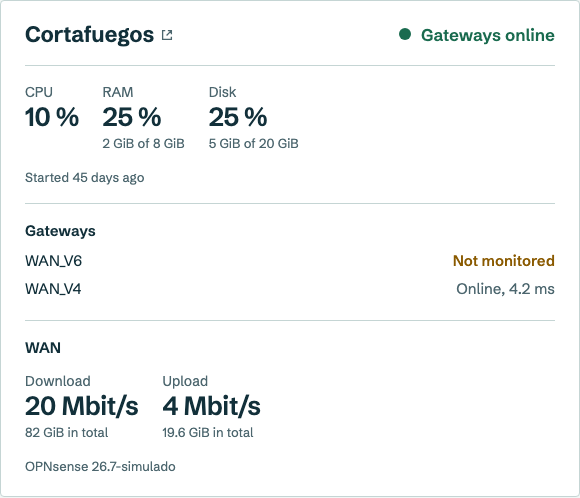

**OPNsense status:**

| Indicator | Meaning |
|---|---|
| Green circle: **Gateways online** | There are gateways with measurements and none is failing |
| Neutral: **Gateways not monitored** | OPNsense doesn't measure its gateways, so there's no way to know whether there is connectivity. To see it, turn on their monitoring in OPNsense, in *System > Gateways* (see the next note) |
| Amber triangle: **Gateway degraded** | There is packet loss or high latency |
| Red square: **Gateway down** | Some gateway is down |

**If a gateway goes Offline when you turn monitoring on:** many ISPs don't answer pings on the gateway IP, especially with PPPoE. Set a public IP as **Monitor IP**, such as `9.9.9.9`, different from your upstream DNS servers. Leave unmonitored the gateways with no real uplink, for example IPv6: otherwise **Gateway down** will appear.

WAN speed appears from the second reading on and is the average over the refresh interval. Resource data comes from OPNsense, and Talaia doesn't show its pending updates.

**WireGuard on OPNsense:** if you use WireGuard on OPNsense, turn on **Show WireGuard status** in the connection and give the user the `VPN: WireGuard: Status` privilege. That privilege also allows starting and stopping WireGuard; Talaia only uses it to read. The block adds a section with each instance, whether it is up or down, its connected peers out of the total, and its traffic. If an instance goes down, the status becomes **WireGuard tunnel down**, in amber, unless a gateway is failing. A peer counts as connected if it has made contact in the last 5 minutes, according to OPNsense. Peer names aren't shown.

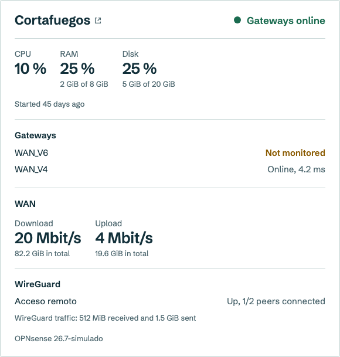

### Portainer

| Field | What to enter |
|---|---|
| URL | That of Portainer, for example `https://portainer.local:9443` |
| Access token | The one you create in *My account > Access tokens* |
| Don't verify the TLS certificate | Turn it on if Portainer uses its self-signed certificate |

Use a user just for Talaia, not an administrator, with access to the environments you want to see, in *Environments > Manage access*. In Community Edition, that token could also modify the resources it can access. Talaia only uses it to read, but keep it as sensitive data.

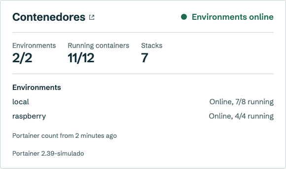

**Portainer status:**

| Indicator | Meaning |
|---|---|
| Green circle: **Environments online** | All respond and no container has problems |
| Amber triangle: **Containers with problems** | Some container fails its health check |
| Red square: **Environment down** | Portainer can't reach some environment |
| Neutral: **No Docker environments** | There are none, or the user has no access. Check *Manage access* |

The counts are those Portainer keeps in its latest snapshot, so they may be several minutes old, as the block shows. A stopped container doesn't change the status, because it may be stopped on purpose. To see each container, open Portainer with the block's link.

### WGDashboard

| Field | What to enter |
|---|---|
| URL | That of WGDashboard, for example `http://wgdashboard.local:10086` |
| API key | A key created for Talaia in WGDashboard's settings |
| Don't verify the TLS certificate | Turn it on if WGDashboard uses a self-signed certificate |

First enable API keys in WGDashboard's settings and create one for Talaia. **That key gives full access to WGDashboard**, because there are no read-only keys. Talaia only uses it to read, but keep it as sensitive data. WGDashboard logs every query, so don't set a shorter refresh than you need.

If testing the connection shows **The service rejected the credentials**, the key doesn't exist or API keys are disabled.

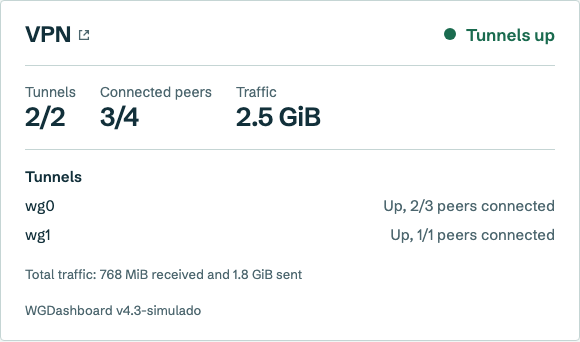

**WGDashboard status:**

| Indicator | Meaning |
|---|---|
| Green circle: **Tunnels up** | All tunnels are running |
| Amber triangle: **Tunnel stopped** | Some tunnel is stopped. It may be on purpose |
| Neutral: **No tunnels** | WGDashboard has no tunnels |

A peer counts as connected if it has made contact in the last 3 minutes, according to WGDashboard. A disconnected peer doesn't change the status: a phone, for example, only connects while you use it. The block doesn't show peer names, so as not to publish who connects. To see them, open WGDashboard with the block's link. Traffic is the total since WGDashboard started recording it.

## Editing and deleting connections

**Edit:** click **Edit** on the connection. Leave the credential empty to keep the current one. If you change the URL, you'll have to enter it again: this prevents sending it to another server by mistake.

**Delete:** click **Delete** and confirm on the same row. It can't be undone, and the service disappears from the dashboard.

## Arranging the dashboard

In the administration, open **Dashboard**. Each new connection is added on its own to the first page, and here you decide what is shown and where.

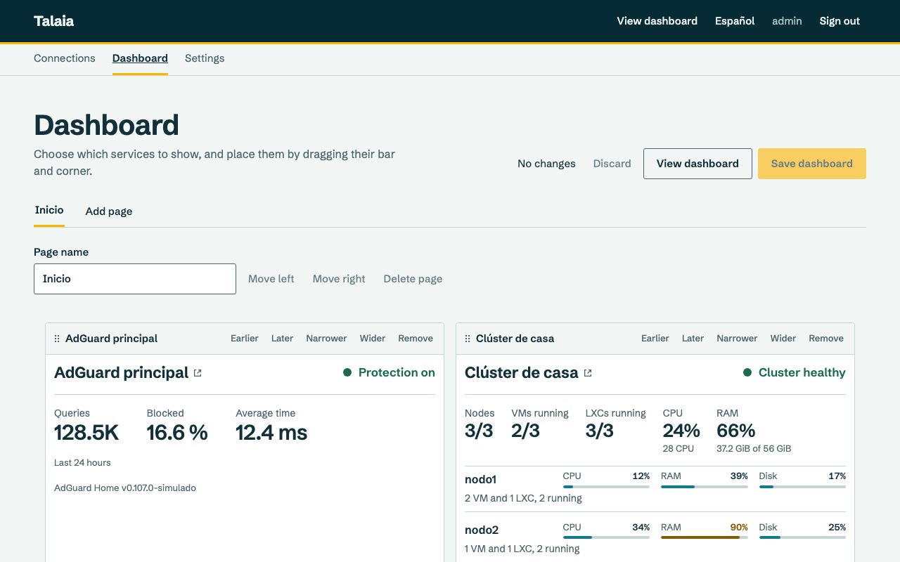

**Placing the services:**
- **Move:** drag the block's top bar.
- **Resize:** drag its bottom-right corner.
- **Without dragging:** use **Earlier**, **Later**, **Narrower** and **Wider**.
- **Remove:** stops showing it on that page. The connection isn't deleted, and you can add it again with **Add to this page**.

**Pages:** click **Add page**, give it a name and add its services. If there is more than one, the dashboard shows tabs. A service can be on several pages.

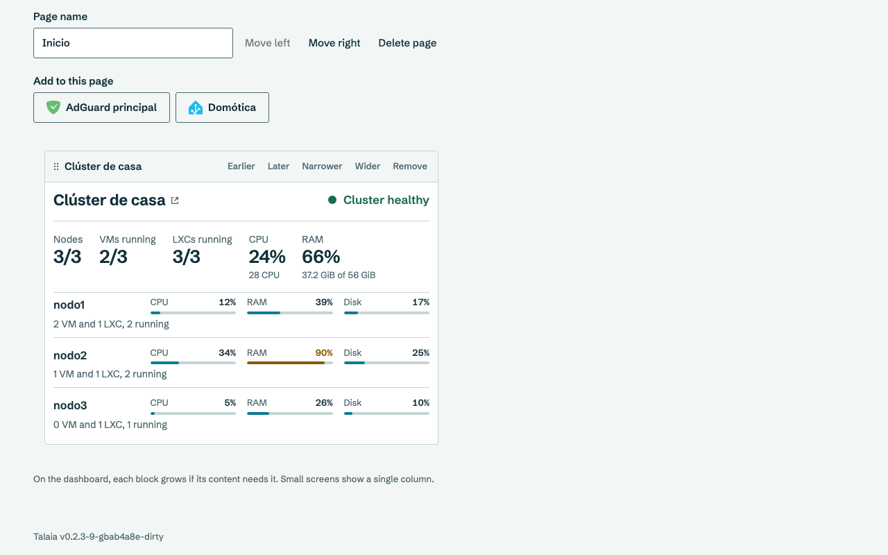

**Click Save dashboard** to apply the changes, or **Discard** to undo them.

**How it looks afterwards:** on the dashboard, each block is as tall as its content: it grows if it needs to, even if it looks cut off in the editor, and leaves no blank space if you made it taller. On narrow screens, blocks stack in a single column.

**Privacy:** a service that isn't on any page doesn't go out through the public API, although Talaia keeps querying it.

## Settings

In the administration, open **Settings**.

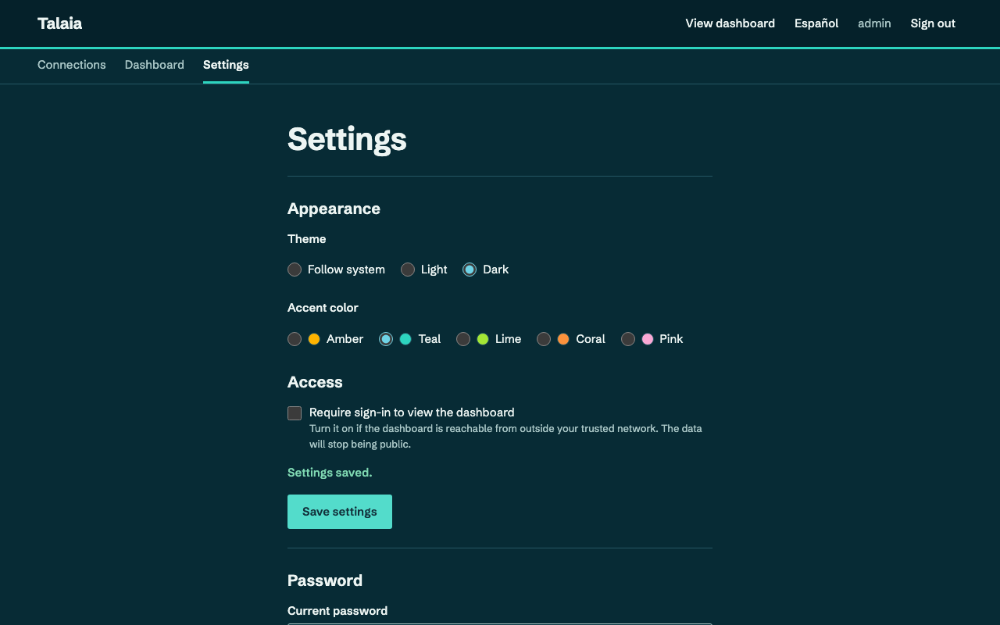

- **Theme and accent color:** they apply to everyone who opens the dashboard.

  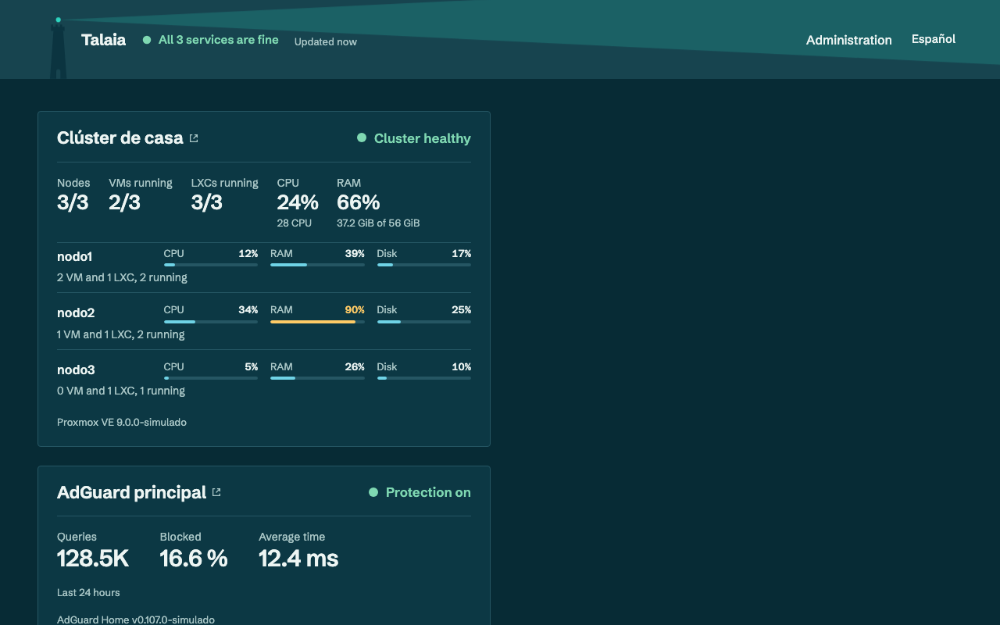

- **Require sign-in to view the dashboard:** the data stops being public, and anyone who had the dashboard open stops seeing it. Turn it on if the dashboard is reachable from outside your trusted network.
- **Password:** enter the current one and the new one twice, with at least 12 characters. Other sessions are signed out.

## Language and appearance

- **Language:** Talaia uses your browser's language if it is Spanish, and English otherwise. The **English** or **Español** button switches it, and the choice is remembered in that browser and applied to its other open tabs.
- **Light or dark mode:** by default it follows your system. You can fix it in [Settings](#settings).
- **Phone:** the interface adapts to small screens.

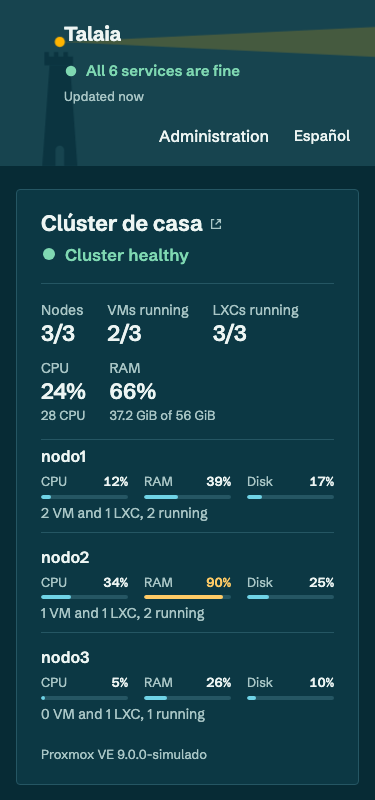

## Security and remote access

- **The dashboard is public by default:** anyone who reaches its port can see the status of your services. **To publish it on the Internet**, require sign-in in [Settings](#settings) and use HTTPS, or protect it with a VPN.
- **Links:** anyone who opens the dashboard sees each service's address. If you don't want to show the internal URL, set a custom link in the connection.
- **Credentials:** they are stored encrypted and never shown.
- **HTTPS:** Talaia serves HTTP. To use HTTPS, put it behind a reverse proxy, such as Nginx Proxy Manager, that sends the `X-Forwarded-Proto` header.
- **Behind a proxy:** Talaia sees the proxy's IP, so failed sign-ins count for every client.

## Backups

**On Proxmox,** the container backup (`vzdump`) includes everything.

**By hand,** all the configuration is in the data folder, which in the container is `/var/lib/talaia`:

| File | Contents |
|---|---|
| `talaia.db` and the `talaia.db-*` files | Administrator and connections |
| `secret.key` | Key to decrypt the credentials |

1. Stop Talaia.
2. Copy the whole data folder somewhere safe.
3. Start it again.

**Protect the backup:** it holds the key next to the encrypted credentials, so whoever has it can read them. Without `secret.key`, the credentials can't be recovered and you'll have to enter them again in each connection.

## Troubleshooting

**Messages from a service:**

| Message | What to do |
|---|---|
| The service rejected the credentials | Check the username and the credential. On Proxmox, also check that the token has the `PVEAuditor` role on `/`: with privilege separation, both the user and the token need it |
| The service did not respond in time | Check that the service works and isn't overloaded |
| Can't connect to the service | Check the URL and the port, and that Talaia's machine has access, including firewall rules between networks |
| TLS error | Check whether the URL uses `http` or `https`. If the certificate is self-signed, tick **Don't verify the TLS certificate** |
| Unexpected response | Check that the URL belongs to the right service. Some proxies redirect: use the final URL |
| The credential can't be decrypted | `secret.key` has changed or been lost. Restore it or enter the credential again |
| Unexpected error reading the service | Check Talaia's logs, on its standard error output |

**Other problems:**

| Problem | Cause and solution |
|---|---|
| Talaia doesn't start and mentions the key's permissions | `secret.key` is readable by other users. Run `chmod 600` on that file |
| "Too many failed attempts" | Wait 15 minutes or restart Talaia |
| I forgot the password | On the Proxmox node, run `pct exec ID -- runuser -u talaia -- talaia reset-password -data /var/lib/talaia`. Without a container: `talaia reset-password -data DATA_FOLDER`. It shows a new password, which you can change in **Settings**, and signs out open sessions. Your data is kept |
| The installer can't download | Check that the node has Internet access. If it can't get out, use `--binary` |
| The installer says there is no storage | Set it with `--storage`. List the available ones with `pvesm status` |
| The service doesn't start in the container | Check `pct exec ID -- journalctl -u talaia -n 50`. If installing fails, the installer deletes the container and shows this log first |
| I can't reach the dashboard | Check the address with `pct exec ID -- hostname -I` and that your firewall allows that port |
| A service doesn't appear on the dashboard | Check in **Dashboard** that it is on that page. A new connection is added to the first one |
| The dashboard doesn't update behind a proxy | Check that the proxy doesn't buffer the responses of `/api/dashboard/events` |
| CPU, memory and disk don't appear | Click **Test connection**. They require Supervisor and an administrator token |
| A service's link doesn't open | Talaia uses the connection URL, which may not be reachable from your browser. Set a custom link in the connection |
| An entity shows as **Not found** | It no longer exists in Home Assistant or its identifier changed. Edit the connection and update the selection |
| Home Assistant is slow or times out | In very large installations, increase the refresh, for example to 60 seconds |

## Current limitations

- The Proxmox view doesn't include storage.
- A connection has a single content: if it is on two pages, it looks the same on both.
- It doesn't update itself: you have to run the update command.
- The OPNsense block doesn't show its pending updates.
- The Portainer and WGDashboard blocks, and OPNsense's WireGuard, don't detail each container or peer: they only give counts.

The status of each item is in [Status and changes](../proyecto/06-estado-y-cambios.md), in Spanish.
