# Manual de usuario de Talaia

Talaia es un panel para ver de un vistazo el estado de los servicios de tu laboratorio doméstico. Está pensado para usarlo como página inicial del navegador.

*[English version](../user/user-manual.md).*

> **Versión de este manual:** `v0.4.1`. Muestran datos AdGuard Home, Proxmox VE, Home Assistant, OPNsense, Portainer, WGDashboard, QNAP y un SAI a través de NUT, comprueban si responden otros equipos de red, y avisan por Telegram, ntfy o un webhook cuando un servicio cambia de estado. Consulta las [limitaciones actuales](#limitaciones-actuales).

## Índice

1. [Instalación](#instalación)
2. [Primer arranque](#primer-arranque)
3. [El panel](#el-panel)
4. [La administración](#la-administración)
5. [Añadir una conexión](#añadir-una-conexión)
6. [Editar y eliminar conexiones](#editar-y-eliminar-conexiones)
7. [Organizar el panel](#organizar-el-panel)
8. [Ajustes](#ajustes)
9. [Notificaciones](#notificaciones)
10. [Idioma y apariencia](#idioma-y-apariencia)
11. [Seguridad y acceso remoto](#seguridad-y-acceso-remoto)
12. [Copias de seguridad](#copias-de-seguridad)
13. [Solución de problemas](#solución-de-problemas)
14. [Limitaciones actuales](#limitaciones-actuales)

## Instalación

### En Proxmox VE (recomendado)

Ejecuta esto como root en la consola de un nodo de Proxmox:

```sh
curl -fsSL https://github.com/izakdev/talaia/releases/latest/download/talaia-proxmox.sh -o talaia-proxmox.sh
bash talaia-proxmox.sh install
```

Te muestra lo que va a crear y pide confirmación. Crea un contenedor no privilegiado con Debian, 1 vCPU, 512 MB de RAM y 4 GB de disco, que arranca con el nodo. El contenedor no necesita Internet.

Al terminar muestra **un enlace para crear el administrador**. Solo sirve una vez, y hasta usarlo nadie más puede crearlo.

**Opciones más habituales:**

| Opción | Por defecto | Función |
|---|---|---|
| `--ctid ID` | El siguiente libre | ID del contenedor |
| `--hostname NOMBRE` | `talaia` | Nombre del contenedor |
| `--ip CIDR` y `--gateway IP` | DHCP | Dirección fija, por ejemplo `--ip 192.0.2.50/24 --gateway 192.0.2.1` |
| `--bridge NOMBRE` y `--vlan ID` | `vmbr0`, sin VLAN | Red |
| `--storage NOMBRE` | El primero disponible | Almacenamiento del disco |
| `--port N` | `8080` | Puerto de Talaia |
| `--cores`, `--memory` y `--disk` | 1, 512 y 4 | vCPU, MB de RAM y GB de disco |
| `--yes` | | No pide confirmación |

Consulta todas con `bash talaia-proxmox.sh --help`.

> **Sin acceso a GitHub desde el nodo,** compila el binario con `make dist`, copia al nodo `dist/talaia-linux-amd64` y `scripts/talaia-proxmox.sh`, y ejecuta `bash talaia-proxmox.sh install --binary ./talaia-linux-amd64`.

### Actualizar

En el nodo de Proxmox, con el ID de tu contenedor:

```sh
curl -fsSL https://github.com/izakdev/talaia/releases/latest/download/talaia-proxmox.sh -o talaia-proxmox.sh
bash talaia-proxmox.sh update --ctid ID
```

Hace una copia de la base de datos y del binario, y actualiza. **Si la versión nueva no arranca o falla algún paso, vuelve sola a la anterior**, te dice qué paso ha fallado y confirma qué versión sigue en marcha. Las copias, hasta 3, quedan en `/var/lib/talaia/backups` dentro del contenedor.

Para actualizar el sistema del contenedor:

```sh
pct exec ID -- bash -c "apt update && apt -y upgrade"
```

### Desde el código

Necesitas `git`, `make`, Go y Node.js 22 o posterior.

```sh
git clone https://github.com/izakdev/talaia.git
cd talaia
make build
./bin/talaia -listen :8080 -data ./data
```

Abre `http://IP_DEL_EQUIPO:8080`. Crea el administrador enseguida: sin el instalador, hasta entonces podría hacerlo cualquiera en tu red.

**Opciones de arranque:**

| Parámetro | Variable de entorno | Por defecto | Función |
|---|---|---|---|
| `-listen` | `TALAIA_LISTEN` | `:8080` | Dirección y puerto |
| `-data` | `TALAIA_DATA_DIR` | `data` | Carpeta de datos |
| `-key-file` | `TALAIA_KEY_FILE` | `secret.key` en la carpeta de datos | Clave de cifrado |
| `-setup-token-file` | `TALAIA_SETUP_TOKEN_FILE` | Ninguno | Código que protege el primer arranque |

En el contenedor, estas variables están en `/etc/talaia/talaia.env`. Si cambias algo, reinicia con `pct exec ID -- systemctl restart talaia`.

## Primer arranque

La primera vez, Talaia te pide crear el administrador. Si has usado el instalador, abre su enlace, que ya incluye el **código de instalación**. Si lo has perdido, está en `/var/lib/talaia/setup.token` dentro del contenedor.

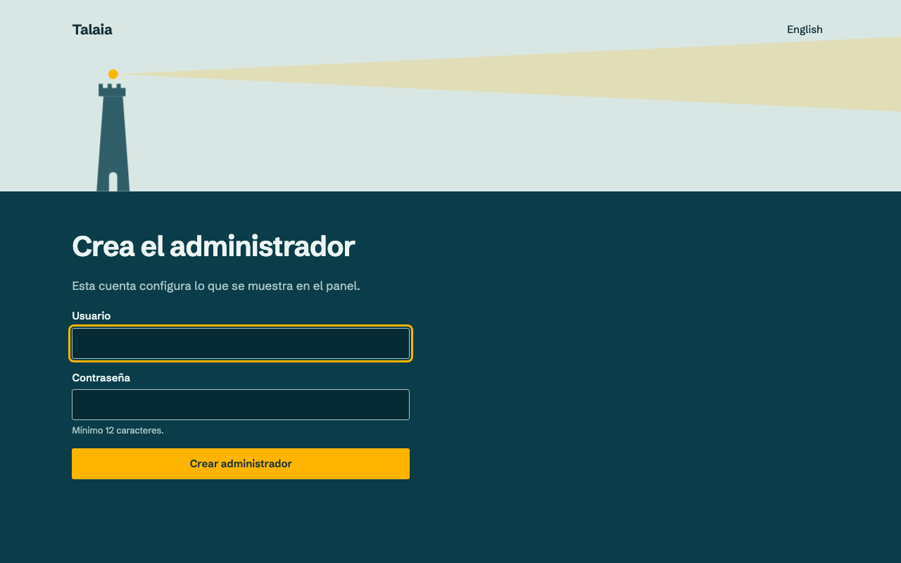

1. Escribe un usuario.
2. Escribe una contraseña de al menos 12 caracteres.
3. Pulsa **Crear administrador**.

Podrás cambiarla en **Ajustes**. Si la olvidas, consulta [Solución de problemas](#solución-de-problemas).

## El panel

El panel es la página principal. Por defecto no necesita iniciar sesión, salvo que lo [exijas en los ajustes](#ajustes). Se actualiza solo, sin recargar la página.

Si aún no hay servicios, te lleva a la administración para añadirlos:

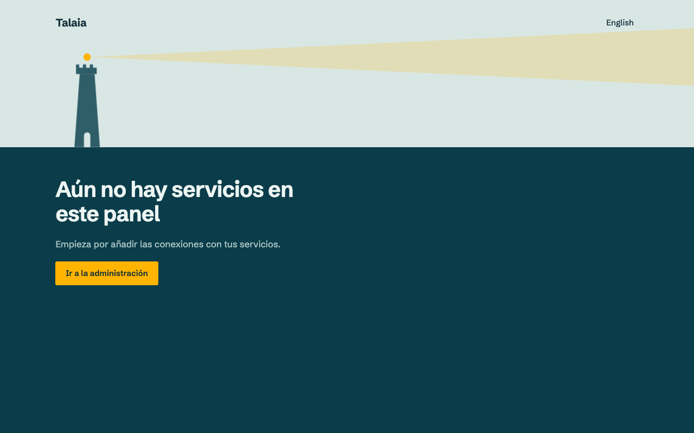

Cuando hay servicios, cada uno tiene su propio bloque, con el icono del servicio junto a su nombre; puedes [cambiarlo](#cambiar-el-icono). El nombre es un enlace que abre el servicio en una pestaña nueva:

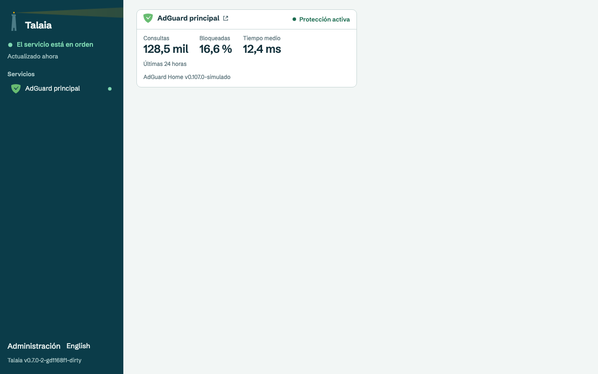

**De un vistazo:** junto al nombre de Talaia verás si todo va bien, por ejemplo «Los 6 servicios están en orden», y cuándo se actualizaron los datos por última vez. La versión de Talaia aparece al pie de la página. Si algún servicio tiene un aviso o falla, la cabecera lo dice y nombra cada servicio, aunque esté en otra página; pulsa un nombre para ir a su bloque. La luz de la atalaya también cambia: ámbar con avisos y roja con fallos. Esos bloques llevan además una franja del mismo color en su borde superior.

**Estado de AdGuard:**

| Indicador | Significado |
|---|---|
| Círculo verde: **Protección activa** | Todo funciona y se están bloqueando dominios |
| Triángulo ámbar: **Protección desactivada** | AdGuard responde, pero no está filtrando |
| Cuadrado rojo: **Servidor DNS parado** | AdGuard responde, pero su DNS no está en marcha |
| Cuadrado rojo: **Con fallos** | Talaia no puede consultar el servicio |
| Círculo vacío: **Consultando…** | Aún no hay resultado |

**Datos de AdGuard:**

| Dato | Significado |
|---|---|
| Consultas | Consultas DNS en el periodo indicado. Pasa el cursor para ver el número exacto |
| Bloqueadas | Porcentaje bloqueado por filtros, navegación segura y control parental |
| Tiempo medio | Tiempo medio de respuesta |

El porcentaje puede ser algo mayor que el dato «bloqueadas por filtros» de AdGuard, porque incluye también los otros dos motivos.

**Estado de Proxmox:**

| Indicador | Significado |
|---|---|
| Círculo verde: **Clúster correcto** o **Nodo en línea** | Todos los nodos responden |
| Triángulo ámbar: **N de M nodos en línea** | Algún nodo está sin conexión |
| Cuadrado rojo: **Clúster sin quórum** | No hay mayoría de nodos para tomar decisiones |
| Cuadrado rojo: **Con fallos** | Talaia no puede consultar el servicio |

**Datos de Proxmox:**

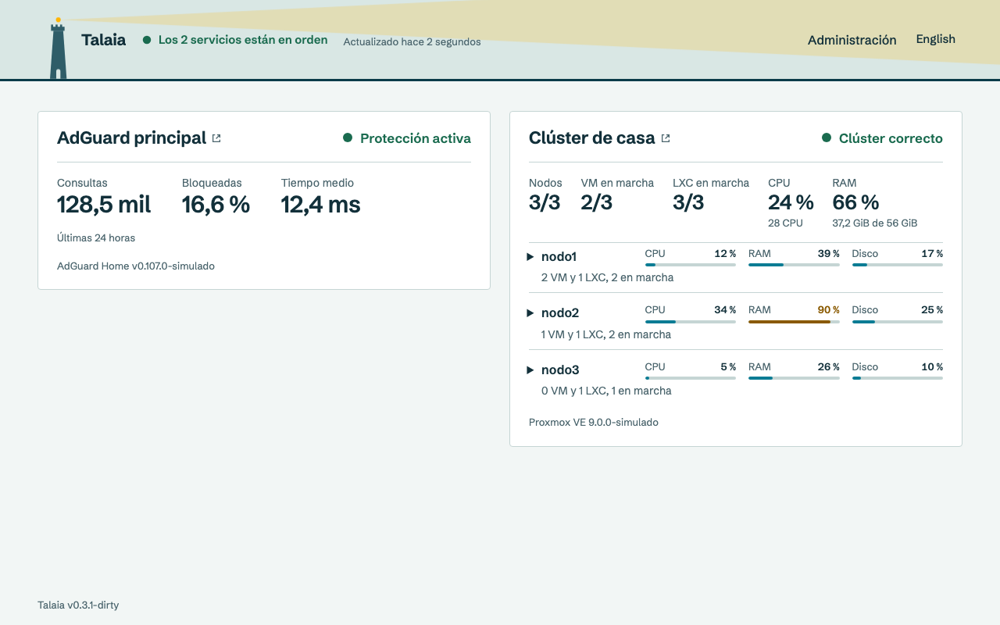

| Dato | Significado |
|---|---|
| Nodos | Nodos en línea sobre el total |
| VM y LXC en marcha | En marcha sobre el total, sin contar plantillas |
| CPU y RAM | Uso conjunto de los nodos en línea |
| Por nodo | Uso de CPU, RAM y disco. Con un 90 % o más, el valor se resalta |

Si tienes activo el detalle, pulsa un nodo para ver sus VM y LXC:

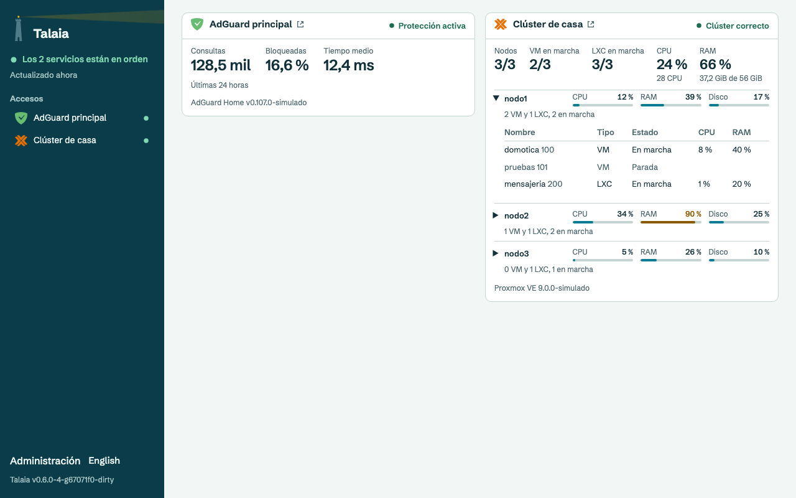

**Estado de Home Assistant:**

| Indicador | Significado |
|---|---|
| Círculo verde: **En marcha** | Funciona y las entidades elegidas tienen datos |
| Triángulo ámbar: **Entidades sin datos: N** | Alguna entidad está no disponible, es desconocida o ya no existe |
| Triángulo ámbar: **Arrancando** | Home Assistant no ha terminado de arrancar o se está deteniendo |
| Triángulo ámbar: **Modo seguro** | Se ha iniciado con las integraciones personalizadas desactivadas |
| Cuadrado rojo: **Modo de recuperación** | La configuración tiene errores y funciona con lo mínimo |
| Cuadrado rojo: **Con fallos** | Talaia no puede consultar el servicio |

**Datos de Home Assistant:**

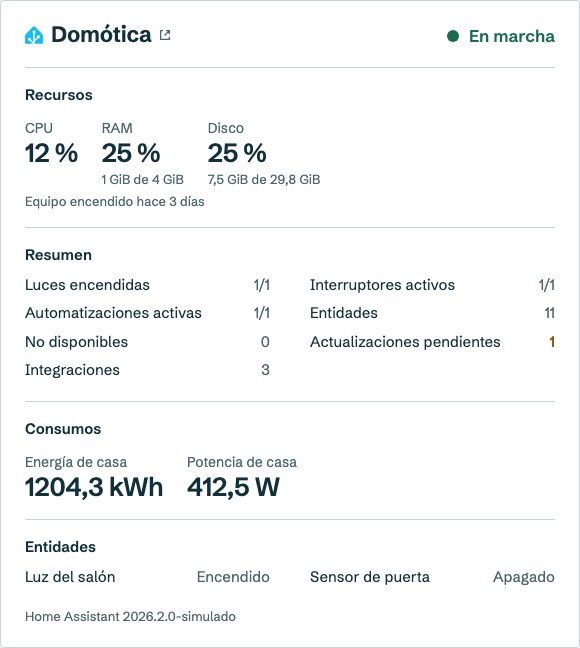

| Sección | Contenido |
|---|---|
| Recursos | CPU y RAM de Home Assistant, y disco y último arranque del equipo. Requiere [Supervisor y un token de administrador](#home-assistant) |
| Resumen | Luces, interruptores y otros elementos activos sobre el total, y número de entidades, no disponibles, actualizaciones pendientes e integraciones |
| Consumos y Entidades | Las entidades que elijas |

La CPU y la RAM son las de Home Assistant, no las del equipo completo.

Solo aparecen las entidades que elijas. Los sensores de potencia y energía van en **Consumos** y el resto en **Entidades**. Los consumos no se suman, para no contar dos veces un medidor general y sus enchufes: si quieres un total, crea un sensor agregado en Home Assistant y elígelo aquí.

**Si un servicio falla,** la cabecera y la atalaya se ponen en rojo, y su bloque indica el motivo y mantiene atenuado el último dato conocido, junto con su antigüedad. Se recupera solo cuando el servicio vuelve.

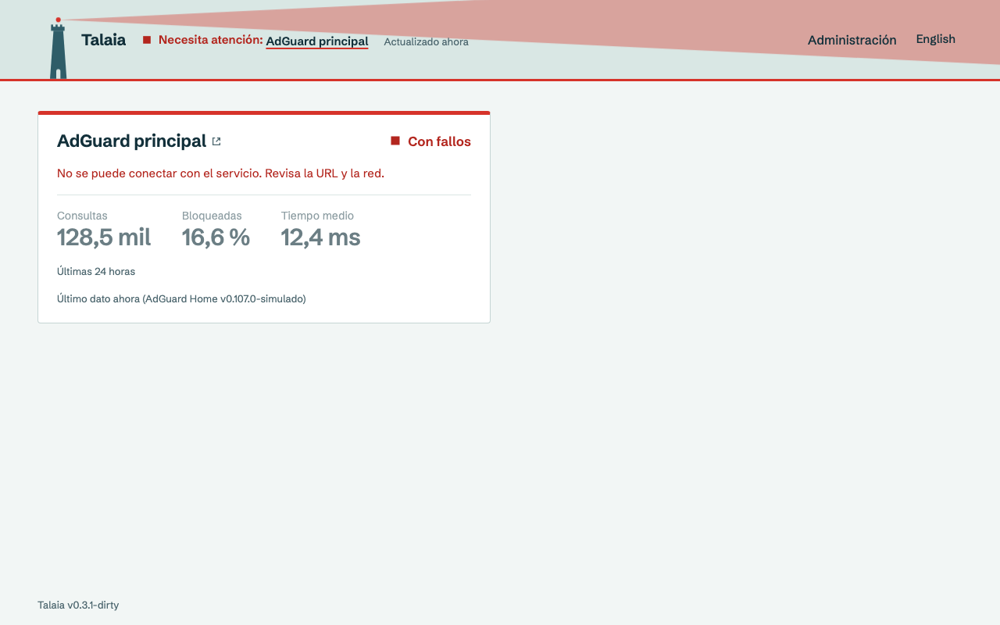

Si aparece **Sin actualización en vivo**, se ha perdido la comunicación con Talaia. El panel reintenta solo, y los datos pueden estar desactualizados hasta entonces.

## La administración

Entra con el enlace **Administración** del panel o en `/admin`. Si no tienes sesión, te pedirá tu usuario y contraseña. La sesión dura 30 días o hasta que pulses **Cerrar sesión**.

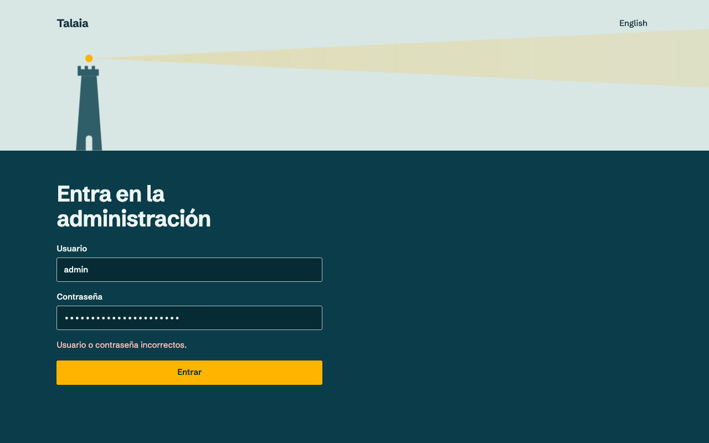

Tras 10 intentos fallidos desde una misma IP, tendrás que esperar 15 minutos o reiniciar Talaia.

En **Conexiones** ves tus servicios, su configuración y si funcionan:

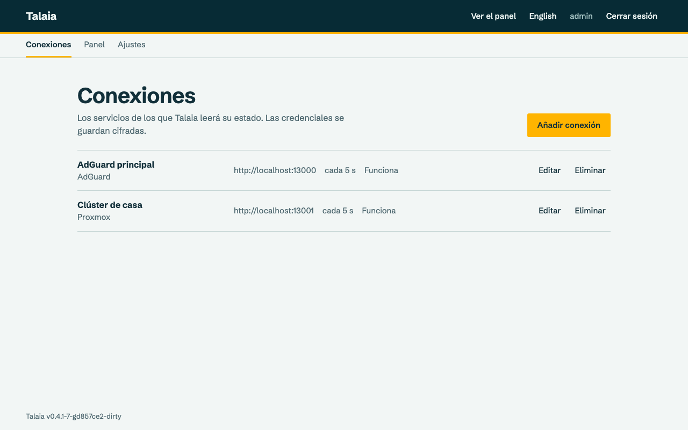

## Añadir una conexión

1. En **Conexiones**, pulsa **Añadir conexión**.
2. Busca o elige el servicio.

   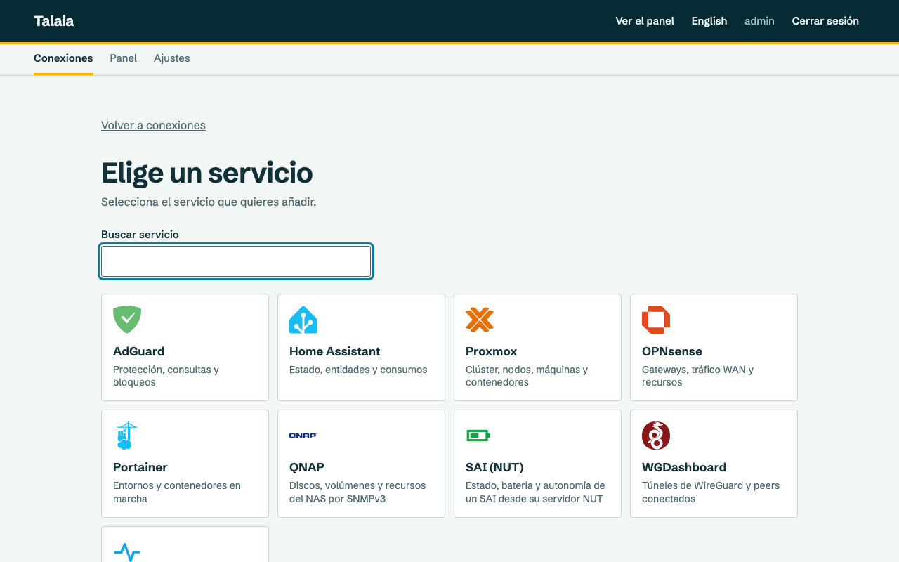

3. Rellena el formulario.
4. Pulsa **Probar conexión**. No guarda nada.
5. Pulsa **Guardar**.

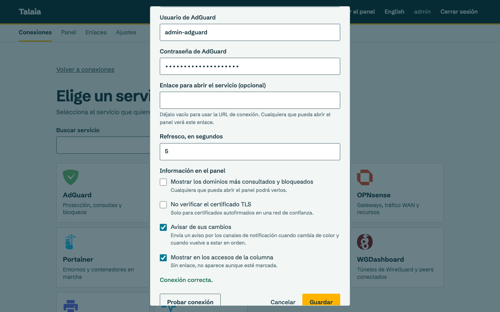

**Campos comunes:**

| Campo | Qué poner |
|---|---|
| Nombre | Cómo quieres verlo en el panel |
| Icono | El del servicio, salvo que [elijas otro](#cambiar-el-icono) |
| URL | Dirección del servicio con `http://` o `https://` y su puerto |
| Refresco | Cada cuántos segundos se consulta, de 5 a 3600 |
| Enlace para abrir el servicio | Opcional. La dirección que usas en el navegador, si es distinta de la URL. Vacío, se usa la URL |
| No verificar el certificado TLS | Solo para certificados autofirmados en una red de confianza |

Talaia, no tu navegador, es quien se conecta al servicio. La URL debe ser accesible desde el equipo donde se ejecuta Talaia.

### AdGuard Home

| Campo | Qué poner |
|---|---|
| URL | La de la interfaz web de AdGuard, por ejemplo `http://adguard.local:3000` |
| Usuario de AdGuard | Tu usuario de la interfaz web |
| Contraseña de AdGuard | Su contraseña |
| Mostrar los dominios más consultados y bloqueados | Opcional. Añade dos listas al panel |

Las listas de dominios están desactivadas por defecto porque añaden detalle a una vista rápida y pueden revelar hábitos de navegación: **cualquiera que pueda abrir el panel las verá**.

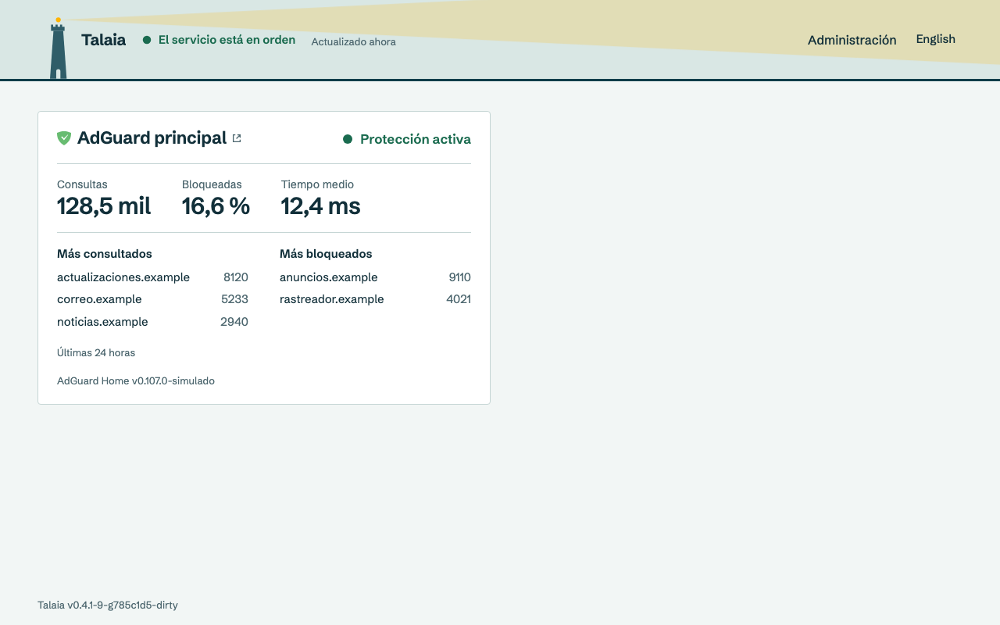

### Proxmox VE

Talaia solo necesita permisos de lectura. Crea un usuario y un token específicos ejecutando esto en un nodo:

```sh
pveum user add talaia@pve
pveum acl modify / --users talaia@pve --roles PVEAuditor
pveum user token add talaia@pve dashboard --privsep 1
pveum acl modify / --tokens 'talaia@pve!dashboard' --roles PVEAuditor
```

El tercer comando muestra el valor del token una sola vez. Cópialo.

| Campo | Qué poner |
|---|---|
| URL | La de cualquier nodo, por ejemplo `https://proxmox.local:8006` |
| API token de Proxmox | `talaia@pve!dashboard=VALOR`, con el valor que has copiado |
| Mostrar el detalle de cada VM y LXC | Activado por defecto. Desactívalo para ver solo los consumos por nodo |
| No verificar el certificado TLS | Márcalo si usas el certificado autofirmado de Proxmox |

**Clúster:** basta con una conexión a cualquiera de sus nodos. Si ese nodo se cae, Talaia no podrá consultar el clúster.

**Nodos independientes:** añade una conexión por nodo.

**Datos visibles:** cualquiera que pueda abrir el panel verá los nombres de los nodos y, con el detalle activo, los de las VM y LXC.

**Si actualizas desde una versión anterior:** las conexiones de Proxmox ya guardadas tienen el detalle desactivado hasta que lo actives al editarlas.

### Home Assistant

Crea el token en Home Assistant: entra en tu perfil, abre **Seguridad** y, en **Tokens de acceso de larga duración**, pulsa **Crear token**. Se muestra una sola vez, así que cópialo.

| Campo | Qué poner |
|---|---|
| URL | La de tu Home Assistant, por ejemplo `http://homeassistant.local:8123` |
| Token de larga duración | El que has copiado |
| Entidades en el panel | Las que quieras ver |
| Mostrar el resumen de luces, interruptores y otros elementos | Activado por defecto. Solo cuenta elementos, sin personas, cerraduras, alarmas ni puertas |

**Para elegir las entidades:**

1. Rellena la URL y el token, y pulsa **Cargar entidades**.
2. Busca por nombre o identificador, o filtra por **Consumos** o **Seleccionadas**.
3. Marca las que quieras ver, hasta 200.

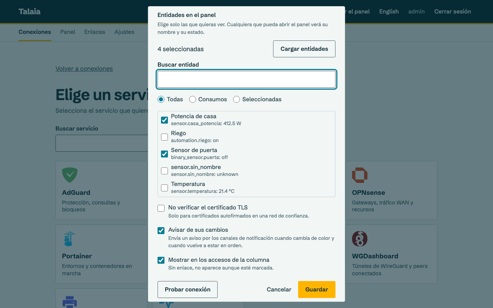

**Datos visibles:** cualquiera que pueda abrir el panel verá el nombre y el estado de las entidades elegidas. Ten cuidado con las que revelen información personal, como la ubicación de una persona o una alarma. Las que no elijas no salen de Talaia.

**CPU, memoria y disco:** Home Assistant solo los ofrece con estas dos condiciones:

- Una instalación con Supervisor, como Home Assistant OS.
- Un token de un usuario administrador. Talaia solo lee, pero ese token tiene todos los permisos de administración, así que protégelo.

Si no se cumplen, **Probar conexión** te lo indica y el resto del bloque funciona igual. Si no quieres usar un token de administrador, o tu instalación no tiene Supervisor, activa la integración System Monitor en Home Assistant y elige sus sensores como entidades.

**Si actualizas desde una versión anterior:** las conexiones ya guardadas tienen el resumen desactivado hasta que lo actives al editarlas.

### OPNsense

| Campo | Qué poner |
|---|---|
| URL | La de la interfaz web, con `https://`, por ejemplo `https://opnsense.local` |
| Clave de API | El valor de `key` en el archivo que descarga OPNsense |
| Secreto de API | El valor de `secret` en ese archivo |
| No verificar el certificado TLS | Actívalo si OPNsense usa su certificado autofirmado |

Crea un usuario solo para Talaia, en *System > Access > Users*:

1. Marca la contraseña aleatoria, para que no pueda iniciar sesión en la web.
2. En **Effective Privileges**, añade estos privilegios:

| Privilegio | Para qué |
|---|---|
| `Diagnostics: System Activity` | CPU y tiempo encendido. Imprescindible |
| El de estado de gateways | Gateways. Imprescindible |
| `Reporting: Traffic` | Tráfico de la WAN |
| `Lobby: Dashboard` | RAM, disco y versión |
| `VPN: WireGuard: Status` | Estado de WireGuard, solo si activas su opción |

3. Crea una API key y copia cada valor en su campo.

Los nombres pueden variar según la versión. **Probar conexión** te avisa si faltan datos por los privilegios.

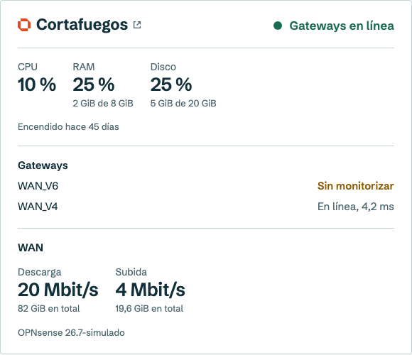

**Estado de OPNsense:**

| Indicador | Significado |
|---|---|
| Círculo verde: **Gateways en línea** | Hay gateways con medidas y ninguno falla |
| Neutro: **Gateways sin monitorizar** | OPNsense no mide sus gateways, así que no se sabe si hay conexión. Para verlo, activa su monitorización en OPNsense, en *System > Gateways* (consulta la nota siguiente) |
| Triángulo ámbar: **Gateway degradado** | Hay pérdida de paquetes o latencia alta |
| Cuadrado rojo: **Gateway caído** | Algún gateway ha caído |

**Si al activar la monitorización un gateway pasa a Offline:** muchos operadores no responden a ping en la IP del gateway, sobre todo con PPPoE. Indica en **Monitor IP** una IP pública, como `9.9.9.9`, distinta de tus DNS de subida. Deja sin monitorizar los gateways que no tengan salida real, por ejemplo IPv6: de lo contrario, aparecerá **Gateway caído**.

La velocidad de la WAN aparece a partir de la segunda lectura y es la media del tiempo de refresco. Los datos de recursos son de OPNsense, y Talaia no muestra sus actualizaciones pendientes.

**WireGuard en OPNsense:** si usas WireGuard en OPNsense, activa **Mostrar el estado de WireGuard** en la conexión y añade al usuario el privilegio `VPN: WireGuard: Status`. Ese privilegio también permite arrancar y parar WireGuard; Talaia solo lo usa para leer. El bloque añade una sección con cada instancia, si está activa o caída, sus peers conectados sobre el total y el tráfico. Si una instancia cae, el estado pasa a **Túnel WireGuard caído**, en ámbar, salvo que haya un gateway con fallos. Un peer cuenta como conectado si ha contactado en los últimos 5 minutos, según OPNsense. Los nombres de los peers no se muestran.

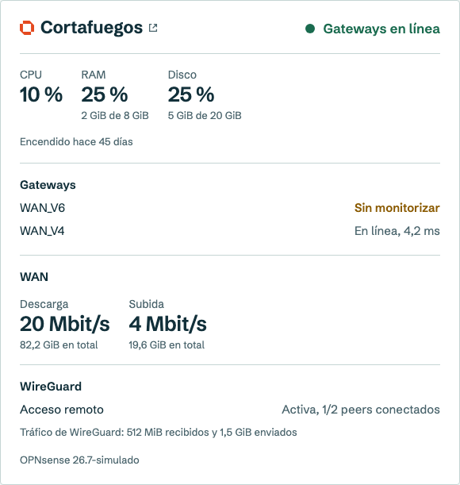

### Portainer

| Campo | Qué poner |
|---|---|
| URL | La de Portainer, por ejemplo `https://portainer.local:9443` |
| Token de acceso | El que crees en *My account > Access tokens* |
| No verificar el certificado TLS | Actívalo si Portainer usa su certificado autofirmado |

Usa un usuario solo para Talaia, que no sea administrador, con acceso a los entornos que quieras ver, en *Environments > Manage access*. En Community Edition, ese token también podría modificar los recursos a los que tenga acceso. Talaia solo lo usa para leer, pero guárdalo como un dato sensible.

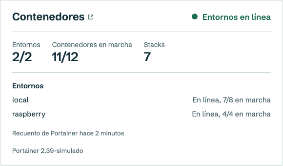

**Estado de Portainer:**

| Indicador | Significado |
|---|---|
| Círculo verde: **Entornos en línea** | Todos responden y ningún contenedor tiene problemas |
| Triángulo ámbar: **Contenedores con problemas** | Algún contenedor falla su comprobación de salud |
| Cuadrado rojo: **Entorno caído** | Portainer no llega a algún entorno |
| Neutro: **Sin entornos Docker** | No hay ninguno, o el usuario no tiene acceso. Revisa *Manage access* |

Los recuentos son los que Portainer guarda en su última instantánea, así que pueden tener varios minutos, como indica el bloque. Un contenedor parado no cambia el estado, porque puede estarlo a propósito. Para ver cada contenedor, abre Portainer con el enlace del bloque.

### WGDashboard

| Campo | Qué poner |
|---|---|
| URL | La de WGDashboard, por ejemplo `http://wgdashboard.local:10086` |
| Clave de API | Una clave creada para Talaia en los ajustes de WGDashboard |
| No verificar el certificado TLS | Actívalo si WGDashboard usa un certificado autofirmado |

Primero activa las claves de API en los ajustes de WGDashboard y crea una para Talaia. **Esa clave da acceso completo a WGDashboard**, porque no las hay de solo lectura. Talaia solo la usa para leer, pero guárdala como un dato sensible. WGDashboard anota cada consulta en su registro, así que no pongas un refresco más corto de lo necesario.

Si al probar la conexión ves **Credenciales rechazadas**, la clave no existe o las claves de API están desactivadas.

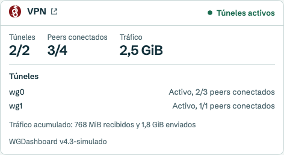

**Estado de WGDashboard:**

| Indicador | Significado |
|---|---|
| Círculo verde: **Túneles activos** | Todos los túneles están en marcha |
| Triángulo ámbar: **Túnel parado** | Algún túnel está parado. Puede estarlo a propósito |
| Neutro: **Sin túneles** | WGDashboard no tiene ningún túnel |

Un peer cuenta como conectado si ha contactado en los últimos 3 minutos, según WGDashboard. Un peer desconectado no cambia el estado: un móvil, por ejemplo, solo se conecta cuando lo usas. El bloque no muestra los nombres de los peers, para no publicar quién se conecta. Para verlos, abre WGDashboard con el enlace del bloque. El tráfico es el acumulado desde que WGDashboard lo registra.

### QNAP

Talaia lee el NAS por **SNMPv3**, con autenticación y cifrado. No usa ninguna cuenta de QTS ni puede cambiar nada en el NAS. Sirve para QTS y QuTS hero.

**En el NAS:**

1. Abre **Panel de control > Servicios de red > SNMP** (*Control Panel > Network Services > SNMP*) y marca **Habilitar servicio SNMP** (*Enable SNMP service*), con el puerto 161.
2. No marques ningún **Nivel de trap SNMP** (*SNMP trap level*): Talaia pregunta al NAS, no recibe avisos.
3. En **Versión SNMP** (*SNMP version*), elige **SNMP V3** y escribe un nombre de usuario para Talaia.
4. Marca **Usar autenticación** (*Use Authentication*), con **HMAC-SHA**, y escribe una clave.
5. Marca **Usar privacidad** (*Use Privacy*), con **CBC-DES**, y escribe otra clave distinta. QTS solo ofrece DES, un cifrado débil: usa claves largas y aleatorias, de al menos 8 caracteres, para que nadie pueda adivinarlas con el tráfico de la red.
6. Aplica los cambios.

El equipo de Talaia debe llegar al puerto **UDP 161** del NAS. Si están en redes distintas, abre ese puerto en el firewall.

| Campo | Qué poner |
|---|---|
| Dirección SNMP | `snmp://` y la dirección del NAS, por ejemplo `snmp://qnap.local`. Añade `:puerto` si no es el 161 |
| Usuario SNMPv3 | El de la configuración de SNMP |
| Clave de autenticación | La de **Usar autenticación** |
| Clave de cifrado | La de **Usar privacidad**. Si cambias una de las dos claves, escribe las dos |
| Protocolo de cifrado | CBC-DES, salvo que tu NAS te deje elegir AES |
| Enlace para abrir el servicio | La dirección de la web del NAS, por ejemplo `https://qnap.local`. Sin ella, el nombre del bloque no enlaza a ningún sitio |

Si al probar la conexión ves **Credenciales rechazadas**, revisa el usuario y las claves. Si ves **El servicio no ha respondido a tiempo**, revisa que SNMP esté activado, el protocolo de cifrado y el firewall.

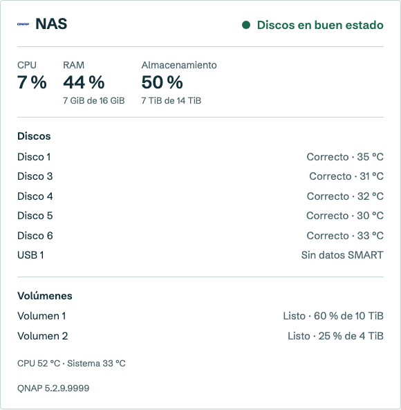

El bloque muestra el uso de CPU, memoria y almacenamiento; cada disco con su salud SMART y su temperatura, como **Disco** y su bahía o **USB** y su orden; cada volumen con su estado y lo que ocupa; las temperaturas de la CPU y del sistema; y la versión del firmware. No muestra el nombre del NAS, los modelos, los números de serie ni los nombres de los volúmenes. Muchas cajas USB no pasan el SMART al NAS: esos discos aparecen como **Sin datos SMART**, en gris, y no cambian el estado.

**Estado de QNAP:**

| Indicador | Significado |
|---|---|
| Círculo verde: **Discos en buen estado** | No hay ningún problema |
| Cuadrado rojo: **Disco con fallos** | Algún disco tiene el SMART anómalo o en error. Haz copia y cámbialo |
| Cuadrado rojo: **Almacenamiento degradado** | Un RAID ha perdido un disco y ya no tiene redundancia |
| Cuadrado rojo: **Almacenamiento con errores** | Un pool o un volumen no está disponible |
| Cuadrado rojo: **Temperatura crítica** | La CPU, el sistema o un disco ha llegado a su umbral de error |
| Triángulo ámbar: **Aviso SMART** | Algún disco empieza a dar avisos. Vigílalo |
| Triángulo ámbar: **Sincronizando** | Un RAID se reconstruye o sincroniza |
| Triángulo ámbar: **Almacenamiento con avisos** | QTS marca un pool en aviso, o da un estado que Talaia no conoce |
| Triángulo ámbar: **Volumen casi lleno** | Algún volumen está al 90 % o más |
| Triángulo ámbar: **Temperatura alta** | La CPU, el sistema o un disco ha llegado a su umbral de aviso |
| Triángulo ámbar: **Ventilador averiado** | QTS marca un ventilador con fallo |

Si hay varios problemas, el bloque muestra el más grave. Los umbrales son los de QTS por defecto, porque SNMP no da los tuyos: CPU, aviso a 75 °C y error a 80 °C; sistema, a 60 °C y 70 °C; discos, a 60 °C y 70 °C.

### SAI (NUT)

Talaia lee el estado del SAI del servidor **NUT** (*Network UPS Tools*), `upsd`, que corre en el equipo al que está conectado el SAI por USB: un nodo de Proxmox, un NAS, una Raspberry Pi… Si usas PeaNUT u otra web para ver el SAI, también leen de ese servidor. Talaia solo hace consultas: no puede apagar el SAI ni cambiar nada, y **no necesita usuario ni contraseña**, porque NUT solo los pide para dar órdenes.

**En el equipo que tiene el SAI:**

1. Comprueba que `upsd` escucha en la red y no solo en el propio equipo. En `/etc/nut/upsd.conf` debe haber una línea `LISTEN` con su dirección o `LISTEN 0.0.0.0 3493`; tras cambiarla, reinicia el servicio con `systemctl restart nut-server`. Si ya tienes otros equipos que vigilan el SAI con `upsmon`, o PeaNUT en otro equipo, ya escucha en la red.
2. El equipo de Talaia debe llegar al puerto **TCP 3493**. Si hay un firewall entre los dos, ábrelo para la dirección de Talaia.
3. Para saber el nombre del SAI, mira los corchetes de `/etc/nut/ups.conf`, por ejemplo `[sai]`, o ejecuta `upsc -l`. Solo hace falta si el servidor tiene más de uno.

Si no sabes qué equipo tiene el SAI, mira en cualquier equipo que lo vigile la línea `MONITOR` de `/etc/nut/upsmon.conf`: lo que va detrás de `@` es el servidor.

| Campo | Qué poner |
|---|---|
| Dirección del servidor NUT | `nut://` y la dirección del equipo que tiene el SAI, por ejemplo `nut://sai.local`. Añade `:puerto` si no es el 3493, y `/nombre` si el servidor tiene varios SAI: `nut://sai.local/sai` |
| Enlace para abrir el servicio | Opcional, por ejemplo la dirección de PeaNUT. Sin ella, el nombre del bloque no enlaza a ningún sitio |

El formulario no tiene campo de contraseña ni la casilla del certificado TLS. Si al probar la conexión ves **No se puede conectar con el servicio**, revisa la línea `LISTEN` y el firewall. Si ves **No se encuentra el SAI**, el servidor tiene varios o ninguno con ese nombre: indica el correcto en la dirección.

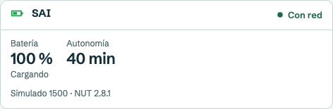

El bloque muestra la carga de la batería, con **Cargando** si se está cargando, y la **autonomía**: cuánto aguantaría con la batería según el consumo de ese momento, como la calcula el SAI. En el pie, el modelo y la versión de NUT. No muestra el nombre del SAI en NUT, su número de serie ni la dirección del servidor.

**Estado del SAI:**

| Indicador | Significado |
|---|---|
| Círculo verde: **Con red** | El SAI tiene corriente de la red |
| Triángulo ámbar: **Con batería** | Se ha ido la luz y los equipos tiran de la batería |
| Cuadrado rojo: **Batería baja** | La batería está a punto de agotarse: los equipos que vigilan el SAI empezarán a apagarse |
| Triángulo ámbar: **Cambiar batería** | El SAI avisa de que su batería está gastada, aunque haya red |
| Triángulo ámbar: **Sobrecarga** | Los equipos conectados consumen más de lo que el SAI puede dar |
| Neutro: **Estado desconocido** | El SAI no da un estado que Talaia conozca |

Si el servidor responde pero no recibe datos del SAI, el bloque se pone en rojo con el mensaje **El servidor NUT no recibe datos del SAI**: revisa el cable USB y el driver en el equipo que lo tiene conectado.

### Disponibilidad

Para equipos que no tienen API ni SNMP, como los switches TP-Link de la gama Easy Smart (TL-SG108PE y similares), Talaia solo comprueba si **responden**. No pide usuario ni contraseña, no entra en su web y no cambia nada. Crea **una conexión por equipo**: cada uno tiene su bloque y sus avisos.

| Campo | Qué poner |
|---|---|
| Dirección del equipo | `tcp://` con la dirección y el puerto, por ejemplo `tcp://switch.local:80`: Talaia abre la conexión y la cierra. O una dirección `http://` o `https://`, por ejemplo `http://switch.local`: Talaia pide esa página y solo mira el código de respuesta |
| Enlace para abrir el servicio | Opcional, por ejemplo la web del switch. Sin él, el nombre del bloque no enlaza a ningún sitio, ni siquiera con una dirección `http://` |
| No verificar el certificado TLS | Solo tiene efecto con `https://` y un certificado autofirmado |

Los switches Easy Smart tienen su web en el puerto 80, así que basta con `tcp://` y la dirección del switch seguida de `:80`. Con `http://` también se comprueba que la web contesta, pero si la página que indicas pide contraseña con un código 401, el bloque sale en ámbar: usa la página principal o `tcp://`.

El formulario no tiene campo de contraseña. Si al probar la conexión ves **No se puede conectar con el servicio**, revisa la dirección y el puerto, y que el equipo de Talaia llegue a esa red.

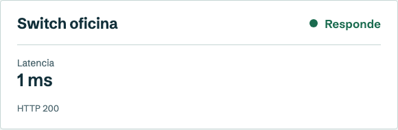

El bloque muestra la **latencia**, lo que tarda el equipo en aceptar la conexión o en contestar, y en el pie si la prueba es **TCP** o **HTTP** con su código. No muestra la dirección, el puerto ni la URL.

**Estado del equipo:**

| Indicador | Significado |
|---|---|
| Círculo verde: **Responde** | Acepta la conexión TCP, o la web contesta con un código 2xx o 3xx (las redirecciones no se siguen) |
| Triángulo ámbar: **Responde con HTTP …** | La web contesta, pero con un error, por ejemplo 503: el equipo está encendido, pero algo falla |
| Cuadrado rojo: **Con fallos** | No responde en 10 segundos, rechaza la conexión o el certificado TLS no es válido |

Talaia no hace ping: en el contenedor sin privilegios que crea el instalador, hacerlo exigiría cambiar su configuración de red. Un equipo sin ningún puerto TCP abierto no se puede vigilar.

## Editar y eliminar conexiones

**Editar:** pulsa **Editar** en la conexión. Deja la credencial vacía para conservar la actual. Si cambias la URL, tendrás que volver a escribirla: así evitas enviarla por error a otro servidor.

**Eliminar:** pulsa **Eliminar** y confirma en la misma fila. No se puede deshacer, y el servicio desaparece del panel.

### Cambiar el icono

Cada bloque lleva el icono de su servicio. Si prefieres otro (por ejemplo, el de Pi-hole para un AdGuard, o el de la marca de tu router), cámbialo en la conexión:

1. Edita la conexión y pulsa el botón de **Icono**.
2. Escribe el nombre de la marca. No importan las mayúsculas, las tildes ni los guiones: «pi hole» encuentra Pi-hole.
3. Elige el icono con el ratón, o con las flechas e Intro. **Esc** cierra el buscador sin cerrar el formulario.
4. Pulsa **Guardar**.

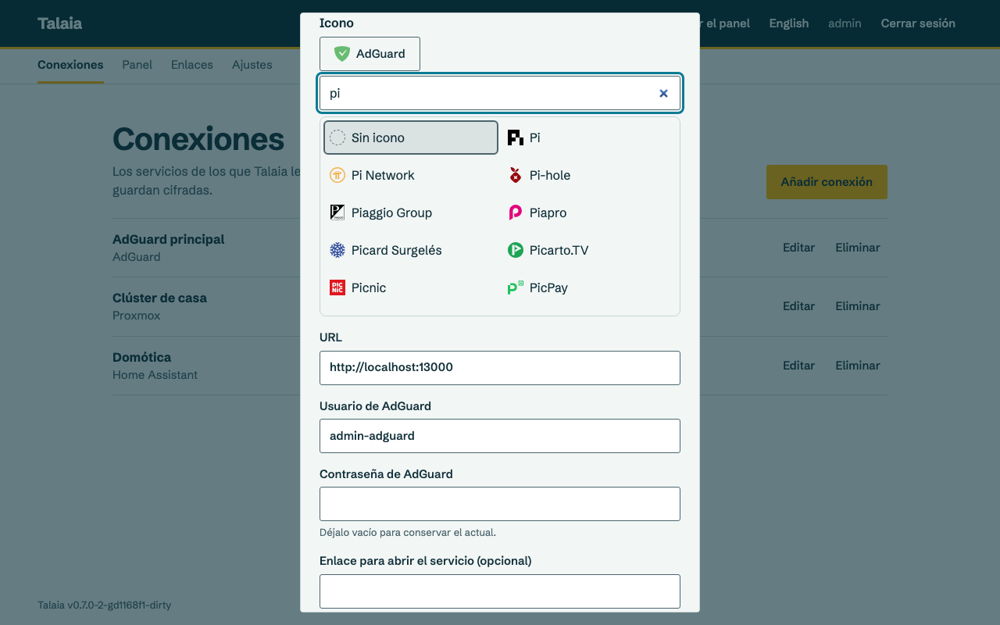

- **Sin icono:** es la primera opción del buscador. El bloque queda solo con el nombre.
- **Restablecer:** vuelve al icono del servicio.

Talaia trae dentro los logotipos de [Simple Icons](https://simpleicons.org), más de 3.400 marcas, así que no se conecta a Internet para mostrarlos. Si un logotipo es negro y usas el modo oscuro, se pinta del color del texto para que se vea:

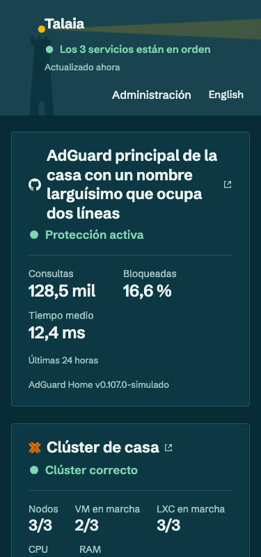

El icono se ve en el panel público: es solo un dibujo y no dice nada de tu servicio.

## Organizar el panel

En la administración, abre **Panel**. Cada conexión nueva se añade sola a la primera página, y aquí decides qué se ve y dónde.

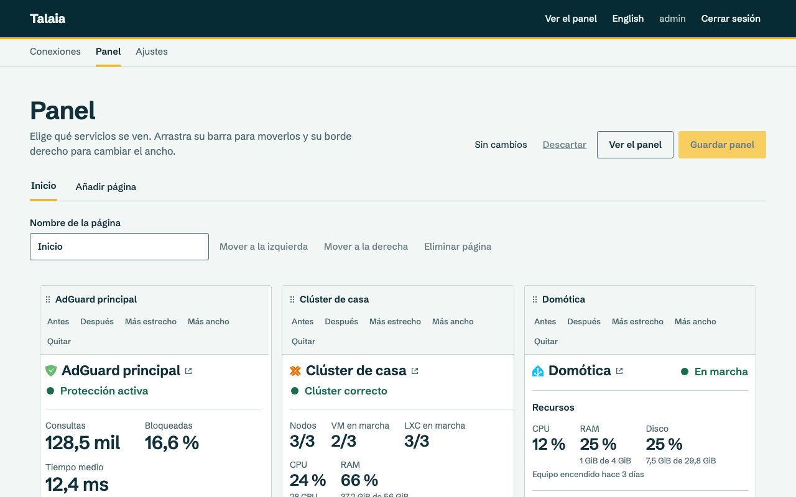

**Colocar los servicios:**
- **Mover:** arrastra la barra superior del bloque.
- **Cambiar el ancho:** arrastra su borde derecho. La altura no se elige: se ajusta sola a lo que muestra el bloque.
- **Sin arrastrar:** usa **Antes**, **Después**, **Más estrecho** y **Más ancho**. Los botones pasan por un cuarto, un tercio, media fila, dos tercios y la fila entera. Un servicio nuevo ocupa un tercio.
- **Quitar:** deja de mostrarlo en esa página. La conexión no se elimina, y puedes volver a añadirla con **Añadir a esta página**.

**Páginas:** pulsa **Añadir página**, ponle nombre y añade sus servicios. Si hay más de una, el panel muestra pestañas. Un servicio puede estar en varias páginas.

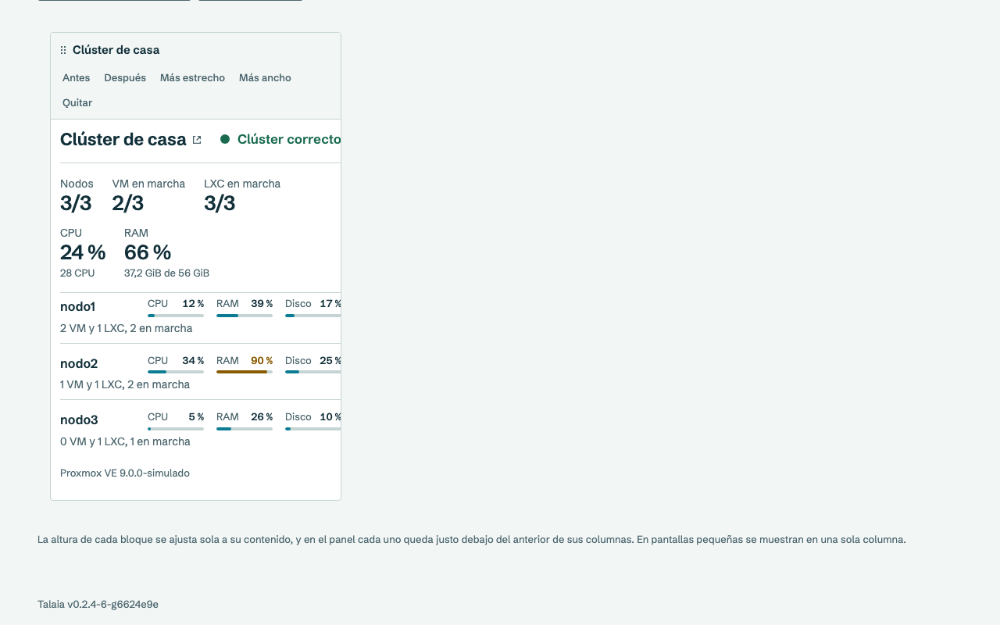

**Pulsa Guardar panel** para aplicar los cambios, o **Descartar** para deshacerlos.

**Cómo se ve después:** el panel ocupa todo el ancho de la pantalla. Cada bloque queda justo debajo del anterior de sus columnas, según lo que ocupe su contenido: así, dos bloques cortos uno encima de otro caben al lado de uno largo, sin huecos. Si un bloque crece con los datos, los de debajo se recolocan solos. En pantallas medianas, los bloques de menos de media fila se muestran a media fila, y en las estrechas, en una sola columna.

**Privacidad:** un servicio que no esté en ninguna página no sale por la API pública, aunque Talaia lo siga consultando.

## Ajustes

En la administración, abre **Ajustes**.

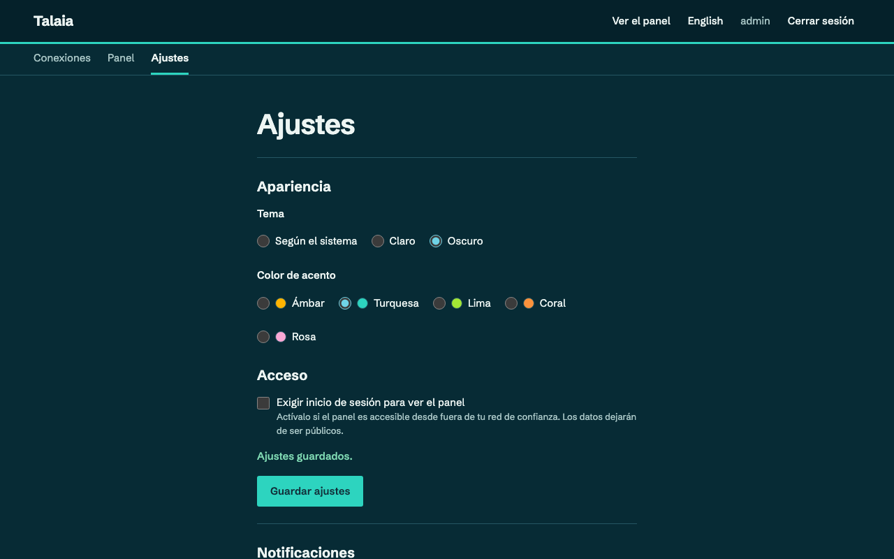

- **Tema y color de acento:** se aplican a todos los que abran el panel.

  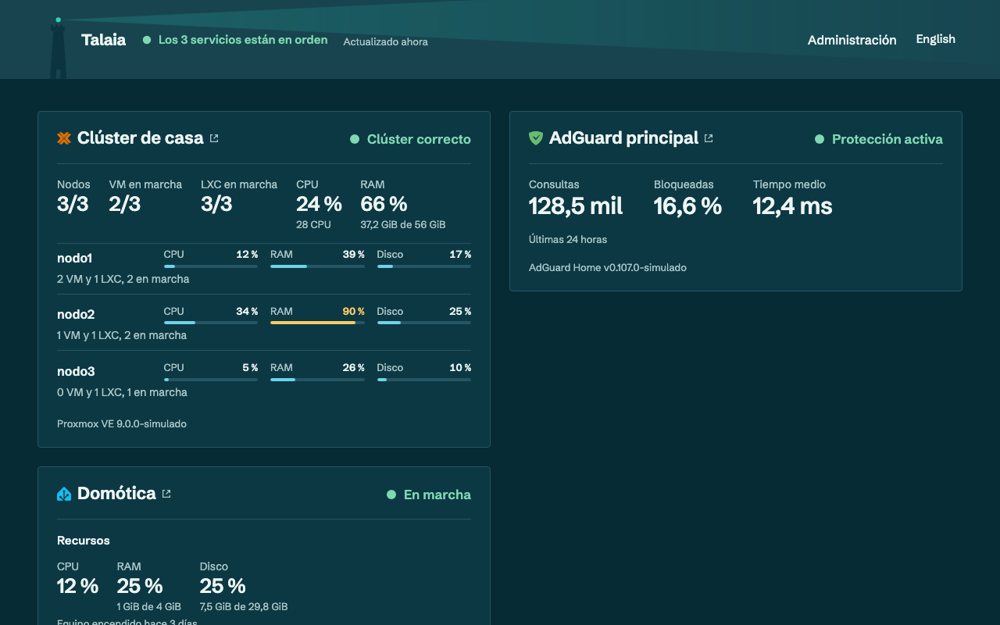

- **Exigir inicio de sesión para ver el panel:** los datos dejan de ser públicos, y quien tuviera el panel abierto deja de verlo. Actívalo si el panel es accesible desde fuera de tu red de confianza.
- **Contraseña:** escribe la actual y dos veces la nueva, de al menos 12 caracteres. Se cierran las demás sesiones.

## Notificaciones

Talaia puede avisarte en el móvil cuando un servicio del panel pasa a ámbar o a rojo, y otra vez cuando vuelve a estar en orden. Funciona sin ningún navegador abierto. El aviso lleva el nombre de cada servicio y su estado tal como sale en su bloque, sin direcciones ni contraseñas:

```
🟠 Talaia · Necesita atención
AdGuard: Protección desactivada
VPN: Túnel parado
```

En ntfy, la app pone el emoji delante del título y la lista de servicios va debajo.

En la administración, abre **Ajustes** y baja hasta **Notificaciones**.

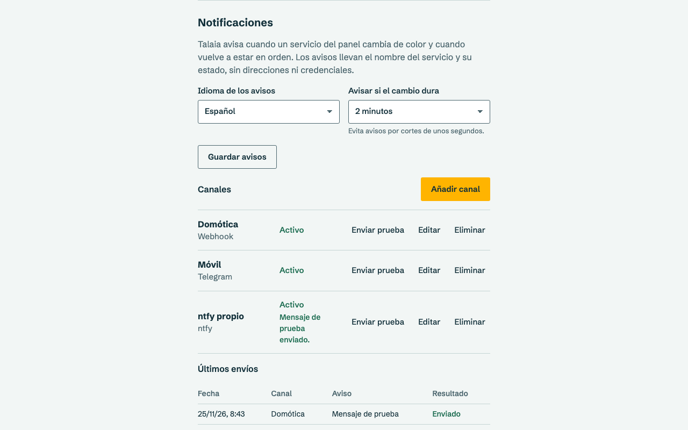

**Añadir un canal:** pulsa **Añadir canal**, elige el tipo y rellena sus datos. **Enviar prueba** manda un mensaje de prueba sin guardar nada, para comprobar que llega. Si el canal tarda demasiado en contestar, verás en ámbar que el mensaje puede haber llegado: míralo en el móvil antes de repetir la prueba. Puedes tener varios canales, y todos los activos reciben cada aviso.

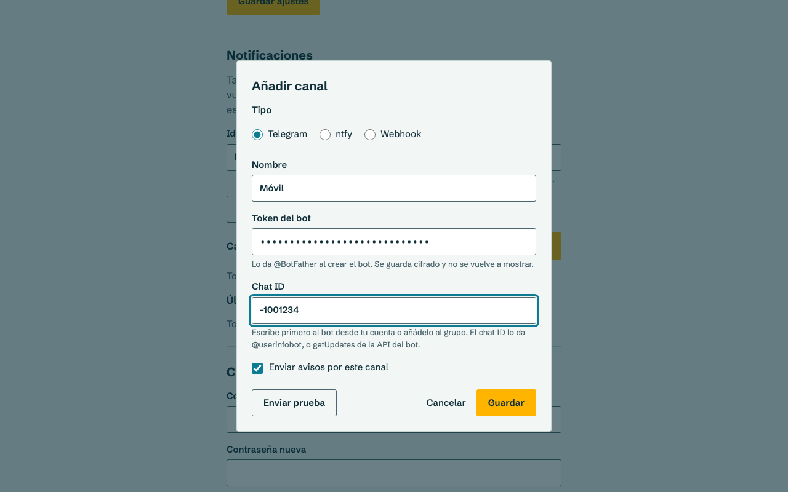

- **Telegram:**
  1. Abre una conversación con [@BotFather](https://t.me/BotFather), envía `/newbot` y sigue sus pasos. Te dará el **token del bot**.
  2. Escribe cualquier cosa a tu bot nuevo; si quieres los avisos en un grupo, añade el bot al grupo.
  3. Consigue el **chat ID**: [@userinfobot](https://t.me/userinfobot) te da el tuyo, o abre `https://api.telegram.org/botTOKEN/getUpdates` en el navegador y busca `"chat":{"id":…}`. En un grupo, el número es negativo.
- **ntfy:** deja vacío el servidor para usar [ntfy.sh](https://ntfy.sh) o escribe el tuyo. El **tópico** es el nombre del canal en ntfy: suscríbete a él en la app de ntfy. En ntfy.sh, quien conozca el tópico puede leer tus avisos, así que elige uno difícil de adivinar. El token de acceso solo hace falta si tu servidor exige iniciar sesión.
- **Webhook:** Talaia envía un `POST` con este JSON a la URL que indiques, por ejemplo la de un webhook de Home Assistant o de n8n:

  ```json
  {
    "event": "change",
    "language": "es",
    "text": "🟠 Talaia · Necesita atención\nAdGuard: Protección desactivada",
    "services": [
      { "name": "AdGuard", "type": "adguard", "tone": "warn", "previous": "good", "label": "Protección desactivada" }
    ],
    "sent_at": "2026-11-19T10:00:00Z"
  }
  ```

  `tone` y `previous` valen `good`, `warn` o `bad`. El mensaje de prueba lleva `"event": "test"` y la lista de servicios vacía.

El token, el tópico y la URL se guardan cifrados y no se vuelven a mostrar. Al editar un canal, déjalos en blanco para conservarlos; si cambias el servidor de ntfy, tendrás que volver a escribir el tópico y el token.

**Cuándo avisa:**
- **Avisar si el cambio dura:** el estado nuevo tiene que mantenerse ese tiempo, 2 minutos por defecto. Así no recibes avisos por un corte de unos segundos. **Sin espera** avisa en cuanto Talaia ve el cambio.
- Si varios servicios cambian a la vez, recibes un solo mensaje.
- No hay recordatorios: un aviso cuando cambia y otro cuando vuelve a verde.
- Solo avisan los servicios que están en alguna página del panel. Un estado gris, como «Consultando…» o «Sin túneles», no avisa.
- Al reiniciar Talaia no se repiten los avisos ya enviados.
- **Silenciar un servicio:** edita su conexión y desmarca **Avisar de sus cambios**. Sigue en el panel, y en la lista de conexiones aparece «Sin avisos». Al volver a marcarlo no te llegan avisos atrasados.

**Idioma de los avisos:** español o inglés. Al dar de alta el primer canal se elige el de la administración; cámbialo y pulsa **Guardar avisos**.

**Últimos envíos:** la tabla muestra los 50 últimos avisos y pruebas, por qué canal, y si se enviaron o por qué fallaron. Si no se puede llegar al canal o responde con un error, Talaia lo reintenta dos veces en los dos minutos siguientes. Si el mensaje salió pero el canal no contesta en 30 segundos, aparece en ámbar **Sin confirmar: puede haber llegado** y no se reintenta, para que no te llegue repetido.

Telegram y ntfy.sh necesitan que el equipo de Talaia tenga salida a Internet. Si no la tiene, usa un servidor ntfy propio o un webhook de tu red.

## Idioma y apariencia

- **Idioma:** Talaia usa el de tu navegador si es español y, si no, inglés. El botón **English** o **Español** lo cambia, se recuerda en ese navegador y se aplica a sus otras pestañas abiertas.
- **Modo claro u oscuro:** por defecto sigue tu sistema. Puedes fijarlo en [Ajustes](#ajustes).
- **Móvil:** la interfaz se adapta a pantallas pequeñas.

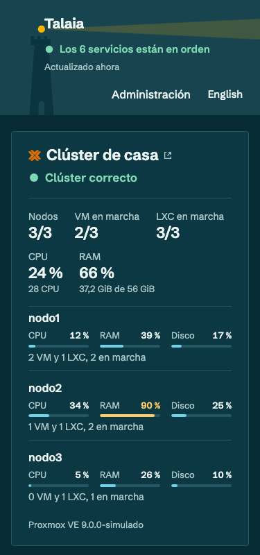

## Seguridad y acceso remoto

- **El panel es público por defecto:** cualquiera que llegue a su puerto puede ver el estado de tus servicios. **Para publicarlo en Internet**, exige inicio de sesión en [Ajustes](#ajustes) y usa HTTPS, o protégelo con una VPN.
- **Enlaces:** cualquiera que abra el panel ve la dirección de cada servicio. Si no quieres mostrar la URL interna, configura un enlace propio en la conexión.
- **Credenciales:** se guardan cifradas y nunca se muestran.
- **HTTPS:** Talaia sirve HTTP. Para usar HTTPS, ponlo detrás de un proxy inverso, como Nginx Proxy Manager, que envíe la cabecera `X-Forwarded-Proto`.
- **Detrás de un proxy:** Talaia ve la IP del proxy, de modo que los inicios de sesión fallidos cuentan para todos los clientes.

## Copias de seguridad

**En Proxmox,** la copia de seguridad del contenedor (`vzdump`) lo incluye todo.

**A mano,** toda la configuración está en la carpeta de datos, que en el contenedor es `/var/lib/talaia`:

| Archivo | Contenido |
|---|---|
| `talaia.db` y archivos `talaia.db-*` | Administrador y conexiones |
| `secret.key` | Clave para descifrar las credenciales |

1. Para Talaia.
2. Copia la carpeta de datos completa a un lugar seguro.
3. Vuelve a arrancarlo.

**Protege la copia:** contiene la clave junto a las credenciales cifradas, así que quien la tenga puede leerlas. Sin `secret.key`, las credenciales no se pueden recuperar y tendrás que volver a escribirlas en cada conexión.

## Solución de problemas

**Mensajes de un servicio:**

| Mensaje | Qué hacer |
|---|---|
| Credenciales rechazadas por el servicio | Revisa el usuario y la credencial. En Proxmox, comprueba también que el token tenga el rol `PVEAuditor` en `/`: con la separación de privilegios, tanto el usuario como el token lo necesitan |
| El servicio no ha respondido a tiempo | Comprueba que el servicio funciona y no está saturado |
| No se puede conectar con el servicio | Revisa la URL y el puerto, y que el equipo de Talaia tenga acceso, incluidas las reglas del firewall entre redes |
| Error de TLS | Revisa si la URL usa `http` o `https`. Si el certificado es autofirmado, marca **No verificar el certificado TLS** |
| La respuesta no es la esperada | Revisa que la URL sea la del servicio correcto. Algunos proxies redirigen: usa la URL final |
| No se puede descifrar la credencial | `secret.key` ha cambiado o se ha perdido. Restáurala o vuelve a escribir la credencial |
| Error inesperado al consultar el servicio | Revisa los registros de Talaia, en su salida estándar de error |
| No se encuentra el SAI | El servidor NUT tiene varios SAI, o ninguno con ese nombre. Indica cuál en la dirección: `nut://equipo/sai` |
| El servidor NUT no recibe datos del SAI | Revisa el cable USB y el driver de NUT en el equipo que tiene el SAI conectado |

**Otros problemas:**

| Problema | Causa y solución |
|---|---|
| Talaia no arranca y menciona permisos de la clave | `secret.key` es accesible por otros usuarios. Ejecuta `chmod 600` sobre ese archivo |
| «Demasiados intentos fallidos» | Espera 15 minutos o reinicia Talaia |
| He olvidado la contraseña | En el nodo de Proxmox, ejecuta `pct exec ID -- runuser -u talaia -- talaia reset-password -data /var/lib/talaia`. Sin contenedor: `talaia reset-password -data CARPETA_DE_DATOS`. Muestra una contraseña nueva, que puedes cambiar en **Ajustes**, y cierra las sesiones abiertas. Tus datos se conservan |
| El instalador no puede descargar | Comprueba que el nodo tenga Internet. Si no puede salir, usa `--binary` |
| El instalador indica que no hay almacenamiento | Indícalo con `--storage`. Consulta los disponibles con `pvesm status` |
| El servicio no arranca en el contenedor | Consulta `pct exec ID -- journalctl -u talaia -n 50`. El instalador elimina el contenedor si falla al instalar, y muestra este registro antes |
| No puedo acceder al panel | Comprueba la dirección con `pct exec ID -- hostname -I` y que tu firewall permita ese puerto |
| Un servicio no aparece en el panel | Comprueba en **Panel** que esté en esa página. Una conexión nueva se añade a la primera |
| El panel no se actualiza detrás de un proxy | Comprueba que el proxy no retenga las respuestas de `/api/dashboard/events` |
| No aparecen CPU, memoria ni disco | Pulsa **Probar conexión**. Requieren Supervisor y un token de administrador |
| El enlace de un servicio no abre | Talaia usa la URL de conexión, que puede no ser accesible desde tu navegador. Configura un enlace propio en la conexión |
| Una entidad aparece como **No encontrada** | Ya no existe en Home Assistant o ha cambiado de identificador. Edita la conexión y actualiza la selección |
| Home Assistant tarda mucho o da error de tiempo de espera | En instalaciones muy grandes, sube el refresco, por ejemplo a 60 segundos |
| QNAP no responde a tiempo | Comprueba que SNMP esté activado con la versión SNMP V3, que el protocolo de cifrado coincida y que el firewall deje pasar UDP 161 |
| Un equipo de disponibilidad sale en ámbar con HTTP 401 o 404 | La página indicada pide contraseña o no existe. Usa la página principal o una dirección `tcp://` con el puerto de su web |
| El SAI no conecta | Comprueba la línea `LISTEN` de `upsd.conf` en el equipo que tiene el SAI y que el firewall deje pasar TCP 3493 |
| Un aviso dice «el canal rechaza el token o la clave» | Revisa el token del bot de Telegram o el de ntfy. Si lo has revocado en @BotFather, escribe el nuevo |
| Un aviso dice «el canal ha rechazado el mensaje» | En Telegram, revisa el chat ID y que hayas escrito antes al bot o que el bot siga en el grupo. En ntfy, revisa el tópico y si tu servidor permite publicar en él |
| Un aviso dice «no se puede conectar con el servidor» | Comprueba que el equipo de Talaia tenga salida a Internet (Telegram, ntfy.sh) o llegue a tu servidor ntfy o a tu webhook |
| No llegan avisos | Comprueba que el canal esté activo, que el servicio esté en el panel y que su conexión tenga marcado **Avisar de sus cambios**. Con **Enviar prueba** sabrás si el canal funciona |

## Limitaciones actuales

- La vista de Proxmox no incluye el almacenamiento.
- Una conexión tiene un solo contenido: si está en dos páginas, se ve igual en ambas.
- No se actualiza solo: hay que ejecutar el comando de actualización.
- El bloque de OPNsense no muestra sus actualizaciones pendientes.
- Los bloques de Portainer y WGDashboard, y el WireGuard de OPNsense, no detallan cada contenedor ni cada peer: solo dan recuentos.
- El bloque de QNAP usa los umbrales de temperatura de QTS por defecto, no los tuyos, y no distingue qué volumen es de un disco USB.
- El bloque del SAI muestra un solo SAI, sin tensiones ni consumo, y la conexión con NUT no va cifrada; no viaja ninguna contraseña.
- La disponibilidad comprueba un equipo por conexión, solo por TCP o HTTP, sin ping, y solo cuenta como respuesta un código HTTP 2xx o 3xx.
- Las notificaciones avisan de cambios de color, sin recordatorios: un cambio de etiqueta dentro del mismo color no avisa, y todos los canales activos reciben todos los avisos.

El estado de cada punto está en [Estado y cambios](../proyecto/06-estado-y-cambios.md).
